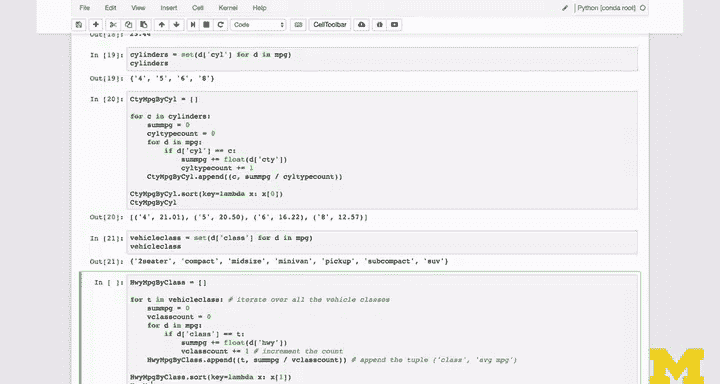

# 课程1-3：Python CSV文件读写与数据汇总 📊


在本教程中，我们将学习如何通过迭代CSV文件来创建字典并计算汇总统计量。我们将从读取CSV文件开始，逐步学习如何提取数据、进行计算，并通过分组分析来获取更深入的洞察。

## 导入必要模块与设置

首先，我们需要导入Python的`csv`模块，它提供了读取和写入CSV文件的功能。

```python
import csv
```

为了方便后续的数据展示，我们设置浮点数打印精度为两位小数。

```python
%precision 2
```

## 读取CSV文件并转换为字典列表

现在，我们使用`csv.DictReader`来读取名为“MPG”的CSV文件，并将其转换为一个字典列表。每个字典代表CSV文件中的一行数据。

```python
with open('mpg.csv') as csvfile:
    mpg_data = list(csv.DictReader(csvfile))
```

让我们查看列表中的前三个元素，以了解数据的结构。

```python
print(mpg_data[:3])
```

输出显示，列表中的每个字典都以CSV的列名作为键，每辆车的具体数据作为对应的值。列表的长度是234，这意味着我们的数据集中包含了234辆汽车的信息。

```python
print(len(mpg_data))
```

要查看CSV文件的所有列名，可以使用字典的`.keys()`方法。

```python
print(mpg_data[0].keys())
```

## 计算整体平均值

假设我们想计算数据集中所有汽车的平均城市油耗（MPG）。我们需要遍历字典列表，对每辆车的城市MPG值进行求和，然后除以车辆总数。

由于字典中的所有值最初都是字符串类型，我们需要先将它们转换为浮点数才能进行数学运算。

```python
sum_city_mpg = sum(float(d['cty']) for d in mpg_data)
avg_city_mpg = sum_city_mpg / len(mpg_data)
print(avg_city_mpg)
```

类似地，我们可以计算所有汽车的平均高速公路油耗。

```python
sum_hwy_mpg = sum(float(d['hwy']) for d in mpg_data)
avg_hwy_mpg = sum_hwy_mpg / len(mpg_data)
print(avg_hwy_mpg)
```

结果显示，平均高速公路油耗高于城市油耗，这与实际情况相符。

## 按气缸数分组计算平均值

上一节我们计算了整体平均值，本节中我们来看看一个更复杂的例子：按汽车的气缸数分组计算平均城市MPG。

首先，我们需要找出数据集中气缸数的所有唯一值。

```python
cylinders = set(d['cyl'] for d in mpg_data)
print(cylinders)
```

我们看到数据集中包含4缸、5缸、6缸和8缸的汽车。

以下是计算每个气缸数级别平均城市MPG的步骤：
1.  创建一个空列表来存储计算结果。
2.  遍历每个唯一的气缸数级别。
3.  对于每个级别，再次遍历所有字典，匹配具有该气缸数的车辆。
4.  累加匹配车辆的MPG值并计数。
5.  计算平均值并将其添加到结果列表中。

```python
avg_mpg_by_cyl = []

for cyl in cylinders:
    sum_mpg = 0
    count = 0
    for d in mpg_data:
        if d['cyl'] == cyl:
            sum_mpg += float(d['cty'])
            count += 1
    avg_mpg = sum_mpg / count
    avg_mpg_by_cyl.append((int(cyl), avg_mpg))

# 按气缸数从低到高排序
avg_mpg_by_cyl.sort()
print(avg_mpg_by_cyl)
```

从结果可以看出，随着气缸数的增加，平均城市油耗呈下降趋势。

## 按车型类别分组计算平均值

接下来，让我们看另一个类似的例子：计算不同车型类别的平均高速公路MPG。

首先，查看数据集中有哪些车型类别。

```python
classes = set(d['class'] for d in mpg_data)
print(classes)
```

数据集中包含两座跑车、紧凑型、中型、小型货车、皮卡、超小型和SUV等类别。

计算每个车型类别平均高速公路MPG的逻辑与上一个例子类似：
1.  遍历每个唯一的车型类别。
2.  对于每个类别，遍历所有字典，匹配属于该类别的车辆。
3.  累加高速公路MPG值并计数。
4.  计算平均值并存储。

```python
avg_hwy_by_class = []

for v_class in classes:
    sum_hwy = 0
    count = 0
    for d in mpg_data:
        if d['class'] == v_class:
            sum_hwy += float(d['hwy'])
            count += 1
    avg_hwy = sum_hwy / count
    avg_hwy_by_class.append((v_class, avg_hwy))



# 按MPG从低到高排序
avg_hwy_by_class.sort(key=lambda x: x[1])
print(avg_hwy_by_class)
```

结果显示，皮卡的平均油耗最差，而紧凑型车的油耗表现最佳。

## 总结与展望 🎯

本节课中，我们一起学习了如何使用Python的`csv`模块读取CSV文件，并将其转换为字典列表进行数据处理。我们掌握了计算整体平均值、以及按特定字段（如气缸数、车型类别）进行分组并计算汇总统计量的方法。

如果你觉得这种通过手动迭代进行数据分析的方式有些低效或繁琐，不必担心。在下周的课程中，我们将学习`Pandas`库，它是一个功能强大、效率更高的Python数据分析工具，能让类似的任务变得简单快捷。

感谢观看，期待下次再见！