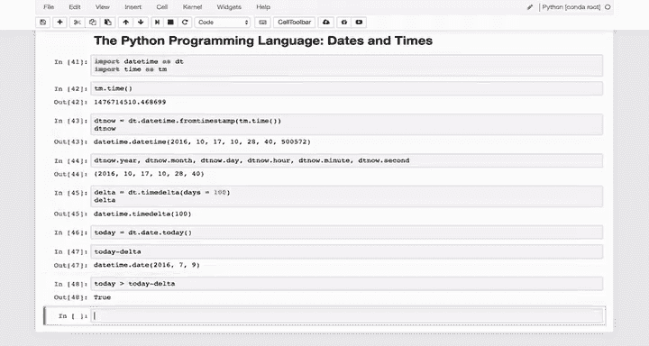

# 课程1-3：Python日期与时间处理 📅⏰


在本节课中，我们将要学习Python中处理日期和时间的基础知识。许多数据分析任务都与日期和时间相关，例如计算特定时间段内的平均销售额，或筛选在给定期间内购买的产品。掌握日期时间的处理是数据科学实践中的重要一环。

## 从“纪元时间”说起

上一节我们介绍了数据分析中日期时间的重要性，本节中我们来看看计算机系统中一种常见的日期时间存储方式。

首先，你需要知道日期和时间可以用多种不同的方式存储。在线交易系统中最常见的传统存储方法之一是基于“纪元”的偏移量。“纪元”指的是1970年1月1日。虽然这背后有很多历史原因，但在系统中看到以自该日期起的秒数或毫秒数来存储交易时间的情况并不少见。

因此，如果你在期望看到日期和时间的地方看到了很大的数字，就需要对它们进行转换才能理解数据的含义。

## 在Python中处理时间

了解了纪元时间的概念后，我们来看看如何在Python中操作它。

在Python中，你可以使用 `time` 模块获取自纪元以来的当前时间。

```python
import time
current_time = time.time()
```

然后，你可以使用datetime对象上的 `fromtimestamp` 函数创建一个时间戳。

```python
from datetime import datetime
timestamp = datetime.fromtimestamp(current_time)
```

当我们打印这个值时，会看到年、月、日等信息也被打印出来。

datetime对象具有方便的属性来获取对应的小时、天、秒等。

```python
year = timestamp.year
month = timestamp.month
day = timestamp.day
hour = timestamp.hour
```

## 使用时间差进行计算

datetime对象允许使用时间差进行简单的数学运算。例如，这里我们可以创建一个100天的时间差，然后与datetime对象进行减法和比较。

以下是使用时间差进行计算的步骤：

1.  从 `datetime` 模块导入 `timedelta`。
2.  创建一个表示100天的时间差对象。
3.  对日期进行加减运算或比较。

```python
from datetime import timedelta
hundred_days = timedelta(days=100)
future_date = timestamp + hundred_days
past_date = timestamp - hundred_days
is_future = future_date > timestamp
```

## 在数据科学中的应用：创建时间窗口

时间差计算在数据科学中常用于创建时间窗口。例如，你可能想找出销售额最高的任意五天时间段，并将其标记出来以供后续分析。

其核心思路是定义一个固定的时间长度（如5天），然后在时间序列上滑动这个窗口进行计算或筛选。



```python
# 假设我们有一个日期列表和对应的销售额列表
# 这里简化表示滑动窗口的概念
window_size = timedelta(days=5)
# 在实际分析中，你会遍历日期，计算每个5天窗口内的总销售额
```

---

本节课中我们一起学习了Python处理日期和时间的基础。我们了解了“纪元时间”的概念，学习了如何使用 `datetime` 模块创建和操作时间对象，以及如何利用 `timedelta` 进行时间计算并创建用于分析的时间窗口。在后续课程中，我们将使用Pandas库更深入地研究日期和时间。