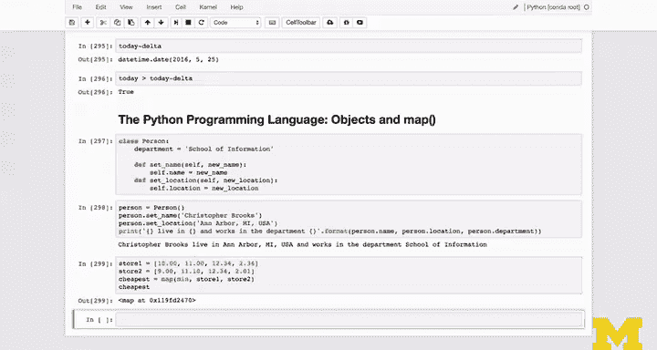

# 9：Python高级对象与映射


在本节课中，我们将要学习Python中面向对象编程的基础知识以及`map`函数的功能与应用。这些概念是构建复杂数据科学工作流的重要基石。

---

### 面向对象Python简介

到目前为止，我们尚未深入讨论面向对象的Python。虽然函数在Python生态系统中扮演重要角色，但Python确实拥有类，这些类可以附加方法，并能被实例化为对象。

本课程并非深入探讨Python对象或面向对象编程的繁琐细节。实际上，尽管你会在Python中大量使用对象，但在交互式环境中创建新类的可能性较小，因为这通常较为冗长。但了解Python对象的一些细节仍然很重要，以免在遇到时感到意外。

#### 定义类

首先，你可以使用`class`关键字定义类，并以冒号结尾。在此关键字下方缩进的任何内容都属于该类的范围。

```python
class ClassName:
    # 类定义体
```

Python中的类通常使用驼峰命名法，即每个单词的首字母大写。

#### 类变量与实例变量

你无需在对象内部声明变量，可以直接开始使用它们。也可以声明类变量，这些变量在所有实例之间共享。

```python
class Person:
    school = "School of Information"  # 类变量

    def set_name(self, name):
        self.name = name  # 实例变量

    def set_location(self, location):
        self.location = location  # 实例变量
```

在上面的例子中，我们为所有人设置了一个默认的学校。虽然在此处用处不大，但为了完整性我们展示了它。

#### 定义方法

定义方法与定义函数类似。一个关键变化是，为了让方法能够访问调用它的实例，必须在方法签名中包含`self`参数。同样，如果你想引用对象上设置的实例变量，需要在变量前加上`self`和一个点号。

在这个`Person`类的定义中，我们编写了两个方法：`set_name`和`set_location`，它们分别更改名为`name`和`location`的实例绑定变量。

运行此代码单元时，我们看不到任何输出。类已存在，但我们尚未创建任何对象。

#### 实例化与使用

我们可以通过在类名后加上空括号来实例化这个类。然后，我们可以使用在大多数语言中常见的点号表示法来调用函数和打印类的属性。

```python
person1 = Person()
person1.set_name("Alice")
person1.set_location("New York")
print(person1.name)
print(person1.school)
```

#### 重要注意事项

从这个简短的例子中，你应该了解Python面向对象编程的几个含义：

第一，Python中的对象没有私有或受保护的成员。如果你实例化一个对象，你就拥有访问该对象任何方法或属性的完全权限。

第二，在Python中创建对象时不需要显式的构造函数。如果需要，你可以通过声明`__init__`方法来添加构造函数。

```python
class Person:
    def __init__(self, name, location):
        self.name = name
        self.location = location
```

现在，我不会更深入地探讨Python对象，因为其中有很多细微之处。坦白说，对于数据科学入门而言，Python的大多数面向对象特性并不那么突出。如果你对此更感兴趣，我建议查阅Python教程中的文档，它对语言的面向对象特性有相当全面的概述，课程资源中也会提供参考。

---

### 函数式编程与`map`函数

上一节我们介绍了Python中面向对象的基础，本节中我们来看看函数式编程的一个核心工具——`map`函数。

`map`函数是Python中函数式编程的基础之一。函数式编程是一种编程范式，在这种范式中，你需要显式声明所有可能通过给定函数执行而改变的参数。因此，函数式编程被称为无副作用的，因为它有一个软件契约来描述调用函数时实际可以改变的内容。

现在，Python并非纯粹意义上的函数式编程语言，因为函数可能产生许多副作用，而且你当然不必传入所有你希望更改的内容。但函数式编程促使人们更深入地思考如何将操作链接在一起，这确实是数据科学（尤其是数据清洗）中的一个基本主题。

因此，函数式编程方法在Python中经常使用，看到一个函数的参数本身是另一个函数的情况并不少见。

内置的`map`函数是Python函数式编程特性的一个例子，我认为它结合了该语言的多个方面。

#### `map`函数签名

`map`函数的签名如下所示。第一个参数是你想要执行的函数，第二个及之后的参数是可以迭代的对象。

```python
map(function, iterable, ...)
```

所有可迭代的参数会被一起解包并传入给定的函数。

这听起来有点晦涩，让我们看一个例子。假设我们有两个数字列表，可能是两个不同商店对完全相同商品的价格。我们想找出在两个商店之间购买更便宜商品所需支付的最低价格。

#### 使用`map`进行比较

为此，我们可以遍历每个列表，比较商品并选择最便宜的。使用`map`，我们可以在单个语句中完成这种比较。

```python
store1_prices = [10, 20, 30]
store2_prices = [15, 18, 35]

cheapest_prices = map(min, store1_prices, store2_prices)
```

但当我们尝试打印这个`map`对象时，会看到一个奇怪的引用值，而不是我们期望的项目列表。

```python
print(cheapest_prices)  # 输出类似：<map object at 0x...>
```

#### 惰性求值

这被称为Python中的**惰性求值**。`map`函数返回一个`map`对象，并且在你查看内部值之前，实际上并不会尝试对两个项目运行给定的函数。

这是语言中一个有趣的设计模式，在处理大数据时常用。这使我们能够实现非常高效的内存管理，即使某些计算可能很复杂。

#### 迭代`map`对象

`map`对象是可迭代的，就像列表和元组一样，因此我们可以使用`for`循环来查看`map`中的所有值。

```python
for price in cheapest_prices:
    print(price)
```

这种传递函数及其应应用于的数据结构的模式，是函数式编程的标志，在数据分析和清洗中非常常见。

---

### 实践练习

以下是一个供你尝试的问题，它结合了你可能在数据清洗中期望执行的一些任务。



**问题**：你有两个列表，一个包含产品名称，另一个包含对应的价格。使用`map`函数和一个自定义函数，创建一个新的迭代器，其中每个元素是一个字符串，格式为“产品: $价格”。

```python
products = ["Apple", "Banana", "Cherry"]
prices = [1.2, 0.5, 2.1]

def format_item(product, price):
    return f"{product}: ${price:.2f}"

formatted_items = map(format_item, products, prices)

for item in formatted_items:
    print(item)
```

---

### 总结

本节课中我们一起学习了Python中面向对象编程的基础，包括如何定义类、实例变量、类变量和方法。我们还深入探讨了函数式编程的核心概念，特别是`map`函数的使用、其惰性求值特性以及它在数据清洗和分析中的实际应用。掌握这些高级对象和映射技术，将为你构建高效、可维护的数据科学代码奠定坚实基础。