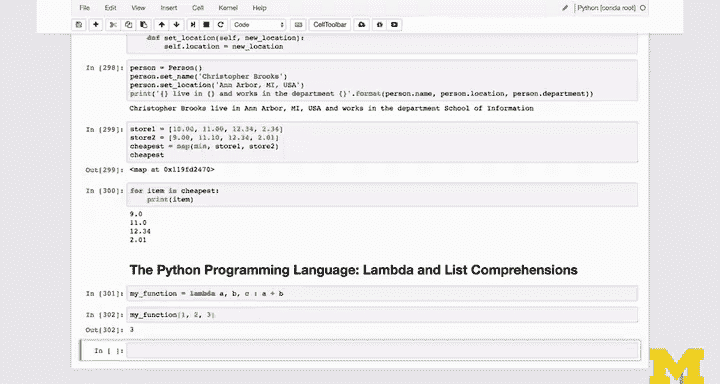
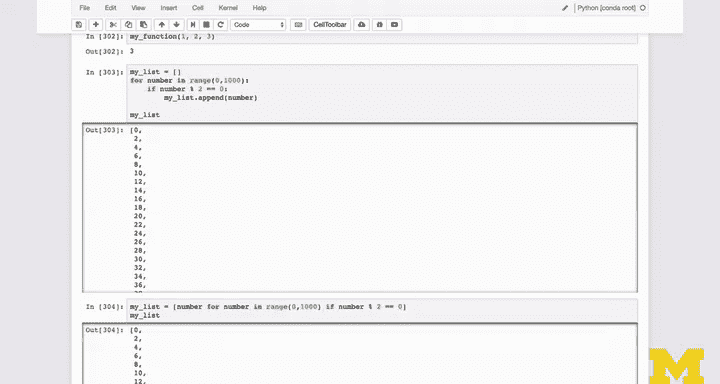

# 10：Python Lambda表达式与列表推导式 🐍✨


在本节课中，我们将要学习Python中两个强大而简洁的特性：Lambda表达式与列表推导式。它们能帮助我们以更少的代码完成常见的数据处理任务。

---

## Lambda表达式：匿名函数 🔄

在本周的内容中，你可能已经看到了关键字`lambda`的出现。随着你越来越多地使用Python进行数据科学工作，你肯定会更频繁地见到它。

Lambda是Python创建匿名函数的方式。它们与其他函数相同，但没有名称。其意图在于它们是简单或短命的函数，直接在一行中写出函数比费力创建一个命名函数更容易。

Lambda的语法相当简单，但可能需要一些时间来适应。

你使用关键字`lambda`声明一个lambda函数，后跟一个参数列表，接着是一个冒号，然后是一个**单个表达式**。这是关键：在lambda中只能计算一个表达式。表达式的值会在lambda执行时被返回。

lambda的返回值是一个函数引用。因此，在这个例子中，你将执行`my_function`并传入三个不同的参数。

**核心概念**：Lambda表达式的基本结构
```python
lambda arguments: expression
```

请注意，Lambda参数不能有默认值，并且Lambda内部不能有复杂的逻辑，因为你被限制为只能使用单个表达式。

---



## Lambda表达式的局限性与用途 📝

上一节我们介绍了Lambda表达式的基本语法，本节中我们来看看它的特点。

因此，Lambda确实比完整的函数定义受限得多。但我认为它们对于简单的小型数据清理任务非常有用。你会在网上看到大量使用它们的例子。所以，你应该能够阅读和编写Lambda表达式。让我们在这里尝试一下。


---

## 列表推导式：简洁的序列构建 🚀

我们已经学习了Python中很多关于序列的知识：元组、列表、字典等等。

序列是我们可以迭代遍历的结构，我们通常通过循环或从文件读取数据来创建它们。Python内置支持使用一种更简短的语法来创建这些集合，这种语法称为**列表推导式**。

以下是一个例子。首先，我们在这里写一个小型for循环，我在0到1000之间迭代，然后使用取模运算符检查数字除以2是否会产生任何小数。如果数字对2取模的结果是0，那么我知道它能被整除。所以这一定是一个偶数，我会把它添加到我们的列表中。

我们可以通过将迭代写在一行来将其重写为列表推导式。我们以列表中想要的值开始列表推导式。在这个例子中，它是一个数字。然后我们将其放入for循环中。最后，我们添加任何条件子句。

你可以看到这是一种紧凑得多的格式，而且往往也更快。

**核心概念**：列表推导式的基本结构
```python
[expression for item in iterable if condition]
```

---

## 列表推导式的优势与练习 💡

就像Lambda表达式一样，列表推导式是一种紧凑的格式，可以提供可读性和性能上的好处。你经常会在数据科学教程或Stack Overflow上发现它们被使用，但本课程的作业并不要求你必须使用它们。



在这里，你为什么不尝试将一个函数转换为列表推导式呢？

---

## 总结 🎯

本节课中我们一起学习了Python中两个重要的简洁编程工具：Lambda表达式和列表推导式。Lambda允许我们创建简单的匿名函数，而列表推导式则提供了一种快速构建列表（或其他可迭代对象）的优雅方式。理解并熟练运用它们，能让你的代码更加简洁高效。