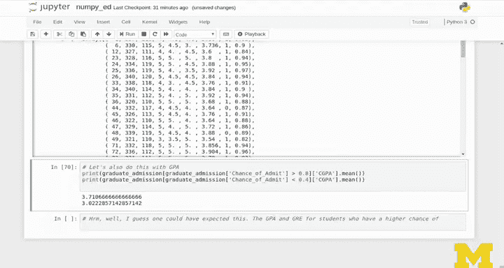

# 11：数值计算库NumPy 🧮


在本节课中，我们将学习Python数值计算的基础库——NumPy。我们将了解如何创建和操作数组，进行数学运算，以及如何将数据集加载到数组中进行基本分析。NumPy是许多高级数据科学库（如pandas）的基石，掌握其核心概念至关重要。

---

## 概述：什么是NumPy？

NumPy是Python中进行数值计算的基础包。它提供了创建、存储和操作数据的强大方法，使其能够与多种数据库和数据格式无缝、快速地集成。它也是pandas库构建的基础，pandas是一个我们将要学习的高性能、以数据为中心的包。

## 创建数组

上一节我们介绍了NumPy的基本概念，本节中我们来看看如何创建数组。

NumPy数组可以显示为列表或列表的列表，也可以通过列表来创建。创建数组时，我们向`np.array()`函数传入一个列表作为参数。

```python
import numpy as np
import math

a = np.array([1, 2, 3])
print(a)
print(a.ndim)  # 打印数组的维度数
```

如果我们向`np.array()`传入一个列表的列表，就可以创建一个多维数组，例如矩阵。

```python
b = np.array([[1, 2, 3], [4, 5, 6]])
print(b)
print(b.shape)  # 打印每个维度的长度
print(a.dtype)  # 检查数组中元素的类型
```

除了整数，NumPy数组也接受浮点数。

```python
c = np.array([2.2, 5, 1.1])
print(c)
print(c.dtype.name)
```

注意，NumPy会自动将像`5`这样的整数转换为浮点数，因为这样做不会损失精度。NumPy会尝试提供最佳的数据类型格式，以保持数组中数据类型的同质性（即所有元素类型相同）。

有时我们知道要创建的数组的形状，但不知道其中的内容。NumPy提供了几个函数来创建带有初始占位符的数组，例如`zeros`或`ones`。

以下是创建具有相同形状但填充值不同的两个数组的方法：

```python
d = np.zeros((2, 3))
print(d)
e = np.ones((2, 3))
print(e)
```

我们还可以生成一个随机数数组。

```python
f = np.random.rand(2, 3)
print(f)
```

`zeros`、`ones`和`random.rand`经常用于创建示例数组，尤其是在Stack Overflow帖子和其他讨论论坛中。

我们还可以使用`arange`函数在数组中创建数字序列。第一个参数是起始边界，第二个参数是结束边界（不包含），第三个参数是连续数字之间的差值。

```python
g = np.arange(10, 50, 2)  # 创建一个从10（包含）到50（不包含）的偶数数组
print(g)
```

如果我们想生成一个浮点数序列，可以使用`linspace`函数。在这个函数中，第三个参数不是两个数字之间的差值，而是你想要生成的项目总数。

```python
h = np.linspace(0, 2, 15)  # 生成从0到2（包含）的15个数字
print(h)
```

## 数组操作

上一节我们学习了如何创建数组，本节中我们来看看如何对数组进行数学和逻辑操作。

我们可以对数组进行许多操作，例如数学运算（加法、减法、平方、指数）以及布尔数组操作（二进制值）。我们还可以进行矩阵操作，如乘积、转置、求逆等。

算术运算符在数组上按元素应用。

```python
a = np.array([10, 20, 30, 40])
b = np.array([1, 2, 3, 4])

c = a - b  # 减法
d = a * b  # 乘法（逐元素）
print(c)
print(d)
```

通过算术操作，我们可以将现有数据转换为我们想要的形式。例如，将华氏温度转换为摄氏温度。

```python
fahrenheit = np.array([0, 10, -5, -15, 0])
celsius = (fahrenheit - 32) * 5 / 9  # 转换公式
print(celsius)
```

另一个有用且重要的操作是布尔数组。我们可以在数组上应用一个运算符，将为原始数组中的每个元素返回一个布尔数组，如果满足条件，则对应位置为`True`。

例如，如果我们想获取一个布尔数组来检查摄氏温度是否大于-20度：

```python
print(celsius > -20)
```

我们还可以使用取模运算符来检查数组中的数字是否为偶数。

```python
print(celsius % 2 == 0)
```

除了逐元素操作，了解NumPy支持矩阵操作也很重要。让我们看看矩阵乘积。

如果我们想做逐元素乘积，我们使用星号`*`。

```python
a = np.array([[1, 2], [3, 4]])
b = np.array([[5, 6], [7, 8]])
print(a * b)  # 逐元素乘积
```

如果我们想做矩阵乘积（点积），我们使用`@`符号。

```python
print(a @ b)  # 矩阵乘积
```

星号`*`用于逐元素操作，而`@`符号用于点积。在本课程中，你不需要担心复杂的矩阵运算，但重要的是要知道NumPy是Python科学计算库的基础，它能够进行逐元素操作（星号）和矩阵级操作（`@`符号）。

## 数组类型与聚合

上一节我们介绍了数组的基本操作，本节中我们来看看数组的数据类型转换和一些聚合函数。

当操作不同类型的数组时，结果数组的类型将对应于两种类型中更通用的一种，这称为向上转型。

```python
array1 = np.array([[1, 2, 3], [4, 5, 6]])  # 整数数组
print(array1.dtype)
array2 = np.array([[7.1, 8.2, 9.1], [10.4, 11.2, 12.3]])  # 浮点数数组
print(array2.dtype)

array3 = array1 + array2  # 加法，整数向上转型为浮点数
print(array3)
print(array3.dtype)
```

整数是仅包含整数的数字，而浮点数可以包含整数部分和小数部分。示例中的`64`指的是操作系统为表示该数字而保留的位数，它决定了可以表示的数字的大小或精度。

NumPy数组还有一些有趣的聚合函数，例如`sum`、`max`、`min`和`mean`。

```python
print(array3.sum())
print(array3.max())
print(array3.min())
print(array3.mean())
```

对于二维数组，我们可以对每一行或每一列进行相同的操作。

```python
b = np.arange(1, 16).reshape(3, 5)  # 创建一个包含1到15元素的3x5数组
print(b)
```

我们通常认为二维数组由行和列组成，但你也可以将这些数组视为只是数字的巨大有序列表，而数组的形状（行数和列数）只是我们为特定目的而建立的抽象。

实际上，这正是计算机环境中存储基本图像的方式。

## 实战：图像处理示例

让我们看一个例子，看看NumPy如何在像图像处理这样的场景中发挥作用。

对于这个演示，我将使用Python图像库PIL（Pillow）和一个在Jupyter笔记本中显示图像的函数。

```python
from PIL import Image
from IPython.display import display

# 打开并显示图像
img = Image.open('Christot_TF.png')
display(img)

# 将PIL图像转换为NumPy数组
array = np.array(img)
print(array.shape)
print(array)
```

我们看到形状是200x200，值都是`uint8`。`u`表示无符号整数（没有负数），`8`表示每字节8位。这意味着每个值最大可以为2^8=256，但实际上只有255，因为我们从0开始计数。

对于黑白图像，黑色从0开始，白色从255开始。如果我们只想反转这个图像，我们可以使用NumPy数组来实现。

```python
# 创建一个与原始数组形状相同、填充值为255的数组
mask = np.full(array.shape, 255, dtype=np.uint8)
print(mask)

# 从原始数组中减去掩码（逐元素减法）
modified_array = array - mask

# 将所有负值转换为正值（逐元素乘以-1）
modified_array = modified_array * -1

# 确保数据类型正确
modified_array = modified_array.astype(np.uint8)
print(modified_array)

# 显示新图像
display(Image.fromarray(modified_array))
```

记住我一开始谈到这如何可以被认为只是一个巨大的字节数组，而形状是一种抽象。我们可以决定重塑数组并尝试渲染。Pillow将单独的行解释为线条，因此我们可以根据需要更改行数和列数。

```python
# 将数组重塑为100x400（原始为200x200，总单元格数不变）
reshaped = np.reshape(modified_array, (100, 400))
print(reshaped.shape)
display(Image.fromarray(reshaped))
```

通过将数组重塑为只有100行高但400列宽，我们基本上是通过每隔一行取一次并将其堆叠在宽度上来使图像加倍，这使得图像看起来更拉伸。

这不是一门图像处理课程，但重点是向你展示这些NumPy数组实际上只是数据之上的抽象，而这些数据具有底层格式（在本例中为`uint8`）。此外，我们可以在其上构建更多的抽象，例如将字节渲染为黑色或白色的计算机代码，这对人来说是有意义的。在某种程度上，整个学位都是关于数据以及我们可以在该数据之上构建的抽象，从单个字节表示到复杂的函数神经网络或交互式可视化。

你作为数据科学家的角色是理解数据的含义、其在集合中的上下文，并将其转换为不同的表示形式以用于理解。

## 索引、切片与迭代

索引、切片和迭代对于数据操作和分析极其重要，因为这些技术允许我们根据条件选择数据，并复制或更新数据。

首先，我们来看整数索引。一维数组的工作方式与列表类似。要获取一维数组中的元素，我们只需使用偏移索引。

```python
a = np.array([3, 4, 5, 6, 7])
print(a[2])  # 获取索引为2的元素（第三个元素，值为5）
```

对于多维数组，我们需要使用整数数组索引。

```python
a = np.array([[1, 2, 3], [4, 5, 6]])  # 2x3数组
print(a)
print(a[1, 1])  # 选择第1行第1列的元素（值为5，索引从0开始）
```

如果我们想获取多个元素（例如1、4和6）并将它们放入一个一维数组中，我们可以直接将索引输入到`np.array`函数中。

```python
# 方法一：直接索引
new_array = np.array([a[0, 0], a[1, 0], a[1, 2]])
print(new_array)

# 方法二：使用数组索引（将行索引和列索引列表“压缩”在一起）
print(a[[0, 1, 1], [0, 0, 2]])  # 结果相同：[1, 4, 6]
```

布尔索引允许我们根据条件选择任意元素。例如，在我们刚才讨论的矩阵中，我们想找到大于5的元素。

```python
print(a > 5)  # 返回一个布尔数组，显示对应索引处大于5的值
print(a[a > 5])  # 将布尔数组作为掩码应用于原始数组，返回一个与True值相关的一维数组
```

正如我们所看到的，这个功能在pandas工具包中是必不可少的，而pandas是本课程的主要内容，所以我们会经常使用它。

切片是一种基于原始数组创建子数组的方法。对于一维数组，切片的工作方式与列表类似。要进行切片，我们使用冒号`:`。

```python
a = np.array([0, 1, 2, 3, 4, 5])
print(a[:3])   # 获取从索引0到索引3（不包含3）的元素
print(a[2:4])  # 获取从索引2到索引4（不包含4）的元素
```

对于多维数组，它的工作方式类似。

```python
a = np.array([[1, 2, 3, 4], [5, 6, 7, 8], [9, 10, 11, 12]])
print(a)

print(a[:2])           # 获取前两行（第0行和第1行）的所有元素
print(a[:2, 1:3])      # 获取前两行，但只获取第1列和第2列的值
```

在二维数组中，第一个参数用于选择行，第二个参数用于选择列。

重要的是要认识到，数组的切片是**对相同数据的视图**。这称为**引用传递**。因此，修改子数组也会随之修改原始数组。

```python
subarray = a[:2, 1:3]
print(subarray[0, 0])  # 子数组中第0行第0列的值（对应原始数组a[0, 1]）
subarray[0, 0] = 50    # 修改子数组
print(subarray)        # 子数组已更改
print(a)               # 原始数组也被更改！
```

## 加载与分析数据集

现在我们已经学习了NumPy的基础知识，让我们在几个数据集上使用它。

这里我们有一个非常流行的葡萄酒质量数据集，我们只查看红葡萄酒。数据字段包括固定酸度、挥发性酸度、残留糖分、氯化物等。这里重要的是酒精含量和质量。

要将数据集加载到NumPy中，我们可以使用`genfromtxt`函数。我们可以指定数据文件名、分隔符（可选，但我们经常使用）以及要跳过的行数（如果我们有标题行，这里为1）。

`genfromtxt`函数有一个名为`dtype`的参数，用于指定每列的数据类型。这个参数是可选的。如果不指定类型，所有类型都将被转换为更通用或更精确的类型（即会进行一些推断）。

```python
wines = np.genfromtxt('winequality-red.csv', delimiter=';', skip_header=1)
print(wines)
```

我们可以使用整数索引来获取特定的列或行。例如，如果我们想选择固定酸度列（第一列），我们可以通过将索引输入数组来实现。

同样记住，对于多维数组，第一个参数指的是行，第二个参数指的是列。如果我们只给出一个参数，那么我们将得到一个一维列表。

```python
# 获取所有行的第一列（结果为一维数组）
print(wines[:, 0])

# 获取所有行的第一列，但保持二维形状（单列）
print(wines[:, 0:1])
```

第一个语句给我们一个单一的数字列表。第二个语句保留了这是一个单列的一般形状。这是数据形状实际上只是一种抽象的另一个很好的例子，我们可以有意地将其叠加在我们正在处理的数据之上。

如果我们想要一个按顺序排列的列范围，比如第0到第3列（回想一下，这意味着第一、第二和第三列，因为我们从0开始，并且不包含结束索引值），我们也可以这样做。

```python
print(wines[:, 0:3])  # 第0、1、2列
```

如果我们想要几个不连续的列，我们可以将我们想要的列的索引放入一个数组中，并将该数组作为第二个参数传递。

```python
print(wines[:, [0, 2, 5]])  # 第0、2、5列
```

我们还可以对这些数据进行一些基本的汇总。例如，如果我们想找出红葡萄酒的平均质量，我们可以选择质量列。我们可以用几种方法做到这一点，但最合适的是对索引使用`-1`值，因为负数意味着从列表的后面开始切片。

```python
quality = wines[:, -1]  # 最后一列（质量）
print(quality.mean())
```

让我们看看另一个关于研究生入学情况的数据集。它包含诸如GRE分数、TOEFL分数、大学评级等字段，最后是录取机会。利用这个数据集，我们可以进行数据操作和基本分析，以推断哪些条件与更高的录取机会相关。

我们可以使用`genfromtxt`在加载CSV数据时指定数据字段名称，也可以通过将`dtype`参数设置为`None`来让NumPy推断列的类型。

```python
grad_admit = np.genfromtxt('Admission_Predict.csv', dtype=None, delimiter=',', skip_header=1,
                            names=('Serial No.', 'GRE Score', 'TOEFL Score', 'University Rating',
                                   'SOP', 'LOR', 'CGPA', 'Research', 'Chance of Admit'))
print(grad_admit)
print(grad_admit.shape)  # 结果是一个包含400个元组的一维数组
```

我们可以使用列名从数组中检索列。

```python
# 获取CGPA列的前五个值
print(grad_admit['CGPA'][:5])
```

由于数据中的GPA范围是1到10，而在美国更常用的是4分制，一个常见的任务可能是通过除以10再乘以4来转换GPA。

```python
grad_admit['CGPA'] = grad_admit['CGPA'] / 10 * 4  # 归一化到4分制
print(grad_admit['CGPA'][:20])
```

请记住，我们已经实际更改了这些数据。我们赋值给`grad_admit['CGPA']`会改变底层数组。

记住布尔掩码。我们可以用它来找出有多少学生有研究经验，方法是创建一个布尔掩码并将其传递给数组索引运算符。

```python
has_research = grad_admit[grad_admit['Research'] == 1]
print(len(has_research))  # 有研究经验的学生数量
```

由于我们有一个录取机会的数据字段，范围从0到1，我们可以尝试看看录取机会高的学生（比如80%）的平均GRE分数是否高于录取机会低的学生（比如40%）。

首先，我们将使用布尔掩码仅提取那些我们感兴趣的、基于其录取机会的学生，然后我们只提取他们的GRE分数，然后我们将打印平均值。

```python
high_chance_gre = grad_admit[grad_admit['Chance of Admit'] > 0.8]['GRE Score']
low_chance_gre = grad_admit[grad_admit['Chance of Admit'] < 0.4]['GRE Score']

print(high_chance_gre.mean())
print(low_chance_gre.mean())
```

让我们也对GPA做同样的事情。

```python
high_chance_gpa = grad_admit[grad_admit['Chance of Admit'] > 0.8]['CGPA']
low_chance_gpa = grad_admit[grad_admit['Chance of Admit'] < 0.4]['CGPA']

print(high_chance_gpa.mean())
print(low_chance_gpa.mean())
```



基于我们粗略的观察，录取机会较高的学生的GPA和GRE分数似乎也更高。

---

## 总结


本节课中我们一起学习了Python核心科学计算库NumPy的快速导览。你将会看到更多使用这个库的讨论，并且