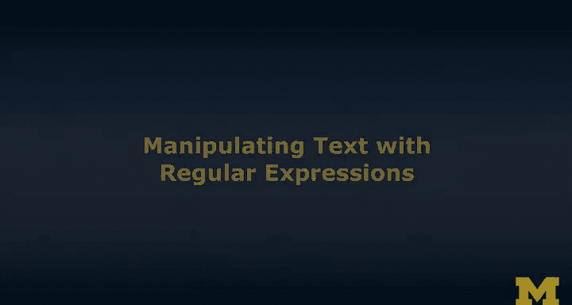
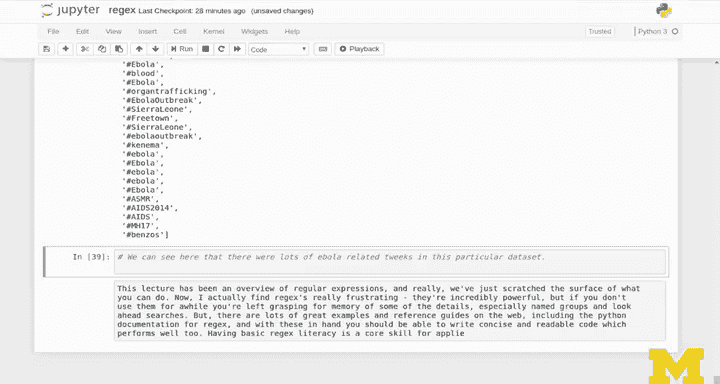
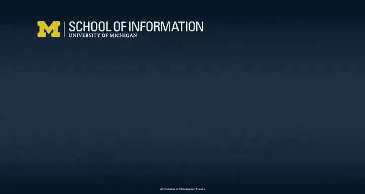

# 课程名称：Python用于数据科学实践 - 第12课：正则表达式文本处理 📝




在本节课中，我们将要学习如何使用正则表达式进行模式匹配和字符串处理。正则表达式是一种强大的工具，可以帮助我们从文本数据中查找、提取和清理信息，是数据科学中数据清洗的核心技术之一。

---

## 概述

正则表达式是一种浓缩的格式化语言。你可以将其视为一个模式，将其提供给正则表达式处理器以及一些源数据。处理器随后使用该模式解析源数据，并将文本块返回给数据科学家或程序员以供进一步操作。

使用正则表达式主要有三个原因：检查源数据中是否存在某个模式；从源数据中获取复杂模式的所有实例；或者通常通过字符串分割，使用模式来清理源数据。

正则表达式并非微不足道，但它们是数据科学应用中数据清洗的基础技术。扎实理解正则表达式将帮助你快速有效地处理文本数据，以用于后续的数据科学应用。

---

## 导入模块与基础函数

首先，我们需要导入Python中存储正则表达式库的`re`模块。

```python
import re
```

`re`模块中有几个主要的处理函数。`match`函数检查字符串开头是否匹配，并返回布尔值。类似地，`search`函数检查字符串中任意位置是否匹配，并返回布尔值。

让我们创建一个示例文本。

```python
text = "This is a good day."
```

现在，让我们看看这是否是一个好日子。

```python
if re.search("good", text):
    print("wonderful")
else:
    print("alas :(")
```

---

## 字符串分割与查找

除了检查条件，我们还可以分割字符串。正则表达式在这里所做的工作称为**分词**，即根据模式将字符串分割成子字符串。

分词是自然语言处理中的核心活动。`findall`和`split`函数将为我们解析字符串并返回文本块。让我们尝试一个例子。

```python
text = "Amy works diligently. Amy gets good grades. Our student Amy is successful."
```

这是一个有点人为的例子，但让我们根据所有“Amy”的实例来分割。

```python
re.split("Amy", text)
```

你会注意到，`split`返回了一个空字符串，后面跟着一系列关于Amy的陈述，这些都是列表的元素。如果我们想计算提到Amy的次数，可以使用`findall`。

```python
re.findall("Amy", text)
```

---

## 复杂模式：锚点

我们已经看到`search`查找某个模式并返回布尔值，`split`使用模式创建子字符串列表，`findall`查找模式并提取所有出现项。

现在我们知道Python正则表达式API的工作原理了，让我们进一步讨论复杂模式。正则表达式规范标准定义了一种标记语言来描述文本中的模式。

让我们从**锚点**开始。锚点指定要匹配的字符串的开头和/或结尾。

`^`字符表示开始，`$`字符表示结尾。如果在字符串前加上`^`，意味着正则表达式处理器检索的文本必须以你指定的字符串开头。对于结尾，必须在字符串后加上`$`字符，意味着处理器检索的文本必须以你指定的字符串结尾。

这是一个例子。

```python
text = "Amy works diligently. Amy gets good grades. Our student Amy is successful."
```

让我们看看这是否以“Amy”开头。

```python
re.search("^Amy", text)
```

注意，`search`实际上返回给我们一个新对象，称为**匹配对象**。匹配对象总是具有布尔值`True`（因为找到了某些内容），因此你总是可以像之前那样在`if`语句中评估它。匹配对象的呈现还告诉你匹配了什么模式（本例中是单词“Amy”）以及匹配的位置（即跨度）。

---

## 字符集

让我们进一步讨论模式，从**字符集**开始。

让我们创建一个字符串，表示一个学生在所有作业中一门课程整个学期的单个字母成绩。

```python
grades = "ACAAAABCBCBAA"
```

如果我们想回答“成绩列表中有多少个B”这个问题，我们可以直接使用`B`作为模式。

```python
re.findall("B", grades)
```

如果我们想计算列表中A或B的数量，不能使用`AB`，因为这用于匹配所有紧跟着B的A。相反，我们将字符A和B放在方括号内。

```python
re.findall("[AB]", grades)
```

这被称为**集合运算符**。你还可以包含按字母数字顺序排列的字符范围。例如，如果我们要引用所有小写字符，可以在方括号内使用`a-z`。

让我们构建一个简单的正则表达式，解析出学生获得A后接B或C的所有实例。

```python
re.findall("A[BC]", grades)
```

注意，`[AB]`模式描述了一组可能的字符，可以是A或B，而`A[BC]`模式表示两组字符，它们必须背靠背匹配。

你可以使用管道运算符`|`（表示“或”）来编写此模式。

```python
re.findall("AB|AC", grades)
```

我们可以使用`^`与集合运算符来否定结果。例如，如果我们想只解析出不是A的成绩，可以这样做。

```python
re.findall("[^A]", grades)
```

这里我们只有B和C。请注意，`^`之前作为锚点匹配字符串的开头，但在集合运算符内部，`^`（以及我们将要讨论的其他特殊字符）会失去其特殊含义。你认为这个操作的结果会是什么？

```python
re.findall("^[^A]", grades)
```

这是一个空列表，因为正则表达式表示我们想要匹配字符串开头不是A的任何值，而我们的字符串以A开头，因此没有找到匹配。

记住，当你使用集合运算符时，你是在进行基于字符的匹配，即以“或”的方式匹配单个字符。

---

## 量词

我们已经讨论了锚点以及匹配模式的开头和结尾，还讨论了使用集合表示法的字符匹配、字符否定以及管道字符如何允许我们在操作中使用“或”。现在让我们继续讨论**量词**。

量词是你希望模式被匹配的次数，以便实际计为一次匹配。最基本的量词是表达式`E{m,n}`，其中`E`是表达式或字符匹配，`m`是你希望匹配的最小次数，`n`是该项目可以匹配的最大次数。

让我们以这些成绩为例。这个学生有多少次连续获得A的记录？我们可以这样做。

```python
re.findall("A{2,10}", grades)
```

我们看到有两次记录，一次学生有四个A，另一次他们只有两个A。

我们可能会尝试使用单个值并重复模式来做到这一点。

```python
re.findall("A{1}A{1}", grades)
```

如你所见，这与第一个例子不同。第一个模式寻找两个A到十个A连续组合，因此它将四个A视为一个连续记录。第二个模式寻找两个A背靠背，因此它看到两个A紧跟着另外两个A。我们说正则表达式处理器从字符串开头开始，并在处理时消耗匹配模式的变量。

重要的是要注意，正则表达式量词语法不允许你偏离`{m,n}`模式。特别是，如果你在大括号之间有额外的空格，你会得到一个空结果。

```python
re.findall("A{2, 2}", grades)
```

正如我们已经看到的，如果我们不包含量词，默认是`{1,1}`。如果你在大括号中只有一个数字，它被视为既是`m`值也是`n`值。

```python
re.findall("A{2}", grades)
```

使用这个，我们可以找到学生成绩下降的趋势。

```python
re.findall("A{1,10}B{1,10}C{1,10}", grades)
```

这有点取巧，因为我们包含了一个任意大的最大值。还有三个其他量词可以用来简写，我们可以考虑在这里使用：`*`用于匹配零次或多次，`?`用于匹配零次或一次，`+`用于匹配一次或多次。

---

## 实际应用：解析维基百科数据

让我们看一个更复杂的例子，加载一些从维基百科抓取的数据。

```python
with open("datasets/wiki_frapa.txt") as file:
    wiki = file.read()
```

扫描此文档，我们注意到所有标题后面都有“edit”一词放在方括号中，后面跟着一个换行符。因此，如果我们想获取本文中所有标题的列表，可以使用`re.findall`。

```python
re.findall("[a-zA-Z]{1,100}\[edit\]", wiki)
```

这并没有完全奏效，它获取了所有标题，但只获取了标题的最后一个词，而且确实相当笨拙。让我们迭代改进这一点。

首先，我们可以使用`\w`来匹配任何字母（包括数字）。

```python
re.findall("\w{1,100}\[edit\]", wiki)
```

`\w`是一个**元字符**，它表示任何字母或数字的特殊模式。实际上，文档中列出了许多不同的元字符，例如`\s`匹配任何空白字符。

接下来，我们可以使用另外三个量词来缩短花括号语法。我们可以使用`*`来匹配零次或多次。

```python
re.findall("\w*\[edit\]", wiki)
```

现在我们已经缩短了正则表达式，让我们稍微改进一下。我们可以使用空格字符添加空格。

```python
re.findall("[\w ]*\[edit\]", wiki)
```

现在我们得到了维基百科页面中的章节标题列表。你现在可以通过遍历这个列表并应用另一个正则表达式来创建标题列表。

```python
for title in re.findall("[\w ]*\[edit\]", wiki):
    print(re.split("\[", title)[0])
```

这可行，但有点麻烦。到目前为止，我们一直在讨论正则表达式作为单个匹配的模式，但实际上你可以同时匹配不同的模式（称为**分组**），然后稍后根据需要引用这些分组。

要分组模式，请使用括号，这实际上非常自然。让我们使用分组重写我们的`findall`。

```python
re.findall("([\w ]*)(\[edit\])", wiki)
```

很好，我们看到Python的`re`模块按组分解结果，并且我们实际上也可以通过返回的匹配对象中的编号来引用分组。

但是，我们如何获取匹配对象列表呢？到目前为止，我们已经看到`findall`返回字符串，`search`和`match`返回单个匹配对象。如果我们想要匹配对象列表该怎么办？在这种情况下，我们使用函数`finditer`。

```python
for item in re.finditer("([\w ]*)(\[edit\])", wiki):
    print(item.groups())
```

`groups`方法返回一个组的元组。我们可以使用`group(数字)`获取单个组，其中`group(0)`是整个匹配，其他数字是我们感兴趣的部分匹配。在本例中，我们想要`group(1)`，即第一个项目。

```python
for item in re.finditer("([\w ]*)(\[edit\])", wiki):
    print(item.group(1))
```

---

## 命名分组

关于正则表达式分组，还有一个我很少使用但很好的概念，即**标记或命名分组**。在前面的例子中，我向你展示了如何使用组的位置，但给它们一个标签并将结果视为字典实际上非常有用。为此，我们使用这种语法：括号后跟一个问号、一个大写`P`，然后是尖括号内的名称。其中括号开始分组，问号加大写`P`表示这是基本正则表达式的扩展，尖括号中的名称是我们使用的字典键，并包裹在那些尖括号中。

```python
for item in re.finditer("(?P<title>[\w ]*)(?P<edit_link>\[edit\])", wiki):
    print(item.groupdict()['title'])
```

当然，我们可以打印出整个字典。

```python
for item in re.finditer("(?P<title>[\w ]*)(?P<edit_link>\[edit\])", wiki):
    print(item.groupdict())
```

---

## 更多元字符与前后查找

我们已经看到了如何使用集合运算符匹配单个字符模式，如何使用括号将匹配分组，以及如何使用量词（如`*`、`?`或`{m,n}`）来描述模式。

我在前面的例子中略过了`\w`，它代表任何单词字符。正则表达式有许多用于不同类型字符的简写，包括`.`表示任何非换行符的单个字符，`\d`表示任何数字，`\s`表示任何空白字符（如空格和制表符）。完整列表可以在Python正则表达式文档中找到。

另一个需要熟悉的概念是**前向查找和后向查找**。在这种情况下，匹配到正则表达式引擎的模式是我们实际试图隔离的文本之前或之后的文本。

例如，在我们的标题中，我们想要隔离“edit”渲染之前的文本。但实际上我们并不关心“edit”文本本身。到目前为止，我们一直在丢弃“edit”，但如果我们想使用它们来匹配但不想捕获它们，可以将它们放在一个组中，并使用`?=`语法进行前向查找。

让我们看一个例子。

```python
for item in re.finditer("(?P<title>[\w ]*)(?=\[edit\])", wiki):
    print(item)
```

这个正则表达式表示匹配两个组，第一个将被命名并称为“title”，包含任意数量的空白或常规单词字符；第二个将是字符“edit”，但我们实际上不希望将此项目放入输出匹配对象中。

---

## 详细模式与解析结构化数据

让我们看一些更多的维基百科数据。这是一些关于美国佛教大学的数据。

```python
with open("datasets/buddhist.txt") as file:
    wiki = file.read()
```

我们可以看到每所大学都遵循相当相似的模式：名称后跟一个破折号，然后是“located in”一词，接着是城市和州。

我将使用这个例子向你展示Python正则表达式的**详细模式**。详细模式允许你编写多行正则表达式并提高可读性。对于此模式，我们必须明确指示所有空白字符，要么通过用反斜杠转义它们，要么使用`\s`特殊值。然而，这意味着我们可以更像代码一样编写正则表达式，甚至可以使用`#`号包含注释。

```python
pattern = """
(?P<title>.*)        # 大学名称
\ –\ located\ in\    # 分隔符
(?P<city>\w*)        # 城市
,\                   # 逗号和空格
(?P<state>\w*)       # 州
"""

for item in re.finditer(pattern, wiki, re.VERBOSE):
    print(item.groupdict())
```

---

## 解析社交媒体数据

这是《纽约时报》关于健康推文的另一个例子。这些数据来自UC Irvine机器学习存储库，这是一个很好的不同种类数据来源。

```python
with open("datasets/nytimeshealth.txt") as file:
    health = file.read()
```

这里我们可以看到有推文，字段由竖线分隔。让我们尝试获取此数据中包含的所有主题标签列表。在Twitter中，主题标签以`#`号（即哈希标记）开头，并在遇到一些空白时结束。

让我们创建一个模式。我们首先想包含`#`号，然后是任意数量的字母数字字符，当我们看到一些空白时结束。

```python
pattern = "#[\w\d]*\s"
```

注意，结尾是一个前向查找，因为我们实际上对匹配此空白并返回值不感兴趣。还要注意，我使用了`*`而不是`+`来匹配字母字符或数字，因为`+`要求至少有一个。

让我们搜索并显示所有主题标签。

```python
re.findall(pattern, health)
```

我们可以看到，在这个特定的数据集中有很多与埃博拉相关的推文。

---

## 总结

本节课我们概述了正则表达式，实际上我们只是触及了你能做的事情的表面。我发现正则表达式确实令人沮丧，它们非常强大，但如果你一段时间不使用，就会忘记一些细节，尤其是命名分组和前向查找搜索。

但是网上有很多很好的例子和参考指南，包括Python的正则表达式文档。有了这些，你应该能够编写简洁、可读且性能良好的代码。





掌握基本的正则表达式读写能力是应用数据科学家的核心技能。