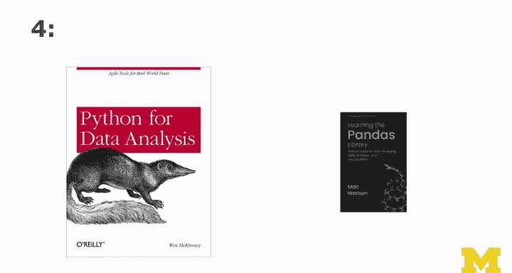

# 13：Pandas库入门 🐼

在本节课中，我们将深入学习如何使用Python的Pandas工具包来操作、清理和查询数据。Pandas是数据科学领域的核心库之一，掌握它将为你后续的数据处理工作打下坚实基础。

---

## 概述 📋

本周，我们将通过研究Pandas数据工具包，深入探讨Python如何用于操作、清理和查询数据。

Pandas由Wes McKinney于2008年创建，它是一个采用宽松许可证的开源项目。作为一个开源项目，它拥有一个强大的社区，超过100名软件开发人员为其贡献代码以使其变得更好。

---

## 学习资源与社区支持 📚

现在，你应该使用课程内的工具与讲师、课程助理和同学互动，以获得关于Pandas的帮助。但我也鼓励你超越课程范围，坦率地说，你可能需要这样做，并利用诸如Stack Overflow这样的问答网站。

Stack Overflow在软件开发社区中被广泛用于发布关于编程、编程语言和编程工具包的问题。Stack Overflow的特殊之处在于它由社区精心管理，特别是Pandas社区，将其作为帮助新成员的首要资源。

如果你在Stack Overflow上发布一个问题，并将其标记为与Pandas和Python相关，那么很有可能会有Pandas开发人员回答你的问题。除了发布问题，Stack Overflow也是一个查看人们遇到什么问题以及如何解决这些问题的好地方。

第二个你可能想考虑的资源是书籍。2012年，Wes McKinney撰写了权威的Pandas参考书，名为《Python for Data Analysis》，由O'Reilly出版，并在2017年更新至第二版。

我认为这是本课程的权威教科书，也是理解Pandas工作原理的重要资源。但我也很欣赏Matt Harrison所著的更简洁的《Learning the Pandas Library》。这不是一本关于数据分析和统计的全面书籍，但如果你只想快速学习Pandas的基础知识，我认为这是一本布局很好的书。

---

## 跟上数据科学领域的发展 🚀

数据科学领域正在迅速发展。每天都有新的工具包和方法被创造出来。要跟上所有这些发展可能很困难。Marco Rodriguez和Tim Golden维护着一个很棒的博客聚合网站，名为Planet Python。你可以访问Planet Python的网页。通过RSS阅读器订阅或从Planet Python的Twitter feed获取最新文章。

有许多定期的Python数据科学贡献者，如果你使用RSS订阅，我强烈建议你关注它。同样，如果你喜欢播客，我喜欢Michael Kennedy和Brian Oen的《Python Bytes》。他们的剧集很短，更侧重于Python新闻，这是了解Python生态系统中一些动态的好方法。

好了，这是我关于如何深化学习的最后一个推荐。Kyle Polock运营着一个优秀的播客，名为《Data Skeptic》。虽然它本身是基于Python的，但它制作精良，并很好地融合了对该领域专家的采访以及简短的教育课程。他描述的许多工作都特定于机器学习方法，并将对你整个学位学习大有裨益。

---

## 开始学习Pandas 🎯

掌握了所有这些资源后，让我们开始深入学习Python数据操作工具包——Pandas。

---

## 总结 ✨

本节课中，我们一起学习了Pandas库的起源、其强大的开源社区支持，以及如何利用各种在线资源（如Stack Overflow、权威书籍、博客聚合网站和播客）来深化对Pandas和数据科学的学习。准备好这些工具和知识后，我们就可以正式开启Pandas数据操作之旅了。在接下来的课程中，我们将具体探索Pandas的核心数据结构和功能。