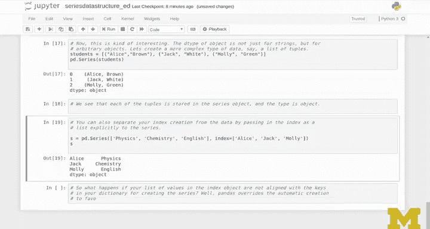

# 课程1.3：探索Pandas Series数据结构 📊


在本节课中，我们将学习Pandas库中的核心数据结构之一：Series。你将了解如何创建Series对象，如何存储和操作一维带索引的数据，以及如何处理缺失值。

---

## 概述

Series是Pandas中的核心数据结构，可以将其视为列表和字典的交叉体。数据按顺序存储，并且每个数据项都有一个标签（索引）用于检索。理解Series是学习Pandas进行数据操作的基础。

---

## 创建Series对象

要开始使用Pandas，我们首先需要导入它。

```python
import pandas as pd
```

### 从列表创建Series

创建Series最简单的方法之一是传入一个列表。Pandas会自动分配一个从0开始的整数索引，并将Series的名称设置为None。

以下是创建Series的步骤：

1.  创建一个列表。
2.  将列表传递给 `pd.Series()` 函数。

让我们看一个例子。假设我们有一个包含学生姓名的列表：

```python
students = ['Alice', 'Jack', 'Molly']
s = pd.Series(students)
print(s)
```

输出结果将显示一个Series对象。Pandas会自动识别Series中数据的类型（本例中为`object`，即字符串），并相应地设置`dtype`参数。索引是从0开始的整数。

我们也可以传入数字列表：

```python
numbers = [1, 2, 3]
s_num = pd.Series(numbers)
print(s_num)
```

在这种情况下，Pandas会将`dtype`设置为`int64`。Pandas底层使用NumPy库的**类型化数组**来存储Series值，这比传统的Python列表处理数据速度更快。

---

## 处理缺失值

在数据处理中，缺失值是一个常见问题。Pandas和底层的NumPy对此有特殊的处理方式。

### None与NaN的区别

在Python中，我们使用`None`类型来表示缺失数据。但在Pandas的**类型化数组**中，处理方式有所不同：

*   如果创建一个包含字符串和`None`的列表，Pandas会将`None`保留为`None`，并将底层数组类型设为`object`。

    ```python
    students_with_none = ['Alice', 'Jack', None]
    s_students = pd.Series(students_with_none)
    print(s_students)
    ```

*   如果创建一个包含数字（整数或浮点数）和`None`的列表，Pandas会自动将`None`转换为一个特殊的浮点值`NaN`（Not a Number）。

    ```python
    numbers_with_none = [1, 2, None]
    s_numbers = pd.Series(numbers_with_none)
    print(s_numbers)
    ```

    你会注意到两件事：首先，值显示为`NaN`；其次，Pandas将这个Series的`dtype`设置为浮点数（例如`float64`），而不是整数。这是因为`NaN`在底层被表示为浮点数，而整数可以被安全地转换为浮点数。

**重要提示**：`NaN`和`None`在Pandas中**不相等**，并且测试方式不同。

```python
import numpy as np

# NaN不等于None
print(np.nan == None)  # 输出：False

# NaN甚至不等于它自己
print(np.nan == np.nan)  # 输出：False

# 必须使用特殊函数来检查NaN
print(np.isnan(np.nan))  # 输出：True
```

因此，当你看到Series中的整数变成了浮点数时，很可能是因为数据中存在缺失值，被转换成了`NaN`。

---

## 从字典创建Series并自定义索引

上一节我们介绍了从简单列表创建Series。本节中我们来看看如何从字典创建Series，这允许我们使用有意义的标签作为索引。

### 使用字典键作为索引

如果你有带标签的数据（例如字典），可以直接用它创建Series。字典的键会自动成为Series的索引。

```python
student_scores = {
    'Alice': 'Physics',
    'Jack': 'Chemistry',
    'Molly': 'English'
}
s = pd.Series(student_scores)
print(s)
```

创建后，可以通过`.index`属性访问索引对象：

```python
print(s.index)
```

### 存储复杂数据类型

Series的`dtype`为`object`时，不仅可以存储字符串，还可以存储任意Python对象，例如元组列表：

```python
students_complex = [('Alice', 'Brown'), ('Jack', 'White'), ('Molly', 'Green')]
s_complex = pd.Series(students_complex)
print(s_complex)
```

### 显式指定索引

你可以将数据创建和索引创建分开，通过`index`参数显式传递一个索引列表。

```python
# 数据是课程
data = ['Physics', 'Chemistry', 'English']
# 索引是学生姓名
custom_index = ['Alice', 'Jack', 'Molly']
s_custom = pd.Series(data, index=custom_index)
print(s_custom)
```

---

## 索引与数据的对齐

当使用字典创建Series并同时提供自定义索引时，Pandas会以你提供的索引为准。



**规则如下**：
*   忽略字典中所有不在你提供的索引列表中的键。
*   对于你提供的索引列表中存在，但字典中不存在的键，Pandas会添加`NaN`（对于数值/混合类型）或`None`（对于纯对象类型）作为缺失值。

让我们看一个例子：

```python
student_scores = {
    'Alice': 'Physics',
    'Jack': 'Chemistry',
    'Molly': 'English'
}
# 我们只对部分学生感兴趣，并且加入一个字典里没有的新学生‘Sam’
selected_index = ['Alice', 'Molly', 'Sam']
s_aligned = pd.Series(student_scores, index=selected_index)
print(s_aligned)
```

在这个结果中：
*   `Jack`虽然存在于原始字典中，但不在我们指定的索引里，所以被忽略。
*   `Sam`在我们指定的索引中，但原始字典中没有，因此其值显示为`NaN`（因为值是字符串，这里实际显示为`NaN`，但在打印时可能显示为`None`，取决于Pandas版本和上下文）。

---

## 总结

本节课中我们一起学习了Pandas Series数据结构。我们涵盖了以下核心概念：

1.  **创建Series**：可以从列表或字典使用 `pd.Series()` 创建。
2.  **索引**：Series具有索引，可以是自动生成的整数，也可以是自定义的标签（如字符串）。索引可以通过 `.index` 访问。
3.  **数据类型**：Pandas使用NumPy**类型化数组**（如`int64`, `float64`, `object`）来高效存储数据。`dtype`属性显示了数据的类型。
4.  **处理缺失值**：
    *   在数值Series中，缺失值用 `NaN`（Not a Number）表示，其`dtype`会变为浮点数。
    *   在对象Series中，缺失值用 `None` 表示。
    *   `NaN` 与 `None` 不等价，且 `NaN != NaN`。检查 `NaN` 需使用 `np.isnan()`。
5.  **索引与数据对齐**：当使用字典并指定`index`参数时，Pandas会以指定的索引为准，进行数据对齐，缺失处填充`NaN`/`None`。


理解Series是掌握Pandas DataFrame（二维表格结构）的重要基础，因为DataFrame的每一列本质上就是一个Series。