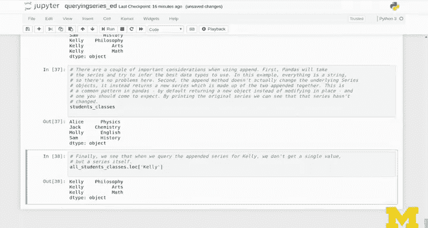

# 密歇根大学《Python用于数据科学实践》第14课：Series查询方法 🐼


在本节课中，我们将学习pandas库中的核心数据类型之一：Series。你将了解Series的结构，如何查询Series对象，如何合并Series对象，以及在数据科学编程中考虑并行化的重要性。

## 概述 📋

Series是pandas库中用于存储一维数据的主要数据结构。理解如何高效地操作Series是进行数据分析和处理的基础。本节将重点介绍Series的查询方法、数据操作技巧以及性能优化的概念。

## 查询Series数据 🔍

Series可以通过索引位置或索引标签进行查询。如果在创建Series时没有指定索引，那么位置和标签在数值上是相同的。

*   **按位置查询**：使用 `iloc` 属性，索引从0开始。
*   **按标签查询**：使用 `loc` 属性。

以下是具体操作方法。

首先，我们导入pandas并创建一个示例Series。

```python
import pandas as pd

# 创建一个字典
student_classes = {
    ‘Alice‘: ‘Physics‘,
    ‘Jack‘: ‘Chemistry‘,
    ‘Molly‘: ‘English‘,
    ‘Sam‘: ‘History‘
}

# 从字典创建Series
s = pd.Series(student_classes)
print(s)
```

现在，我们有了一个名为 `s` 的Series。以下是查询方法。

*   要查看第四个条目（索引位置3），使用 `s.iloc[3]`。
*   要查看Molly的课程，使用 `s.loc[‘Molly‘]`。

需要记住，`iloc` 和 `loc` 是属性，不是方法。因此，查询时使用方括号 `[]`，而不是圆括号 `()`。这被称为索引操作符。

## 索引操作符的智能语法 🤖

Python的索引操作符根据上下文调用项的获取或设置方法。pandas为了让代码更易读，提供了一种智能语法：直接在Series对象上使用索引操作符 `[]`。

*   如果传入整数参数，操作符的行为就像你想通过 `iloc` 查询。例如，`s[3]` 等同于 `s.iloc[3]`。
*   如果传入一个对象（如字符串），操作符的行为就像你想通过 `loc` 查询。例如，`s[‘Molly‘]` 等同于 `s.loc[‘Molly‘]`。

但是，当你的索引本身就是一个整数列表时，情况会变得复杂。pandas可能无法自动判断你是想按位置查询还是按标签查询。

以下是一个示例，其中索引是整数形式的课程代码。

```python
# 创建索引为整数的Series
class_code = {
    99: ‘Physics‘,
    100: ‘Chemistry‘,
    101: ‘English‘,
    102: ‘History‘
}
s = pd.Series(class_code)
print(s)
```

如果我们尝试 `s[0]`，会得到一个KeyError，因为索引中没有标签为0的项。此时，我们必须显式地使用 `iloc` 来获取第一个项：`s.iloc[0]`。

因此，为了安全起见，在索引可能混淆时，最好直接使用 `iloc` 和 `loc` 属性。

## 操作Series数据：迭代与向量化 ⚡

一个常见的任务是对Series中的所有值进行某种操作，例如查找特定数字、汇总数据或以某种方式转换数据。

一种典型的编程方法是遍历Series中的所有项，并对每个项执行操作。例如，计算学生成绩的平均分。

```python
# 创建一个成绩Series
grades = pd.Series([90, 80, 70, 60])

# 迭代方法计算平均分
total = 0
for grade in grades:
    total = total + grade
average = total / len(grades)
print(average)
```

这种方法可行，但速度较慢。现代计算机可以同时执行许多任务。pandas及其底层的NumPy库支持向量化计算。

向量化允许对整个数据数组执行操作，而不是循环遍历每个元素。以下是使用NumPy的 `sum` 函数进行向量化计算的方法。

```python
import numpy as np

# 向量化方法计算平均分
total = np.sum(grades)
average = total / len(grades)
print(average)
```

两种方法结果相同，但速度有差异。为了展示这一点，我们创建一个大型的随机数Series并进行速度测试。

## 性能比较：使用 `%timeit` ⏱️

Jupyter Notebook有一个魔法函数 `%timeit`，可以测量代码的执行时间。我们将用它来比较迭代方法和向量化方法的性能。

首先，创建一个包含10,000个随机数的大型Series。

```python
# 创建大型随机Series
numbers = pd.Series(np.random.randint(0, 1000, 10000))
print(numbers.head())  # 查看前5项
print(len(numbers))    # 验证长度
```

现在，使用 `%%timeit`（单元格魔法函数）来测量两种方法的运行时间。

```python
%%timeit -n 100
# 迭代方法
total = 0
for number in numbers:
    total += number
average = total / len(numbers)
```

```python
%%timeit -n 100
# 向量化方法
total = np.sum(numbers)
average = total / len(numbers)
```

你会观察到向量化方法的速度显著快于迭代方法。这展示了为什么在数据科学中需要关注并行计算特性并开始以函数式编程的思维思考。

简单来说，**向量化**是计算机同时执行多条指令的能力。借助高性能芯片（尤其是显卡），可以获得显著的加速效果。

## 广播：对整个Series应用操作 📡

一个与向量化相关的特性叫做**广播**。通过广播，我们可以将一个操作应用到Series中的每个值，从而改变整个Series。

例如，如果我们想将Series中的每个随机数都增加2，可以直接在Series对象上使用 `+=` 操作符。

```python
# 查看原始数据
print(s.head())

# 使用广播增加所有值
s += 2

# 查看操作后的数据
print(s.head())
```

过程式的方法则是遍历Series中的所有项并直接增加值。pandas支持像遍历字典一样遍历Series。

```python
# 迭代方法增加所有值
for label, value in s.items():
    s.loc[label] = value + 2

# 查看结果
print(s.head())
```

结果相同，但如果你发现自己经常在pandas中迭代，应该思考是否有更好的方法。

让我们再次进行速度比较。

```python
%%timeit -n 10
# 迭代方法
s_new = pd.Series(np.random.randint(0, 100, 1000))
for label, value in s_new.items():
    s_new.loc[label] = value + 2
```

```python
%%timeit -n 10
# 广播方法
s_new = pd.Series(np.random.randint(0, 100, 1000))
s_new += 2
```

广播方法不仅速度更快，而且代码更简洁、更易读。你期望的典型数学运算都是向量化的，NumPy文档概述了如何创建自己的向量化函数。

## 使用 `loc` 添加新数据 ➕

关于使用索引操作符访问Series数据，最后一点需要注意的是：`loc` 属性不仅允许你原地修改数据，还可以添加新数据——如果你传入的索引值不存在。

需要记住，索引可以具有混合类型。虽然需要注意底层的类型，但pandas会在适当的时候自动更改底层的NumPy类型。

以下是一个示例。

```python
# 创建一个数字Series
s = pd.Series([1, 2, 3])
print(s)

# 添加一个字符串索引和整数值的新条目
s.loc[‘History‘] = 102
print(s)
```

我们看到，对于数据值或索引标签的混合类型，pandas没有问题。由于 ‘History‘ 不在原始索引列表中，`s.loc[‘History‘] = 102` 实际上创建了一个新的系列元素，索引名为 ‘History‘，值为102。

## 处理非唯一索引与合并Series 🔗

到目前为止，我只展示了索引值唯一的Series示例。我想通过一个索引值不唯一的例子来结束本讲，这使得pandas Series在概念上与关系型数据库等有所不同。

让我们创建一个记录学生所选课程的Series。

```python
# 创建学生课程Series
student_classes = pd.Series([‘Physics‘, ‘Chemistry‘, ‘English‘, ‘History‘],
                             index=[‘Alice‘, ‘Jack‘, ‘Molly‘, ‘Sam‘])
print(student_classes)
```

现在，为一名新学生Kelly创建一个Series，列出她所修的所有课程。我们将索引设置为Kelly，数据为课程名称。

```python
# 创建Kelly的课程Series (索引不唯一)
kelly_classes = pd.Series([‘Philosophy‘, ‘Arts‘, ‘Math‘],
                           index=[‘Kelly‘, ‘Kelly‘, ‘Kelly‘])
print(kelly_classes)
```

最后，我们可以使用 `.append()` 函数将这个新Series中的所有数据追加到第一个Series中。

```python
# 合并两个Series
all_student_classes = student_classes.append(kelly_classes)
print(all_student_classes)
```

使用 `.append()` 时有几个重要的注意事项。

1.  pandas会尝试推断要使用的最佳数据类型。在这个例子中，所有内容都是字符串，所以没有问题。
2.  `append` 方法实际上不会更改底层的Series对象。相反，它返回一个由两个Series连接而成的新Series。这是pandas中的一个常见模式——默认返回一个新对象而不是原地修改一个对象，你应该习惯这一点。
3.  当我们查询追加后的Series中的 ‘Kelly‘ 时，我们得到的不是一个单一值，而是一个Series本身。

```python
# 查询‘Kelly‘，返回一个Series
print(all_student_classes.loc[‘Kelly‘])
```




## 总结 🎯

在本节课中，我们重点介绍了pandas库的主要数据类型之一：Series。

我们一起学习了：
*   如何使用 `loc` 和 `iloc` 查询Series。
*   Series是一种索引数据结构。
*   如何使用 `append` 合并两个Series对象。
*   **向量化**的重要性及其带来的性能提升。

Series对象还有许多我们未讨论到的方法，但掌握了这些基础知识后，我们将继续讨论pandas的二维数据结构：DataFrame。DataFrame与Series对象非常相似，但包含多列数据，是在清洗和聚合数据时你将花费大部分时间处理的结构。


