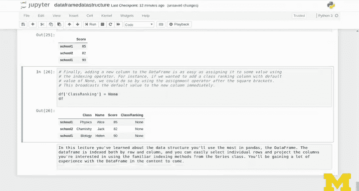

# 16：Pandas核心数据结构DataFrame详解 📊


在本节课中，我们将要学习Pandas库中最核心的数据结构——DataFrame。DataFrame是进行数据分析和清洗任务时主要操作的对象。我们将了解其概念、创建方法以及如何从中选择和操作数据。

## 概述

DataFrame数据结构是Pandas库的核心。它是进行数据分析和清洗任务时主要操作的对象。从概念上讲，DataFrame是一个二维的Series对象，它包含一个索引和多列内容，每一列都有一个标签。实际上，行和列的区别仅仅是概念上的，你可以将DataFrame本身简单地视为一个带有两个轴标签的数组。

## 创建DataFrame

让我们从导入Pandas库开始。

```python
import pandas as pd
```

我们将通过一个例子来切入：创建三条包含学生姓名、课程名称和成绩的学校记录。每条记录都是一个Series。

```python
record1 = pd.Series({'name': 'Alice', 'class': 'physics', 'score': 85})
record2 = pd.Series({'name': 'Jack', 'class': 'chemistry', 'score': 82})
record3 = pd.Series({'name': 'Helen', 'class': 'biology', 'score': 90})
```

与Series类似，DataFrame对象也是带索引的。我将使用一组Series，其中每个Series代表一行数据。就像Series函数一样，我们可以传入数组中的各个项，并将索引值作为第二个参数传入。

```python
df = pd.DataFrame([record1, record2, record3], index=['school1', 'school2', 'school1'])
```

我们可以使用`head`函数查看DataFrame的前几行，包括两个轴的索引，并以此来验证列和行。

```python
df.head()
```

你会注意到，Jupyter创建了一段漂亮的HTML来渲染DataFrame的结果。最左边是索引列（学校名称），然后是数据行，每行都有一个列标题，这些标题来自我们初始记录字典的键。

另一种方法是使用字典列表，其中每个字典代表一行数据。

```python
students = [{'name': 'Alice', 'class': 'physics', 'score': 85},
            {'name': 'Jack', 'class': 'chemistry', 'score': 82},
            {'name': 'Helen', 'class': 'biology', 'score': 90}]
df = pd.DataFrame(students, index=['school1', 'school2', 'school1'])
df.head()
```

## 从DataFrame中选择数据

上一节我们介绍了如何创建DataFrame，本节中我们来看看如何从中提取数据。与Series类似，我们可以使用`.iloc`和`.loc`属性来提取数据。因为DataFrame是二维的，所以向`.loc`索引操作符传递单个值将返回一个Series（如果只有一行要返回的话）。

例如，如果我们想选择与`school2`相关的数据，我们只需用一个参数查询`.loc`属性。

```python
df.loc['school2']
```

请注意，返回的Series名称是索引值，而列名包含在输出中。我们可以使用Python的`type`函数检查返回的数据类型。

```python
type(df.loc['school2'])
```

重要的是要记住，沿水平或垂直轴的索引和列名可能不是唯一的。在这个例子中，我们看到`school1`有两条不同的记录。

如果我们在DataFrame的`.loc`属性中使用单个值，将返回DataFrame的多行，不是作为一个新的Series，而是作为一个新的DataFrame。

```python
df.loc['school1']
type(df.loc['school1'])
```

## 基于多轴选择数据

Pandas DataFrame的强大功能之一是可以基于多个轴快速选择数据。例如，如果你只想列出`school1`的学生姓名，你可以向`.loc`提供两个参数，一个是行索引，另一个是列名。

```python
df.loc['school1', 'name']
```

请记住，就像Series一样，Pandas开发者是使用索引操作符而不是函数参数来实现这一点的。

## 选择单列

如果我们想选择单个列呢？有几种机制。首先，我们可以转置矩阵，这将所有行转换为列，所有列转换为行，这是通过`.T`属性完成的。

```python
df.T
df.T.loc['name']
```

然而，由于`.iloc`和`.loc`用于行选择，Pandas将直接在DataFrame上使用索引操作符（方括号`[]`）保留给列选择。在Pandas DataFrame中，列总是有名称的。因此，这种选择总是基于标签的，不像在Series对象上使用方括号操作符时那样令人困惑。

对于那些熟悉关系数据库的人来说，这个操作符类似于列投影。

```python
df['name']
```

在实践中，这非常有效，因为你经常尝试添加或删除新列。然而，这意味着当你尝试使用`.loc`加列名时，可能会得到一个KeyError。

```python
# df.loc['name']  # 这将产生KeyError
```

同样要注意，单列投影的结果是一个Series对象。

```python
type(df['name'])
```

## 链式操作与注意事项

由于使用索引操作符的结果（无论是DataFrame还是Series），你可以将操作链接在一起。例如，我们可以先使用`.loc`选择所有与`school1`相关的行，然后只为这些行投影`name`列。

```python
df.loc['school1']['name']
```

如果你感到困惑，可以使用`type`来检查操作的结果类型。

```python
type(df.loc['school1'])        # 这应该是一个DataFrame
type(df.loc['school1']['name']) # 这应该是一个Series
```

然而，在一个索引的返回类型上进行索引的链式操作可能会带来一些代价，如果可以使用其他方法，最好避免使用。特别是，链式操作往往导致Pandas返回DataFrame的副本，而不是DataFrame的视图。对于选择数据来说，这没什么大不了的，尽管可能比必要的慢。但如果你在链式操作中修改数据，这是一个重要的区别，因为这可能是错误的来源。

## 使用`.loc`进行切片和选择多列

正如我们所见，`.loc`进行行选择，并且可以接受两个参数：行索引和列名列表。`.loc`属性也支持切片。

如果我们想选择所有行，可以使用冒号`:`表示从开始到结束的完整切片，这就像在Python中切片列表一样。然后，我们可以将列名作为第二个参数（字符串）添加。如果我们想包含多个列，可以在一个列表中指定，Pandas将只返回我们要求的列。

以下是一个例子，我们使用`.loc`操作符请求所有学校的`name`和`score`。

```python
df.loc[:, ['name', 'score']]
```

再看一下：冒号意味着我们想要获取所有行，第二个参数位置的列表是我们想要返回的列的列表。

## 删除数据

在结束关于访问DataFrame数据的讨论之前，让我们谈谈删除数据。在Series和DataFrame中删除数据很容易，我们可以使用`.drop()`函数来实现。

这个函数接受一个参数，即要删除的索引或行标签。这是新用户的另一个棘手之处：默认情况下，`.drop()`函数实际上并不改变DataFrame。相反，`.drop()`函数会返回一个删除了给定行的DataFrame副本。

```python
df.drop('school1')
df  # 原始数据仍然完整
```

`.drop()`有两个有趣的可选参数。第一个叫做`inplace`，如果设置为`True`，DataFrame将被原地更新，而不是返回一个副本。第二个参数是`axis`，它指定应该删除哪个轴，默认值是`0`，表示行轴，但如果你想删除列，可以将其更改为`1`。

例如，让我们使用`.copy()`函数创建一个DataFrame的副本。

```python
copy_df = df.copy()
copy_df.drop('name', axis=1, inplace=True)
copy_df
```

还有第二种删除列的方法，那就是直接通过使用`del`关键字和索引操作符。然而，这种删除数据的方式会立即对DataFrame生效，不返回视图。

```python
del copy_df['class']
copy_df
```

## 添加新列

最后，向DataFrame添加新列就像使用索引操作符为其分配某个值一样简单。例如，如果我们想添加一个默认值为`None`的`class ranking`列，我们可以通过在方括号后使用赋值操作符来实现。这会将默认值立即广播到新列。

```python
df['class ranking'] = None
df
```

## 总结




本节课中我们一起学习了Pandas中最常用的数据结构——DataFrame。DataFrame按行和列进行索引，你可以使用从Series类中熟悉的索引方法，轻松选择单独的行并投影你感兴趣的列。在后续内容中，你将获得大量使用DataFrame的经验。