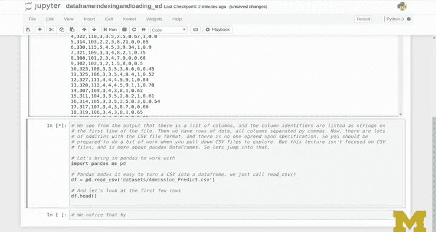

# 课程1-3：DataFrame索引与数据加载 📊


在本节课中，我们将学习如何将外部数据（特别是CSV文件）加载到Pandas的DataFrame中，并掌握一些基本的数据操作技巧，例如设置索引和重命名列。

---

## 概述

数据科学工作流通常始于从外部文件（如CSV文件）读取数据集，然后进行数据清洗和整理，为后续分析做准备。本节将演示如何将逗号分隔值文件加载到DataFrame中，并介绍一些基本的数据操作。

---

## CSV文件简介

CSV文件是一种轻量级且广泛使用的数据格式。任何电子表格软件（如Excel或Google Sheets）都可以将数据保存为CSV格式。这种格式虽然灵活，但缺乏统一标准，因此在处理时可能需要一些额外工作。

以下是CSV文件的一个示例内容：

```bash
!cat datasets/admission_predictions.csv
```

输出显示，文件的第一行是列标识符（字符串形式），随后是数据行，各列之间用逗号分隔。

---

## 将CSV文件加载到DataFrame

上一节我们介绍了CSV文件的基本结构，本节中我们来看看如何使用Pandas将其加载为DataFrame对象。

首先，需要导入Pandas库：

```python
import pandas as pd
```

Pandas提供了`read_csv`函数，可以轻松地将CSV文件转换为DataFrame：

```python
df = pd.read_csv('datasets/admission_predictions.csv')
```



我们可以使用`head`方法查看数据的前几行：

```python
df.head()
```

默认情况下，DataFrame的索引从0开始，而数据中的“学生序列号”可能从1开始。

---

## 设置索引

从上面的输出可以看出，Pandas创建了新的整数索引。如果我们希望将数据中的“序列号”列设置为索引，可以在读取文件时指定`index_col`参数。

以下是设置索引的方法：

```python
df = pd.read_csv('datasets/admission_predictions.csv', index_col=0)
df.head()
```

这样，指定的列（此处为第一列）就成为了DataFrame的索引。

---

## 重命名列

观察数据，我们发现列名`SOP`和`LOR`的含义可能不明确。为了提高可读性，我们可以重命名这些列。

在Pandas中，可以使用`rename`函数来重命名列。该函数接受一个`columns`参数，其值是一个字典，键为旧列名，值为新列名。

以下是重命名列的方法：

```python
new_df = df.rename(columns={
    'SOP': 'Statement of Purpose',
    'LOR ': 'Letter of Recommendation'
})
new_df.head()
```

注意，原始列名`LOR`后面可能包含空格，导致重命名失败。这是一个常见问题，需要特别注意。

---

## 处理列名中的空格

如果列名中包含多余的空格（或其他空白字符），重命名时可能会遇到问题。有几种方法可以处理这种情况。

一种方法是直接在重命名字典中包含空格：

```python
new_df = new_df.rename(columns={'LOR ': 'Letter of Recommendation'})
```

但这种方法不够健壮，如果空白字符是制表符或多个空格，则可能失效。

另一种更通用的方法是使用字符串的`strip`函数来清理所有列名。我们可以将函数引用传递给`rename`的`mapper`参数，并指定应用于列轴（`axis=1`）。

以下是使用`strip`函数清理列名的方法：

```python
new_df = new_df.rename(mapper=str.strip, axis='columns')
new_df.head()
```

这样，所有列名两端的空白字符都会被移除。

需要注意的是，`rename`函数默认返回一个新的DataFrame，原始DataFrame不会被修改。如果需要查看原始DataFrame的列名，可以这样做：

```python
df.columns
```

---

## 直接修改列名

除了使用`rename`函数，我们还可以通过直接给`df.columns`属性赋值来修改列名。这种方法会直接修改原始DataFrame，效率较高，尤其适用于需要修改大量列名的情况。

以下是将所有列名转换为小写并去除空格的示例：

```python
# 获取当前列名列表
cols = list(df.columns)

# 使用列表推导式处理每个列名
cols = [x.lower().strip() for x in cols]

# 将处理后的列表赋值回df.columns
df.columns = cols

# 查看结果
df.head()
```

这种方法不受列名中细微错误的影响，因为我们可以直接操作字符串列表。

---

## 总结

本节课中我们一起学习了如何将CSV文件导入到Pandas的DataFrame中，并掌握了设置索引和重命名列等基本数据操作技能。Pandas的CSV导入功能提供了许多选项，熟练掌握这些选项对于高效进行数据操作至关重要。


一旦设置好数据格式并调整了DataFrame的结构，就为进一步的数据分析和建模打下了坚实的基础。虽然还有其他数据源（如HTML网页、数据库等）可以直接加载到DataFrame中，但CSV是目前最常见的数据格式，掌握在Pandas中处理CSV文件的方法非常重要。