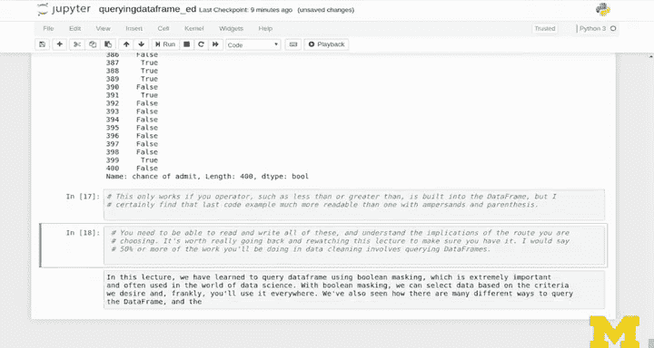

# 18：DataFrame查询技术 🎯


在本节课中，我们将学习如何使用布尔掩码（Boolean Masking）技术来查询Pandas DataFrame。这是数据科学中筛选和提取感兴趣数据的核心技能。

## 概述：理解布尔掩码

上一节我们介绍了DataFrame的基本结构，本节中我们来看看如何高效地从DataFrame中查询数据。这个过程的第一步是理解布尔掩码。

布尔掩码是高效查询NumPy和Pandas数据的核心。它在概念上类似于计算机科学其他领域中使用的位掩码。通过本节课的学习，你将理解布尔掩码的工作原理，以及如何将其应用于DataFrame以获取你感兴趣的数据。

一个布尔掩码是一个数组，可以是一维的（如Series）或二维的（如DataFrame），其中数组的每个值要么是`True`，要么是`False`。这个数组本质上覆盖在我们正在查询的其他数据结构之上。任何与`True`值对齐的单元格将被纳入最终结果，任何与`False`值对齐的单元格则不会。

让我们来看一个例子。

## 创建布尔掩码

首先，我们导入研究生录取数据集作为示例。

以下是导入和准备数据的步骤：

```python
import pandas as pd

df = pd.read_csv('graduate_admissions.csv', index_col=0)
df.columns = [x.lower().strip() for x in df.columns]
```

布尔掩码是通过将运算符直接应用于Pandas Series或DataFrame对象来创建的。

例如，在我们的研究生录取数据集中，我们可能只对查看录取概率高于0.7的学生感兴趣。为了构建这个查询的布尔掩码，我们使用索引运算符投影“录取概率”列，并应用大于运算符与比较值0.7。这本质上是广播一个比较运算符（大于），结果以布尔Series的形式返回。

```python
admit_mask = df['chance_of_admit'] > 0.7
```

生成的Series被索引，其中每个单元格的值是`True`或`False`，取决于学生的录取概率是否高于0.7。

这是非常基础的操作。花点时间看看这个。广播比较运算符的结果是一个布尔掩码，根据比较结果返回`True`或`False`值。

在底层，Pandas通过向量化应用你指定的比较运算符。它高效且并行地处理你指定数组中的所有值（在本例中是DataFrame的“录取概率”列）。结果是一个Series对象（因为只操作了一列），其中填充了`True`或`False`值，这就是比较运算符返回的内容。

## 应用布尔掩码

一旦形成了布尔掩码，你可以用它做什么呢？你可以简单地将其覆盖在数据上，以隐藏你不想要的数据（由所有`False`值表示）。

我们通过在原始DataFrame上使用`.where()`函数来实现这一点。

```python
filtered_df = df.where(admit_mask).head()
```

我们看到生成的DataFrame保留了原始的索引值，只有满足条件的数据被保留。所有不满足条件的行都有`NaN`数据，但这些行并没有从我们的数据集中删除。它们仍然在那里，只是不是数字。

下一步当然是，如果我们不想要`NaN`数据，就使用`.dropna()`函数。这很常见。

```python
filtered_df = df.where(admit_mask).dropna().head()
```

现在返回的DataFrame已经删除了所有`NaN`行。注意，索引现在包括1到4和6，但不包括5。

## 简写索引语法

尽管`.where()`非常方便，但实际上并不常用。相反，Pandas开发者创建了一种简写语法，它结合了`.where()`和`.dropna()`，一次性完成两个操作。以典型的方式，他们重载了索引运算符来实现这一点。

以下是一个例子：

```python
filtered_df = df[df['chance_of_admit'] > 0.7].head()
```

我个人觉得这个更难阅读，但当你阅读其他人的代码时非常常见，所以理解它并能编写它很重要。

回顾一下DataFrame上的索引运算符，它现在可以做三件事：

1.  可以用字符串参数调用以投影单个列：`df['gre_score'].head()`
2.  可以发送一个字符串列表作为列：`df[['gre_score', 'toefl_score']]`
3.  可以发送一个布尔掩码：`df[df['gre_score'] > 320].head()`

这些中的每一个都模仿了`.loc`或`.where().dropna()`的功能。

## 组合多个布尔掩码

在我们结束之前，让我们讨论一下组合多个布尔掩码，例如包含的多个条件。在计算机科学其他地方的位掩码中，这是通过`AND`（如果两个掩码都必须为`True`才能得到最终掩码中的`True`值）或`OR`（如果只需要一个为`True`）来完成的。

不幸的是，在Pandas中感觉不那么自然。例如，如果你想对两个布尔Series进行`AND`操作：

```python
# 这是错误的写法，会导致错误
df['chance_of_admit'] > 0.7 and df['chance_of_admit'] < 0.9
```

尽管使用Pandas有一段时间了，我实际上发现我经常尝试做我刚才做的事情。问题是，你有一个Series对象，而底层的Python不知道如何使用`and`或`or`来比较两个Series。相反，Pandas的作者重写了管道`|`和`&`运算符来处理这个问题。

所以我们必须这样写：

```python
combined_mask = (df['chance_of_admit'] > 0.7) & (df['chance_of_admit'] < 0.9)
```

这里我们可以看到这是我们两个布尔掩码的组合，即按位`AND`。

需要注意的另一件事是操作顺序。这也经常困扰我。新Pandas用户的一个常见错误是尝试使用`&`运算符进行布尔比较，但没有在感兴趣的各个项周围加上括号。

```python
# 这也是错误的，会导致错误
df['chance_of_admit'] > 0.7 & df['chance_of_admit'] < 0.9
```

问题是Python试图对0.7和一个Pandas DataFrame进行按位`AND`操作，而你真正想要的是将DataFrame广播在一起进行按位`AND`。

## 使用内置函数

另一种方法是完全摆脱比较运算符，转而使用内置函数来模拟这种方法。

```python
combined_mask = df['chance_of_admit'].gt(0.7) & df['chance_of_admit'].lt(0.9)
```

这些函数内置于Series和DataFrame对象中，所以你实际上也可以链式调用它们，这会产生相同的答案，并且不使用视觉运算符。

```python
combined_mask = df['chance_of_admit'].gt(0.7).lt(0.9)
```

你可以决定哪种看起来最好。这只在你的运算符（如小于或大于）内置于DataFrame中时才有效，但我当然发现最后一个代码示例比带有`&`和括号的那个可读性更强，所以你可能想考虑使用这个。

你需要能够阅读和编写所有这些，并理解你选择的路径的含义。值得回过头来重新观看这节课，以确保你掌握了它。我会说，你在数据清理工作中50%或更多的工作都涉及查询DataFrame。

## 总结




本节课中我们一起学习了使用布尔掩码查询DataFrame，这在数据科学领域极其重要且经常使用。通过布尔掩码，我们可以根据定义的标准选择数据，坦白说，你会在任何地方使用这个。我们还看到了查询DataFrame的多种不同方式，以及这样做时出现的有趣影响。