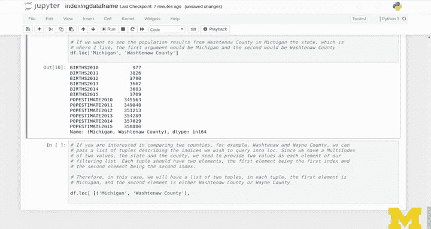

# 课程3：Pandas DataFrame索引操作详解 🗂️


在本节课中，我们将要学习Pandas中DataFrame索引的核心概念与操作方法。索引是高效数据访问和操作的基础，理解其工作原理对于数据科学实践至关重要。

## 概述

索引本质上是行级别的标签。在Pandas中，行对应轴0。索引可以是自动生成的，例如创建没有指定索引的Series时会得到数值索引；也可以显式设置，例如使用字典对象创建Series，或从CSV文件加载数据时设置相应参数。

## 设置索引

设置索引的另一种方法是使用`set_index`函数。该函数接收一个列名列表，并将这些列提升为索引。本节我们将深入探索索引在Pandas中的工作原理。

`set_index`函数是一个破坏性过程，它不会保留当前索引。如果想保留当前索引，需要手动创建新列并将索引属性的值复制到该列中。

以下是设置索引的步骤：

1.  导入Pandas并加载数据
2.  将现有索引保存到新列
3.  使用`set_index`设置新索引

```python
import pandas as pd

# 加载数据
df = pd.read_csv('data/admissions_predict.csv', index_col=0)

# 查看数据前几行
df.head()
```

假设我们不想用序列号索引DataFrame，而是用录取概率。同时，我们想保留序列号以备后用。为此，我们可以将序列号保存在新列中。

```python
# 将当前索引复制到名为'serial_number'的新列
df['serial_number'] = df.index

# 将索引设置为'chance_of_admit'列
df = df.set_index('chance_of_admit')
df.head()
```

可以看到，当从现有列创建新索引时，索引会有一个名称，即该列的原始名称。

## 重置索引

我们可以通过调用`reset_index`函数完全移除索引。这会将索引提升为一列，并创建一个默认的数字索引。

```python
df = df.reset_index()
df.head()
```

现在，“chance_of_admit”被提升回一列，我们有了一个数字索引。

## 多级索引

Pandas的一个优秀特性是多级索引，这类似于关系数据库系统中的复合键。要创建多级索引，我们只需调用`set_index`并提供一个我们想要提升为索引的列名列表。Pandas将按顺序搜索这些列，找到不同的数据并形成复合索引。处理按地区或人口统计信息排序的地理数据时，常能见到这种索引的好例子。

为了更好地说明，让我们换个数据集，查看一些人口普查数据。

```python
# 加载人口普查数据
df = pd.read_csv('data/census.csv')
df.head()
```

在这个数据集中，有两个汇总级别：一个包含整个国家的汇总数据，另一个包含每个州的汇总数据。

我想查看此DataFrame中给定列的所有唯一值列表。我们看到“SUMLEV”列的可能值可以使用DataFrame的`unique`函数查看，这类似于SQL中的`DISTINCT`操作符。

```python
# 查看'SUMLEV'列的唯一值
df['SUMLEV'].unique()
```

我们看到实际上只有两个不同的值：40和50。

让我们排除所有州级别的汇总行，只保留县级数据。

```python
# 只保留县级数据（SUMLEV == 50）
df = df[df['SUMLEV'] == 50]
df.head()
```

此外，虽然这些数据因多种原因而有趣，但让我们将查看的数据减少到仅包含总人口估计值和总出生人数。我们可以通过创建一个要保留的列名列表，然后投影这些列，并将结果DataFrame赋值给变量来实现。

```python
# 定义要保留的列
columns_to_keep = ['STNAME', 'CTYNAME',
                   'BIRTHS2010', 'BIRTHS2011', 'BIRTHS2012', 'BIRTHS2013', 'BIRTHS2014', 'BIRTHS2015',
                   'POPESTIMATE2010', 'POPESTIMATE2011', 'POPESTIMATE2012', 'POPESTIMATE2013', 'POPESTIMATE2014', 'POPESTIMATE2015']

# 投影这些列
df = df[columns_to_keep]
df.head()
```

数据量变小了，但仍然足够大。

## 创建州和县的多级索引

美国人口普查数据按州和县细分人口估计。我们可以加载数据并将索引设置为州和县值的组合，看看Pandas如何在DataFrame中处理它。

我们通过创建一个想要构成索引的列标识符列表，然后使用此列表调用`set_index`，并适当分配输出来实现。我们可以有一个双重索引：首先是州名，其次是县名。

```python
# 设置多级索引：州名和县名
df = df.set_index(['STNAME', 'CTYNAME'])
df.head()
```

这种呈现方式很好地展示了县是如何在州内组织的。

## 查询多级索引数据

一个直接出现的问题是我们如何查询这个DataFrame。之前我们看到，DataFrame的`.loc`属性可以接受多个参数，并且可以同时查询行和列。使用多级索引时，必须按要查询的级别顺序提供参数。

在索引内部，每一列称为一个级别，最外层的列是级别0。

如果我想查看密歇根州沃什特瑙县（我居住的地方）的人口结果，第一个参数应该是“Michigan”，第二个是“Washtenaw County”。

```python
# 查询特定州和县的数据
df.loc['Michigan', 'Washtenaw County']
```

如果想比较两个县，例如沃什特瑙县和韦恩县，我们可以将一个描述我们想要查询的索引的元组列表传递给`.loc`属性。

由于我们有一个包含两个值（州和县）的多级索引，我们需要为过滤列表中的每个元素提供两个值。每个元组应有两个元素：第一个元素是第一个索引，第二个元素是第二个索引。

在这种情况下，我们想要一个包含两个元组的列表。在每个元组中，第一个元素是“Michigan”，第二个元素是“Washtenaw County”或“Wayne County”。

```python
# 查询多个县的数据
df.loc[[('Michigan', 'Washtenaw County'), ('Michigan', 'Wayne County')]]
```



## 多级索引的灵活性

以上就是分层索引的简要工作原理。它们是Pandas库的一个特殊部分，我认为可以使数据的管理和推理更容易。

当然，分层标签不仅适用于行。例如，你可以转置这个矩阵，现在就有了分层的列标签。投影具有这些标签的单个列的工作方式完全符合你的预期。

实际上，我并不经常使用分层索引，而是将所有内容都保留为列并进行操作。但这是Pandas一个独特而复杂的方面，了解它很有用，尤其是在以表格形式查看数据时。

## 总结


本节课中，我们一起学习了Pandas DataFrame索引的核心操作。我们从设置和重置单个索引开始，然后深入探讨了强大的多级索引功能，它允许我们使用州和县的组合来高效地组织和查询数据。我们学习了如何使用`.set_index()`创建索引，使用`.reset_index()`恢复默认索引，以及如何使用`.loc`访问器精确查询多级索引数据。理解这些索引技术是有效管理和分析结构化数据的关键。