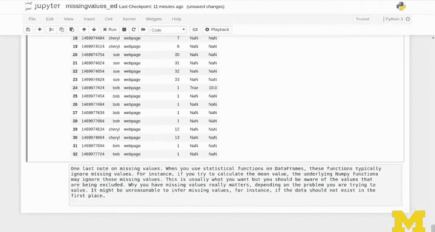

# 课程名称：密歇根大学《Python用于数据科学实践》第20课：缺失值处理 📊


## 概述

在本节课中，我们将要学习如何使用Pandas库处理数据中的缺失值。缺失值是数据清洗过程中的常见问题，理解其成因并掌握有效的处理方法至关重要。我们将探讨缺失值的类型、检测方法以及多种填充和替换策略。

---

## 缺失值的成因

上一节我们介绍了缺失值的概念，本节中我们来看看缺失值出现的常见原因。缺失值可能由多种原因导致。

以下是两个主要示例：
*   **随机缺失**：例如，在调查中受访者未回答问题。如果缺失情况与其他变量（如性别、种族）存在关联，则称为“随机缺失”。
*   **完全随机缺失**：如果缺失情况与其他任何变量都无关，则称为“完全随机缺失”。

此外，数据缺失还可能是因为未被收集。这在合并来自多个来源的数据框时极为常见。例如，将大学人员名单与大学办公室名单合并时，学生通常没有办公室，但仍然是大学的一员。

---

## 在Pandas中检测缺失值

了解了缺失值的成因后，我们来看看如何在Pandas中识别它们。首先导入Pandas库。

```python
import pandas as pd
```

Pandas能够很好地从CSV等底层数据格式中直接检测缺失值。通常，缺失值被格式化为`NaN`、`null`、`None`或`NA`。但有时缺失值的标记并不明确，例如在某些数据中用`99`表示缺失。`read_csv`函数的`na_values`参数允许我们指定缺失值的格式。

让我们加载一个名为`class_grades.csv`的数据文件。

```python
df = pd.read_csv('class_grades.csv')
print(df.head(10))
```

我们可以使用`.isnull()`函数为整个数据框创建一个布尔掩码。这个函数会广播到数据框的每个单元格。

```python
mask = df.isnull()
print(mask.head())
```

这有助于基于特定数据列处理行。另一个有用的操作是使用`dropna()`函数删除所有包含缺失数据的行。

```python
print(df.dropna().head())
```

注意，索引为2、3、7和11的行都消失了。

---

## 填充缺失值

检测到缺失值后，下一步通常是处理它们。Pandas提供了一个方便的`fillna()`函数来填充缺失值。

该函数接受多个参数。你可以传入一个**标量值**，将所有缺失数据更改为该值。例如，将所有缺失值填充为0。

```python
df.fillna(0, inplace=True) # inplace=True表示原地修改，不返回副本
print(df.head())
```

`inplace`属性使Pandas直接修改原数据框，而不是返回一个副本。

此外，如果空格本身是有意义的值，可以使用`na_filter=False`选项来关闭空格过滤。在没有缺失值的大型文件中，这可以提高读取性能。

---

## 缺失值中的信息

有时，缺失值本身可能包含信息。让我举一个自己研究中的例子。我经常处理在线学习系统的日志。在讲座录制系统中，播放器通常有心跳功能，每隔一段时间（例如30秒）向服务器发送播放统计信息。

如果加载数据文件`log.csv`，我们可以看到这种情况。

```python
df = pd.read_csv('log.csv')
print(df.head())
```

在这个数据中，第一列是Unix时间戳，接着是用户名、访问的网页和播放的视频。每一行都有一个播放位置。随着播放位置每次增加1，时间戳大约增加30秒。然而，用户Bob暂停了播放，因此时间增加时，播放位置没有变化。注意，数据并未按时间戳排序，这在并行度高的系统中并不少见。

`paused`（暂停）和`volume`（音量）列中有很多缺失值。如果信息没有变化，通过网络发送这些信息并不高效，因此系统通常只在变化时发送，否则在数据库中插入空值。

---

## 向前填充与向后填充

接下来是`fillna()`的`method`参数。两种常见的填充方法是`ffill`（向前填充）和`bfill`（向后填充）。

*   **`ffill`**：用前一行的有效值填充当前缺失值。
*   **`bfill`**：用后一行的有效值填充当前缺失值。

需要注意的是，为了使填充达到预期效果，数据需要**排序**。来自传统数据库管理系统的数据通常没有顺序保证。在Pandas中，我们可以按索引或值排序。

```python
# 将时间戳设为索引并排序
df = df.set_index('timestamp')
df = df.sort_index()
print(df.head())
```

现在我们有按时间戳排序的数据了。但仔细观察输出，会发现索引并不唯一，两个用户可能同时使用系统。这是常见情况。让我们重置索引，并使用时间和用户一起建立多级索引来处理这个问题。

```python
df = df.reset_index()
df = df.set_index(['timestamp', 'user'])
print(df.head())
```

现在数据已适当索引和排序，我们可以使用`ffill`填充缺失值。处理缺失值时，可以只处理单个或部分列，而不必一次性修复所有缺失值。

```python
df = df.fillna(method='ffill')
```

---

## 使用`replace`函数替换值

除了填充，我们还可以使用`replace`函数进行自定义替换。它支持多种替换方式：值对值、列表、字典、正则表达式。

让我们生成一个简单的例子。

```python
df = pd.DataFrame({
    'A': [1, 1, 2, 3, 4],
    'B': [3, 6, 3, 8, 9],
    'C': list('abcde')
})
```

**值对值替换**：将1替换为100。

```python
df.replace(1, 100, inplace=True)
```

**列表替换**：将1替换为100，将3替换为300。

```python
df.replace([1, 3], [100, 300], inplace=True)
```

**正则表达式替换**：Pandas的替换功能也支持正则表达式。让我们再看一下来自`log.csv`的数据集。

```python
df = pd.read_csv('log.csv')
print(df.head())
```

要使用正则表达式替换，我们将第一个参数设为要匹配的模式，第二个参数设为替换值，并传递第三个参数`regex=True`。

假设我们想检测`video`列中所有以`.html`结尾的HTML页面，并将其替换为关键词“web page”。我们该如何实现？

以下是解决方案：匹配任意数量的字符，然后以`.html`结尾。

```python
df.replace('.*\.html$', 'web page', regex=True, inplace=True)
```

我们看到这达到了预期效果。

---

## 关于缺失值的最后说明

在数据框上使用统计函数时，这些函数通常会忽略缺失值。例如，在计算数据框的平均值时，底层的NumPy函数可能会忽略这些缺失值。这通常是期望的行为，但你应该清楚哪些值被排除了。

缺失值的成因至关重要，它取决于你要解决的问题。在某些情况下，推断缺失值可能是不合理的，例如，如果数据本身就不应该存在。

---

## 总结




本节课中我们一起学习了Pandas中处理缺失值的核心方法。我们探讨了缺失值的不同类型和成因，学习了如何使用`.isnull()`检测缺失值，以及使用`.dropna()`删除含缺失值的行。重点掌握了使用`.fillna()`进行标量填充、向前填充和向后填充的技巧，并了解了如何使用`.replace()`函数进行灵活的值替换，包括支持正则表达式。最后，我们认识到在统计分析中，缺失值通常会被自动忽略，但理解其背后的原因对正确分析数据至关重要。掌握这些技能将为你后续的数据清洗和分析工作打下坚实基础。