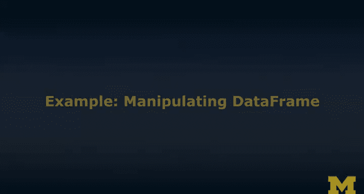
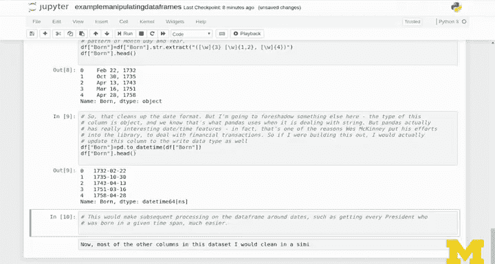

# 课程1-3：DataFrame操作实例 🧹




在本节课中，我们将学习一个基本的数据清洗流程，并介绍几个实用的Pandas API函数。我们将使用一个从维基百科获取的美国总统名单数据集，演示如何拆分姓名、清理日期格式，并探索`apply`函数和`str`模块的用法。

---

## 导入数据

首先，我们需要导入Pandas库并加载数据。

```python
import pandas as pd
df = pd.read_csv('datasets/presidents.csv')
df.head()
```

数据集中包含总统姓名、日期等信息。B列包含许多脚注，可能会带来问题。我们将从清理“姓名”列开始，将其拆分为“名”和“姓”。

---

## 拆分姓名列

我们的目标是将“President”列拆分成“First Name”和“Last Name”两列。我们将尝试几种不同的方法。

### 方法一：使用`replace`函数

一种方法是复制“President”列，然后使用正则表达式替换掉姓氏部分。

```python
df['first'] = df['president']
df['first'] = df['first'].replace(r'\s\w+', '', regex=True)
df.head()
```

这种方法虽然有效，但效率较低，因为它需要复制整个列然后更新字符串。

### 方法二：使用`apply`函数

`apply`函数可以将一个自定义函数应用到DataFrame的每一行或每一列。这是一种更通用的方法。

首先，删除之前创建的列。

```python
del df['first']
```

接下来，定义一个函数来拆分姓名。

```python
def split_name(row):
    row['first'] = row['president'].split(' ')[0]
    row['last'] = row['president'].split(' ')[-1]
    return row

df = df.apply(split_name, axis='columns')
df.head()
```

这个函数提取了空格分隔的第一个单词作为名，最后一个单词作为姓。`apply`函数会负责将结果合并回DataFrame。

### 方法三：使用`str.extract`函数

Pandas的`str`模块提供了专门处理字符串的向量化函数，效率更高。`extract`函数可以使用正则表达式的捕获组来提取内容。

首先，再次删除之前创建的列。

```python
del df['first']
del df['last']
```

然后，使用`extract`函数。我们需要一个能捕获“名”和“姓”的正则表达式。

```python
pattern = r'^(\w+)\s(?:.*\s)?(\w+)$'
names = df['president'].str.extract(pattern)
names.head()
```

为了得到更好的列名，我们可以使用命名捕获组。

```python
pattern = r'^(?P<first>\w+)\s(?:.*\s)?(?P<last>\w+)$'
names = df['president'].str.extract(pattern)
df['first'] = names['first']
df['last'] = names['last']
df.head()
```

`str`模块包含许多用于数据清洗的实用函数，建议查阅官方文档的“Working with text”部分以了解更多。

---

## 清理日期列

接下来，我们清理“Born”列，使其符合“日 月 年”的格式，并将其转换为更易处理的日期时间类型。

我们使用`str.extract`来提取标准日期格式的部分。

```python
df['born'] = df['born'].str.extract(r'([A-Za-z]+\s\d{1,2}\s\d{4})')
df.head()
```

虽然格式已清理，但该列的数据类型仍是“object”（字符串）。为了便于后续的日期操作（例如，筛选特定时间范围内出生的总统），我们将其转换为Pandas的`datetime`类型。

```python
df['born'] = pd.to_datetime(df['born'])
```

Pandas的日期时间功能非常强大，是处理时间序列数据的利器。

---

## 总结与练习建议

本节课中，我们一起学习了DataFrame的基本数据清洗操作。

我们介绍了三种拆分姓名列的方法：`replace`、`apply`和`str.extract`。其中，`str`模块的函数基于正则表达式且是向量化的，通常具有更高的效率。我们还演示了如何清理和转换日期列。

对于数据集中的其他列，可以采用类似的模式进行清洗。建议你暂停视频，打开配套的Notebook，尝试独立完成整个DataFrame的清理工作，这将是一个很好的练习。

**核心要点回顾：**
*   **`apply`函数**：适用于复杂的自定义行/列操作。
*   **`str`模块**（如`extract`）：专门用于向量化的字符串处理，效率高。
*   **`pd.to_datetime`函数**：将字符串列转换为日期时间类型，便于时间序列分析。




通过掌握这些工具，你将能够更有效地准备和清洗数据，为后续的数据分析工作打下坚实基础。