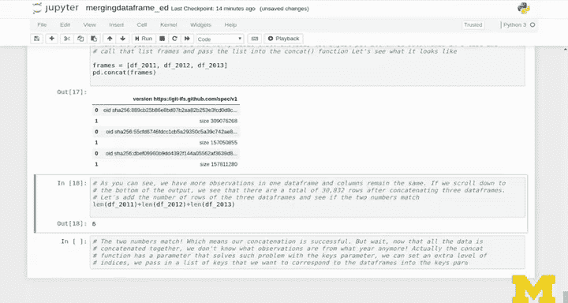

# 22：DataFrame 合并技术 📊


在本节课中，我们将学习如何将多个 DataFrame 对象组合在一起，无论是通过水平合并还是垂直拼接。

## 概述

数据通常存储在不同的表格或文件中。为了进行分析，我们需要将这些数据整合到一起。Pandas 提供了两种主要方法：`merge`（合并）和 `concat`（拼接）。`merge` 用于基于共同列（键）水平连接数据，而 `concat` 用于垂直堆叠具有相同结构的数据。

---

## 关系理论与术语

在深入代码之前，我们需要了解一些关系型数据库的理论和术语约定。这里用一张维恩图来帮助理解这些概念。

维恩图传统上用于展示集合的成员关系。例如，左边的圆圈代表一所大学的所有学生，右边的圆圈代表所有教职工，中间重叠的区域则是那些既是学生又是教职工的人（例如担任助教或参与研究的学生）。

这张图展示了我们可能拥有数据的两个群体，但它们之间存在重叠。在 Pandas 中，我们可以将这两个群体视为两个独立的 DataFrame，可能以人名作为索引。当我们想要合并这些 DataFrame 时，需要做出一些选择。

以下是几种主要的合并类型：

*   **完全外连接**：获取所有人的列表，无论他们是教职工还是学生，并包含数据库中能获取到的所有信息。在集合论中，这被称为**并集**。在维恩图中，它代表任何一个圆圈内的所有人。
*   **内连接**：只获取那些同时是教职工和学生的、信息最全的人员列表。在数据库术语中，这被称为**内连接**，在集合论中称为**交集**。在维恩图中，它代表两个圆圈重叠的部分。

有了这个背景知识，让我们看看在 Pandas 中如何实现。

---

## 使用 `merge` 函数

首先导入 Pandas。

```python
import pandas as pd
```

### 创建示例数据

创建两个 DataFrame：`staff_df` 和 `students_df`。

```python
# 创建教职工 DataFrame
staff_df = pd.DataFrame([{'Name': 'Kelly', 'Role': 'Director of HR'},
                         {'Name': 'Sally', 'Role': 'Course Liaison'},
                         {'Name': 'James', 'Role': 'Grader'}])
# 设置姓名为索引
staff_df = staff_df.set_index('Name')

# 创建学生 DataFrame
students_df = pd.DataFrame([{'Name': 'James', 'School': 'Business'},
                            {'Name': 'Mike', 'School': 'Law'},
                            {'Name': 'Sally', 'School': 'Engineering'}])
# 设置姓名为索引
students_df = students_df.set_index('Name')

# 查看数据
print(staff_df.head())
print(students_df.head())
```

这两个 DataFrame 在 “James” 和 “Sally” 上存在重叠，但 “Mike” 和 “Kelly” 是唯一的。重要的是，两个 DataFrame 都按我们想要合并的列（即“姓名”）建立了索引。

### 执行合并操作

**1. 完全外连接**

要获取并集（所有人），我们使用 `merge` 函数，指定 `how='outer'`，并告知函数使用左右两侧的索引作为连接键。

```python
# 完全外连接
outer_merged = pd.merge(staff_df, students_df, how='outer', left_index=True, right_index=True)
print(outer_merged)
```

结果 DataFrame 列出了所有人。由于 “Mike” 没有角色信息，“Kelly” 没有学校信息，这些单元格显示为缺失值（NaN）。

**2. 内连接**

要获取交集（仅是既是教职工又是学生的人），我们将 `how` 参数设置为 `'inner'`。

```python
# 内连接
inner_merged = pd.merge(staff_df, students_df, how='inner', left_index=True, right_index=True)
print(inner_merged)
```

结果 DataFrame 只包含 “James” 和 “Sally”。

### 左连接与右连接

合并 DataFrame 时还有另外两种常见用例，它们都是**集合加法**的例子。

**3. 左连接**

获取所有教职工的列表，无论他们是否是学生。但如果他们也是学生，我们也希望获取其学生详细信息。这需要用到**左连接**。注意，函数中第一个 DataFrame 是左表，第二个是右表。

```python
# 左连接 (以教职工表为基准)
left_merged = pd.merge(staff_df, students_df, how='left', left_index=True, right_index=True)
print(left_merged)
```

**4. 右连接**

获取所有学生的列表，以及他们的角色（如果他们同时也是教职工）。这需要用到**右连接**。

```python
# 右连接 (以学生表为基准)
right_merged = pd.merge(staff_df, students_df, how='right', left_index=True, right_index=True)
print(right_merged)
```

### 使用 `on` 参数合并列

`merge` 方法不需要一定使用索引进行连接，也可以使用列。`on` 参数可以指定两个 DataFrame 共有的列名作为连接键。

首先，重置索引，使“姓名”变回列。

```python
staff_df_reset = staff_df.reset_index()
students_df_reset = students_df.reset_index()
```

现在使用 `on` 参数进行合并。

```python
# 使用 on 参数进行右连接
merged_on_name = pd.merge(staff_df_reset, students_df_reset, how='right', on='Name')
print(merged_on_name)
```

使用 `on` 参数而不是索引，是更常见的 `merge` 使用方式。

---

## 处理列名冲突

当两个 DataFrame 有同名的列，但含义不同时会发生什么？让我们创建包含位置信息的新 DataFrame 来看看。

```python
# 创建包含位置信息的新 DataFrame
staff_df_new = pd.DataFrame([{'Name': 'Kelly', 'Role': 'Director of HR', 'Location': 'State Street'},
                             {'Name': 'Sally', 'Role': 'Course Liaison', 'Location': 'Washington Avenue'},
                             {'Name': 'James', 'Role': 'Grader', 'Location': 'Washington Avenue'}])

students_df_new = pd.DataFrame([{'Name': 'James', 'School': 'Business', 'Location': '1024 Billiard Avenue'},
                                {'Name': 'Mike', 'School': 'Law', 'Location': 'Fraternity House #22'},
                                {'Name': 'Sally', 'School': 'Engineering', 'Location': '512 Wilson Crescent'}])
```

在教职工 DataFrame 中，“Location” 是办公室地址；在学生 DataFrame 中，“Location” 是家庭住址。`merge` 函数会保留这些信息，但通过添加后缀 `_x` 或 `_y` 来区分数据来自哪个 DataFrame。`_x` 总是代表左表信息，`_y` 代表右表信息。

```python
# 左连接，观察列名冲突
conflict_merged = pd.merge(staff_df_new, students_df_new, how='left', on='Name')
print(conflict_merged)
```

输出中会出现 `Location_x`（来自左表 staff_df_new）和 `Location_y`（来自右表 students_df_new）两列。

---

## 基于多列合并

有时仅凭一个列（如“名”）不足以唯一标识一行，可能需要结合“姓”等其他列。这时，可以向 `on` 参数传递一个列名列表。

```python
# 创建包含名和姓的 DataFrame
staff_multi = pd.DataFrame([{'First Name': 'Kelly', 'Last Name': 'Desjardins', 'Role': 'Director of HR'},
                            {'First Name': 'Sally', 'Last Name': 'Brooks', 'Role': 'Course Liaison'},
                            {'First Name': 'James', 'Last Name': 'Wilde', 'Role': 'Grader'}])

students_multi = pd.DataFrame([{'First Name': 'James', 'Last Name': 'Hammond', 'School': 'Business'},
                               {'First Name': 'Mike', 'Last Name': 'Smith', 'School': 'Law'},
                               {'First Name': 'Sally', 'Last Name': 'Brooks', 'School': 'Engineering'}])

# 基于多列进行内连接
multi_merged = pd.merge(staff_multi, students_multi, how='inner', on=['First Name', 'Last Name'])
print(multi_merged)
```

由于 “James Wilde” 和 “James Hammond” 的姓氏不同，内连接的结果将只包含 “Sally Brooks”。

---

## 使用 `concat` 进行垂直拼接

上一节我们介绍了基于键值的水平合并 (`merge`)，本节中我们来看看垂直拼接 (`concat`)。如果将合并视为水平连接（基于两个 DataFrame 中共有的列值），那么拼接就是垂直连接（将一个 DataFrame 堆叠在另一个的顶部或底部）。

例如，你有一个按年份跟踪信息的数据集，每年的记录是一个独立的 CSV 文件，且每个文件都有完全相同的列结构。如果你想将所有年份的数据整合在一起，就可以使用拼接。

让我们以美国教育部大学记分卡数据为例，该数据包含每所美国大学的学生毕业率、毕业后债务、收入等信息。数据按年份存储在不同的 CSV 文件中。

假设我们需要 2011 到 2013 年的记录。我们首先创建三个 DataFrame，每个包含一年的记录。由于 CSV 文件可能有些问题，我们使用 `error_bad_lines=False` 来忽略错误行。

```python
# 读取三个年份的数据
df_2011 = pd.read_csv('college_scorecard_2011_12.csv', error_bad_lines=False)
df_2012 = pd.read_csv('college_scorecard_2012_13.csv', error_bad_lines=False)
df_2013 = pd.read_csv('college_scorecard_2013_14.csv', error_bad_lines=False)

# 查看每个 DataFrame 的行数
print(len(df_2011), len(df_2012), len(df_2013))
```

现在，将这三个 DataFrame 放入一个列表，并传递给 `pd.concat()` 函数。

```python
# 将 DataFrame 放入列表
frames = [df_2011, df_2012, df_2013]

# 垂直拼接
concatenated_df = pd.concat(frames)
print(len(concatenated_df)) # 检查总行数是否等于三个年份行数之和
```

拼接后，我们得到了一个包含更多观察值（行）的 DataFrame，而列保持不变。但有一个问题：我们不知道每条记录来自哪一年了。

`concat` 函数有一个 `keys` 参数可以解决这个问题，它能添加一个额外的索引层级来标识原始数据来源。



```python
# 使用 keys 参数添加年份标识
concatenated_df_with_keys = pd.concat(frames, keys=['2011', '2012', '2013'])
print(concatenated_df_with_keys.head())
print(concatenated_df_with_keys.index) # 查看多级索引
```

现在，索引中包含了年份信息，我们可以区分每条观察值来自哪一年。

需要注意的是，`concat` 也有 `join` 参数（默认为 `'outer'`）。如果你拼接的两个 DataFrame 列不完全相同，选择 `join='outer'` 时，缺失的单元格将是 NaN；选择 `join='inner'` 时，将只保留共有的列，并可能因为 NaN 值而丢弃一些行。这类似于 `merge` 函数的外连接和内连接概念。

---

## 总结

本节课中我们一起学习了 Pandas 中组合 DataFrame 的两种核心技术。

*   **`merge` 函数**：用于基于一个或多个共同列（键）**水平合并** DataFrame。我们探讨了不同类型的连接：
    *   `how='outer'`：完全外连接（并集）。
    *   `how='inner'`：内连接（交集）。
    *   `how='left'` / `how='right'`：左连接/右连接。
    *   使用 `on` 参数指定连接列，处理列名冲突，以及基于多列进行合并。
*   **`concat` 函数**：用于**垂直拼接**具有相同列结构的 DataFrame。我们学习了如何使用 `keys` 参数来标记拼接后数据的来源。


熟练掌握如何合并与拼接数据，对于数据获取、清洗和整理至关重要。这些技能能帮助你从不同来源整合数据，进行更复杂深入的分析。建议你查阅 Pandas 官方文档，以了解更多关于连接和拼接的高级选项和细节。