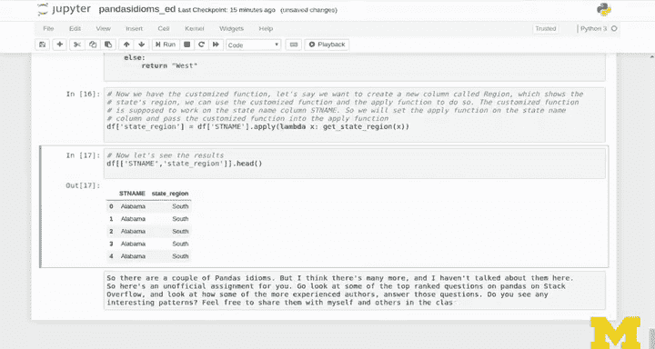

# 课程 23：Pandas 惯用操作 🐼


在本节课中，我们将学习如何编写更符合 Pandas 风格的代码，即“Pandoable”的代码。我们将重点探讨两种核心的 Pandas 惯用法：**方法链式调用**和 **`apply` 函数**的应用。掌握这些技巧能让你的代码更简洁、高效，也更符合社区规范。

---

## 方法链式调用 🔗

上一节我们介绍了编写 Pandas 代码的一些基本概念。本节中，我们来看看第一种惯用法：方法链式调用。其核心思想是，对象上的每个方法都会返回对该对象的引用。这使得我们可以将多个对数据框的操作串联成一行或一个语句，从而让代码更紧凑。

以下是使用链式调用的一个“Pandoable”示例。这段代码的目标是：筛选出汇总级别为50（即县级数据）的行，删除缺失值，将“州名”和“县名”设置为多级索引，并重命名一个列以增强可读性。

```python
(df.where(df['SUMLEV'] == 50)
   .dropna()
   .set_index(['STNAME', 'CTYNAME'])
   .rename(columns={'ESTIMATESBASE2010': 'Estimates Base'}))
```

让我们逐步解析这段代码：
1.  首先，使用 `where` 函数并传入一个布尔掩码，该掩码仅在 `SUMLEV` 列等于50的行上为真。
2.  接着，对 `where` 函数的结果调用 `dropna()` 以删除缺失值。
3.  然后，使用 `set_index` 将索引设置为 `['STNAME', 'CTYNAME']`。
4.  最后，使用 `rename` 将列名 `'ESTIMATESBASE2010'` 改为更易读的名称。

> 注意：为了代码的可读性，我使用括号将整个语句包裹起来，使其可以跨越多行，而不是将所有代码写在一行。

相比之下，下面是一种更传统、非“Pandoable”的写法。它在功能上没有问题，甚至对新手来说可能更易理解，但不如第一个例子那样符合 Pandas 的惯用风格。

```python
# 非链式调用写法
df = df[df['SUMLEV'] == 50]
df.set_index(['STNAME', 'CTYNAME'], inplace=True)
df.rename(columns={'ESTIMATESBASE2010': 'Estimates Base'}, inplace=True)
```

理解任何惯用法的关键在于知道它何时不适用。在这个例子中，我们可以通过计时来比较两种方法的性能。使用 `timeit` 模块进行测试后，我们可能会发现第二种（非链式）方法运行速度更快。这是一个典型的**时间与可读性之间的权衡**。

你会在 Stack Overflow 和官方文档中看到大量使用链式调用的例子。理解这种语法非常重要，也值得你花时间去研究。但请记住，遵循看似风格化的惯用法可能会带来性能问题，这一点也需要考虑，尤其是在处理大规模数据清洗时。

---

## 使用 `apply` 函数进行数据转换 🔄

上一节我们探讨了方法链式调用，本节中我们来看看另一个强大的工具：`apply` 函数。Python 有一个出色的 `map` 函数，它是函数式编程的基础。Pandas 有类似的功能，称为 `applymap`，它会对数据框的每个单元格应用一个函数。但我个人很少使用 `applymap`，更常用的是 `apply` 函数，它可以跨数据框的行或列应用函数。

让我们看一个例子。在我们的普查数据框中，有五个列分别对应不同年份的人口估计值。我们很可能需要创建一些新列来存储每行的最小值和最大值，`apply` 函数可以轻松实现这一点。

首先，我们需要编写一个函数，它接收一行数据，找出其中的最小值和最大值，并返回一个新的序列（Series）。

```python
import numpy as np

def min_max(row):
    data = row[['POPESTIMATE2010', 'POPESTIMATE2011',
                'POPESTIMATE2012', 'POPESTIMATE2013',
                'POPESTIMATE2014', 'POPESTIMATE2015']]
    return pd.Series({'min': np.min(data), 'max': np.max(data)})
```

然后，我们在数据框上调用 `apply` 函数。`apply` 接受要应用的函数和操作的轴作为参数。需要小心的是，参数 `axis=1` 或 `axis=‘columns’` 表示跨所有行应用（即对每一行的所有列进行操作）。

```python
df.apply(min_max, axis='columns').head()
```

当然，你不必局限于返回一个新的序列对象。如果你在进行数据清洗，可能会希望将新数据添加到现有数据框中。在这种情况下，你可以直接修改传入的行数据，为其添加新列。

```python
def min_max(row):
    data = row[['POPESTIMATE2010', 'POPESTIMATE2011',
                'POPESTIMATE2012', 'POPESTIMATE2013',
                'POPESTIMATE2014', 'POPESTIMATE2015']]
    row['max'] = np.max(data)
    row['min'] = np.min(data)
    return row

df.apply(min_max, axis='columns').head()
```

`apply` 是你工具箱中一个极其重要的工具。我在这里介绍它，是因为你很少会看到它像我们刚才那样与大型函数定义一起使用。相反，你通常会看到它与 **Lambda 表达式** 一起使用，以最大限度地简化代码。

以下是一个使用 Lambda 表达式和 `apply` 计算每行最大值的单行示例：

```python
rows = ['POPESTIMATE2010', 'POPESTIMATE2011',
        'POPESTIMATE2012', 'POPESTIMATE2013',
        'POPESTIMATE2014', 'POPESTIMATE2015']
df.apply(lambda x: np.max(x[rows]), axis=1).head()
```

> 如果你不记得 Lambda 表达式，可以简单回顾一下：Lambda 是 Python 中的匿名函数。在这个例子中，它接受一个参数 `x`（即一行数据），并返回该行指定列的最大值。

`apply` 函数的优点在于其灵活性，你可以传入任何自定义函数来完成所需的操作。例如，假设我们想根据州名将各州划分为东北部、中西部、南部和西部四个区域。

首先，我们编写一个自定义函数来根据州名返回区域：

```python
def get_state_region(x):
    northeast = ['Connecticut', 'Maine', 'Massachusetts', ...]
    midwest = ['Illinois', 'Indiana', 'Iowa', ...]
    south = ['Alabama', 'Arkansas', 'Delaware', ...]
    west = ['Alaska', 'Arizona', 'California', ...]

    if x in northeast:
        return 'Northeast'
    elif x in midwest:
        return 'Midwest'
    elif x in south:
        return 'South'
    elif x in west:
        return 'West'
```

然后，我们可以使用 `apply` 函数将这个自定义函数应用到 `STNAME` 列上，以创建一个名为 `state_region` 的新列：

```python
df['state_region'] = df['STNAME'].apply(lambda x: get_state_region(x))
df[['STNAME', 'state_region']].head()
```

---

## 总结 📝

本节课中，我们一起学习了两种关键的 Pandas 惯用操作。

1.  **方法链式调用**：通过将多个操作串联成一个流畅的语句，使代码更加简洁和可读。但需要注意，在某些情况下，传统的分步写法可能具有更好的性能。
2.  **`apply` 函数**：这是一个极其灵活的工具，允许你跨数据框的行或列应用任何自定义函数，无论是用于计算汇总统计量还是进行复杂的数据转换。结合 Lambda 表达式使用，可以写出非常简洁有力的代码。




Pandas 社区还有许多其他的惯用法。我给大家留一个非正式的任务：去 Stack Overflow 上查看一些关于 Pandas 的高票问题，观察经验丰富的作者是如何回答的。你能发现哪些有趣的模式？欢迎与我和课程中的其他同学分享，让我们一起探索更多“Pandoable”的代码风格。