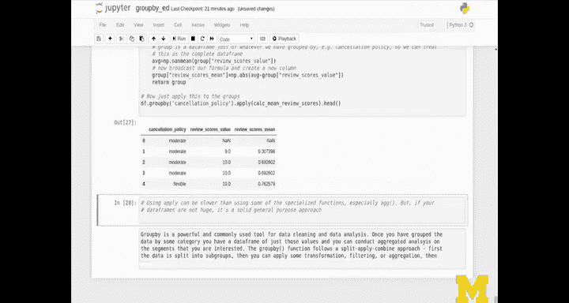

# 24：分组聚合 (GroupBy) 📊


在本节课中，我们将学习 Pandas 库中一个极其强大的功能：`groupby`。我们将了解如何根据特定条件将数据分割成组，然后对每个组进行聚合、转换或过滤操作，最后将结果合并。这是数据分析中“拆分-应用-合并”模式的经典实现。

---

## 概述

有时我们需要基于分组来选择数据，并在组级别上理解聚合后的数据。虽然可以通过迭代数据框的每一行来实现，但这种方法通常非常慢。幸运的是，Pandas 的 `groupby` 函数可以极大地加速这类任务。

`groupby` 的核心思想是：它接收一个数据框，根据某些键值将其拆分成块，然后对这些块应用计算，最后将结果组合回另一个数据框中。在 Pandas 中，这被称为“拆分-应用-合并”模式。

---

## 导入库与数据准备

首先，我们需要导入必要的库并加载数据。

```python
import pandas as pd
import numpy as np
```

我们将使用一些美国人口普查数据。我们读取数据，并排除州级别的汇总（其 `sumlev` 值为 40），只保留县级数据（`sumlev` 值为 50）。

```python
df = pd.read_csv('datasets/census.csv')
df = df[df['sumlev'] == 50]
print(df.head())
```

---

## 传统迭代方法 vs. GroupBy 方法

### 传统迭代方法

在第一个例子中，我们想计算每个州的平均人口。传统方法是获取所有唯一州的列表，然后遍历每个州，筛选数据并计算平均值。

以下是使用传统方法的代码，并使用 `%%timeit` 魔法命令测量其运行时间：

```python
%%timeit -n 3
for state in df['state_name'].unique():
    avg = np.average(df.where(df['state_name'] == state).dropna()['CENSUS2010POP'])
    print(f'Counties in state {state} have an average population of {avg}')
```

可以看到，这种方法需要相当长的时间才能完成。

### 使用 GroupBy 方法

现在，让我们尝试使用 `groupby` 的另一种方法。

```python
%%timeit -n 3
for group, frame in df.groupby('state_name'):
    avg = np.average(frame['CENSUS2010POP'])
    print(f'Counties in state {group} have an average population of {avg}')
```

`groupby` 返回一个元组，其中第一个值是分组键（例如州名），第二个值是属于该组的数据框。这种方法在速度上有巨大的提升。

---

## 使用函数进行分组

大多数时候，你会根据一列或多列进行分组。但你也可以提供一个函数给 `groupby` 来分割数据。

这是一个稍微构造的例子。假设你有一个包含大量处理的大批量作业，并且你只想在给定时间处理大约三分之一的数据。我们可以创建一个函数，根据州名的首字母返回 0 到 2 之间的数字。

首先，需要将数据框的索引设置为要分组的列。

```python
def set_batch(item):
    if item[0] < 'M':
        return 0
    elif item[0] < 'Q':
        return 1
    else:
        return 2

df = df.set_index('state_name')
for group, frame in df.groupby(set_batch):
    print(f'There are {len(frame)} records in group {group} for processing.')
```

请注意，这次我们没有向 `groupby` 传递列名，而是将数据框的索引设置为 `state_name`。如果没有传递列标识符，`groupby` 会自动使用该索引。

---

## 多级索引与复杂分组

让我们再看一个如何分组数据的例子。在这个例子中，我们将使用 Airbnb 的房源数据集。我们感兴趣的两列是 `cancellation_policy`（取消政策）和 `review_scores_value`（评分值）。

```python
df = pd.read_csv('datasets/listings.csv')
print(df.head())
```

### 使用多级索引分组

一种方法是将其提升为多级索引，然后调用 `groupby`。

```python
df = df.set_index(['cancellation_policy', 'review_scores_value'])
for group, frame in df.groupby(level=[0, 1]):
    print(group)
```

当我们有一个多级索引时，需要传入我们感兴趣的分组级别。默认情况下，`groupby` 不知道也不会假设你想要按所有级别分组。

### 使用函数管理分组

如果我们想按取消政策和评分分组，但将 10 分与其他分数分开，可以使用函数来管理分组。

```python
def grouping_fun(item):
    if item[1] == 10:
        return (item[0], 10.0)
    else:
        return (item[0], 'Not 10')

for group, frame in df.groupby(grouping_fun):
    print(group)
```

这样我们就将数据分成了两组：评分为 10 分的和不是 10 分的。

---

## 应用步骤：聚合、转换与过滤

到目前为止，我们在拆分后对数据应用了非常简单的处理（主要是打印语句）。Pandas 开发者为应用步骤定义了三大类数据处理：**聚合**、**转换**和**过滤**。

### 1. 聚合 (Aggregation)

最直接的应用步骤是数据的聚合。这使用 `groupby` 对象上的 `.agg()` 方法。

```python
# 重置索引以便演示
df = df.reset_index()

# 按取消政策分组，并计算每组的平均评分
result = df.groupby('cancellation_policy').agg({'review_scores_value': np.nanmean})
print(result)
```

`.agg()` 方法接收一个字典，键是我们要聚合的列名，值是要应用的函数（例如 `np.nanmean`，它会忽略 NaN 值）。

我们可以扩展这个字典来聚合多个函数或多个列。

```python
result = df.groupby('cancellation_policy').agg({
    'review_scores_value': [np.nanmean, np.nanstd],
    'reviews_per_month': np.nanmean
})
print(result)
```

理解这个语句很重要：
1.  我们在数据框对象上按 `cancellation_policy` 列进行 `groupby`，创建了一个新的 `groupby` 对象。
2.  然后在该对象上调用 `.agg()` 函数。
3.  `.agg()` 函数将应用我们指定的一个或多个函数到分组数据框，并返回每个数据框/组的单行结果。
4.  我们传递了一个字典，其键指示要将函数应用到哪一列。对于第一列，我们实际上提供了一个包含两个函数的元组。`groupby` 对象会识别这个元组，并依次对同一列调用每个函数，结果将位于一个分层索引中。

### 2. 转换 (Transformation)

转换与聚合不同。`.agg()` 每列返回一个值（即每组一行），而 `.transform()` 返回一个与组大小相同的对象。它本质上将你提供的函数广播到组数据框上，返回一个新的数据框。

例如，假设我们想在按取消政策分组的组中包含平均评分值，但保留数据框的形状，以便计算单个观测值与组均值之间的差异。

```python
# 选择感兴趣的列
cols = ['cancellation_policy', 'review_scores_value']
df_sub = df[cols].copy()

# 使用 transform 计算组均值，并保持原数据框形状
transform_df = df_sub.groupby('cancellation_policy')['review_scores_value'].transform(np.nanmean)
transform_df = transform_df.rename('mean_review_score')

# 将结果合并回原数据框
df = df.merge(transform_df, left_index=True, right_index=True)

# 计算每个观测值与组均值的绝对差异
df['mean_diff'] = np.abs(df['review_scores_value'] - df['mean_review_score'])
print(df.head())
```

### 3. 过滤 (Filtering)

`groupby` 对象也内置了对过滤组的支持。你通常会先按某些特征分组，然后对组进行转换，最后在清理过程中丢弃某些组。

`.filter()` 函数接收一个函数，该函数应用于每个组数据框，并返回 `True` 或 `False`，取决于该组是否应包含在结果中。

例如，如果我们只想在结果中包含平均评分高于 9.2 的组：

```python
filtered_df = df.groupby('cancellation_policy').filter(lambda x: np.nanmean(x['review_scores_value']) > 9.2)
print(filtered_df.head())
```

---

## 通用应用：Apply 函数

到目前为止，我在 `groupby` 对象上最常调用的操作是 `.apply()` 函数。它允许你将任意函数应用于每个组，并将每个应用的结果缝合回一个单独的数据框中，同时保留索引。

让我们看一个使用 Airbnb 数据的例子。我们将加载数据的一个干净副本。

```python
df_clean = pd.read_csv('datasets/listings.csv', usecols=['cancellation_policy', 'review_scores_value'])
```

在之前的工作中，我们想计算每个房源的平均评分及其与组均值的偏差。这是一个两步过程。使用 `.apply()`，我们可以将逻辑包装在一个地方。

```python
def calc_mean_review_scores(group):
    avg = np.nanmean(group['review_scores_value'])
    group['review_score_mean'] = avg
    group['mean_diff'] = np.abs(avg - group['review_scores_value'])
    return group

result_df = df_clean.groupby('cancellation_policy').apply(calc_mean_review_scores)
print(result_df.head())
```

使用 `.apply()` 可能比使用一些专用函数（尤其是 `.agg()`）慢，但如果你的数据框不是特别大，这是一个可靠的通用方法。

---

## 总结

本节课我们一起学习了 Pandas 中强大的 `groupby` 功能。

`groupby` 是数据清洗和数据分析中一个强大且常用的工具。一旦你按某个类别对数据进行了分组，你就得到了仅包含这些值的数据框，可以对你感兴趣的片段进行聚合分析。

`groupby` 函数遵循“拆分-应用-合并”的方法：
1.  **拆分**：数据被拆分成若干组。
2.  **应用**：对每组应用某种转换、过滤或聚合操作。
3.  **合并**：Pandas 会自动为你合并结果。




通过掌握聚合（`.agg`）、转换（`.transform`）、过滤（`.filter`）和通用应用（`.apply`）这些方法，你可以高效地处理各种复杂的分组数据分析任务。