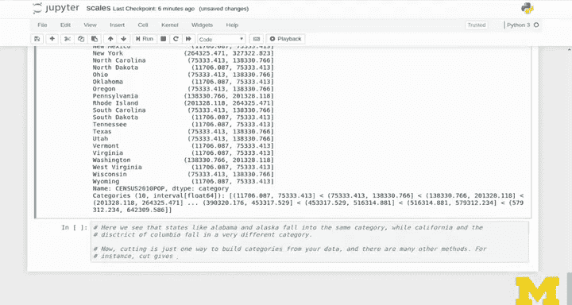

# 课程三：数据尺度处理 📊


在本节课中，我们将学习数据科学中一个基础但至关重要的概念：**数据尺度**。我们将探讨四种主要的数据尺度类型，并学习如何在Pandas中处理不同尺度的数据，包括类型转换和分箱操作。

## 概述

上一节我们介绍了Pandas的许多基础操作。本节中，我们将暂停一下，讨论**数据类型和尺度**。我们已经知道Pandas支持多种计算数据类型，如字符串、整数、浮点数。但这并未涵盖我们所说的**数据尺度**。

假设我们有一个包含学生及其年级（如一年级、二年级、三年级）的DataFrame。一年级和二年级学生之间的差异，与八年级和九年级学生之间的差异相同吗？或者考虑学生在作业中获得的期末考试成绩。A和A-之间的差异，与A-和B+之间的差异相同吗？至少在密歇根大学，答案通常是否定的，尤其是在转换为基于百分比的尺度时。

我们直观地感受到了一些不同的尺度。随着我们从数据清洗进入到统计分析和机器学习，澄清我们的知识和术语非常重要。作为数据科学家，至少需要了解四种不同的尺度。

## 四种数据尺度

以下是数据科学中四种重要的尺度类型。

### 1. 比率尺度
在比率尺度中，测量单位是等距的，并且数学运算（如减法、除法和乘法）都有效。比率尺度的好例子包括身高和体重。

**核心概念**：数值具有真实的绝对零点，可以进行所有数学运算。

### 2. 区间尺度
在区间尺度中，测量单位像比率尺度一样是等距的，但没有明确的“零值”概念。也就是说，不存在真正的零点，因此乘法和除法等运算无效。区间尺度的例子包括以摄氏度或华氏度测量的温度，因为温度永远不会“不存在”，0度本身就是一个有意义的数值。指南针上的方向可能是另一个好例子，指南针上的0度并不表示没有方向，而是描述了一个方向本身。

**核心概念**：数值没有绝对的零点，加减法有意义，乘除法无意义。

对于您将进行的大部分数据挖掘工作，比率尺度和区间尺度之间的差异对于您所应用的算法来说可能并不明显或重要。但在应用高级统计检验时，在脑海中明确这种区别非常重要。

### 3. 序数尺度
在序数尺度中，值的顺序很重要，但值之间的差异不是等距的。密歇根大学许多课程使用的评分方法就是一个很好的例子，其中字母成绩带有加号和减号。但当你将其与百分比值进行比较时，你会发现一个单独的字母涵盖了可用成绩的4%，而带有加号或减号的字母通常只占可用成绩的3%。基于此，如果获得A+或A-的学生数量与获得纯A的学生数量一样多，那将是很奇怪的（当然，假设我们期望课程中的每个百分比点均匀出现）。

序数数据在机器学习中非常常见，有时处理起来可能有点挑战性。

**核心概念**：数据有顺序，但差值不等距。

### 4. 名义尺度
最后要提到的尺度是名义尺度，通常简称为**分类数据**。这里，体育运动中球队的名称可能是一个很好的例子。球队数量有限，但改变它们的顺序、对它们应用数学函数是没有意义的。

分类值非常常见，我们通常将只有两个可能值的类别称为**二元类别**。

**核心概念**：数据代表类别，无顺序和数学意义。

## 为什么讨论尺度？

那么，为什么我要暂停讨论Pandas而跳入关于尺度的讨论呢？鉴于它们在统计学和机器学习中的重要性，Pandas有许多有趣的函数来处理测量尺度之间的转换。

## 在Pandas中处理分类和序数数据

让我们首先从名义数据开始，在Pandas中称为分类数据。Pandas实际上有一个用于分类数据的内置类型，您可以通过使用`astype`方法简单地将数据列设置为分类类型。

`astype`尝试更改数据的底层类型，在本例中更改为分类数据。您还可以通过传入`ordered=True`标志并按顺序传入类别，将其进一步更改为序数数据。

让我们在Pandas中看一个例子。

```python
import pandas as pd
```

这是一个例子。让我们创建一个按降序排列的字母成绩DataFrame。我们还可以设置一个索引值，这里我们只是根据对学生表现的一些人为判断来设置。

```python
# 创建示例DataFrame
grades = ['A+', 'A', 'A-', 'B+', 'B', 'B-', 'C+', 'C', 'C-', 'D', 'F']
student_quality = ['Excellence', 'Great', 'Good', 'Above Average', 'Average', 'Below Average', 'Poor', 'Very Poor', 'Fail', 'Bad Fail', 'No Submission']
df = pd.DataFrame({'grades': grades}, index=student_quality)
print(df.head())
print(df.dtypes)
```

现在，如果我们检查此列的数据类型，会发现它只是一个对象，因为我们设置了字符串值。我们可以使用`astype`函数告诉Pandas我们希望将类型更改为分类。

```python
# 转换为分类类型
df['grades_cat'] = df['grades'].astype('category')
print(df['grades_cat'].head())
```

现在我们看到有11个类别，Pandas知道这些类别是什么。更有趣的是，我们的数据在这种情况下不仅是分类的，而且实际上是有序的，即A-在B+之后，B在B+之前。

我们可以通过首先创建一个新的分类数据类型（包含有序类别列表和`ordered=True`标志）来告诉Pandas数据是有序的。

```python
# 创建有序分类数据类型
my_categories = pd.CategoricalDtype(categories=['F', 'D', 'C-', 'C', 'C+', 'B-', 'B', 'B+', 'A-', 'A', 'A+'], ordered=True)
grades_ordered = df['grades'].astype(my_categories)
print(grades_ordered.head())
```

现在我们看到Pandas不仅知道有11个类别，而且还知道这些类别的顺序。

## 有序分类数据的用途

那么，你能用这个做什么呢？因为存在排序，这可以帮助进行布尔掩码中的一些比较。例如，如果我们有一个成绩列表并将它们与C进行比较，我们可以看到词典比较（字符串的默认比较）会产生我们不想要的结果。

```python
# 字符串比较（非分类数据）
print(df['grades'] > 'C')

# 有序分类数据比较
print(grades_ordered > 'C')
```

我们可以看到，在设置为有序分类类型的DataFrame上进行广播时，我们得到了可能期望的结果。然后，我们可以在此序数数据上使用一组特定的数学运算符，如最小值、最大值等。

## 虚拟变量

有时，将分类值表示为每个类别为一列（用True或False表示该类别是否适用）是有用的。这在特征提取中尤其常见，这是数据挖掘课程中的一个主题。具有布尔值的变量通常称为**虚拟变量**，Pandas有一个名为`get_dummies`的内置函数，它将单个列的值转换为多列的0和1，指示虚拟变量的存在。我很少使用它，但当使用时，它非常方便。

```python
# 创建虚拟变量
dummy_df = pd.get_dummies(df['grades'])
print(dummy_df.head())
```

## 数值数据分箱

我想讨论的另一个常见的基于尺度的操作是将区间或比率尺度（如数字成绩）转换为分类尺度。现在，这对您来说可能有点违反直觉，因为您丢失了关于值的信息，但在几个地方通常这样做。例如，如果您正在可视化类别的频率，这可能是一种非常有用的方法，直方图通常与转换后的区间或比率数据一起使用。此外，如果您在数据上使用机器学习分类方法，则需要使用分类数据，因此降低维度可能有助于应用给定的技术。

Pandas有一个名为`cut`的函数，它接受一个类似数组的结构（如DataFrame的列或Series）作为参数。它还接受要使用的箱数，并且所有箱都保持等距。

让我们回到一些人口普查数据作为例子。我们看到，我们可以按州分组，然后聚合以获得按州划分的平均县大小列表。如果我们进一步对此应用`cut`，比如10个箱，我们可以看到使用平均县大小列为分类的州。

```python
import numpy as np

# 读取数据
df_census = pd.read_csv('datasets/census.csv')
# 筛选县级数据
df_county = df_census[df_census['SUMLEV'] == 50]
# 按州分组并计算平均人口
state_pop = df_county.set_index('STNAME').groupby(level=0)['CENSUS2010POP'].mean()
print(state_pop.head())

# 使用cut进行分箱
binned = pd.cut(state_pop, 10)
print(binned.head())
```

在这里，我们看到像阿拉巴马州和阿拉斯加州这样的州属于同一类别，而加利福尼亚州和哥伦比亚特区则属于非常不同的类别。

## 等频分箱与等宽分箱

分箱只是从数据构建分类的一种方式，还有许多其他方法。例如，`cut`为您提供区间数据，其中每个类别之间的间距大小相等。但有时您希望基于频率形成类别，希望每个箱中的项目数量相同。Pandas提供了`qcut`函数来实现等频分箱。

```python
# 使用qcut进行等频分箱
quantile_binned = pd.qcut(state_pop, 10)
print(quantile_binned.head())
```

这真的取决于您的数据形状以及您计划用它做什么。

## 总结

本节课中，我们一起学习了数据科学中的核心概念——**数据尺度**。我们探讨了比率、区间、序数和名义四种尺度，并掌握了在Pandas中处理它们的关键技能：



1.  使用`astype`和`CategoricalDtype`将数据转换为有序/无序分类类型。
2.  利用`get_dummies`创建虚拟变量进行特征提取。
3.  运用`cut`和`qcut`函数对数值数据进行等宽或等频分箱，将其转换为分类数据。


理解并正确转换数据尺度，是进行准确的数据分析、统计建模和机器学习的基础。在接下来的课程中，我们将运用这些知识进行更深入的数据操作和分析。