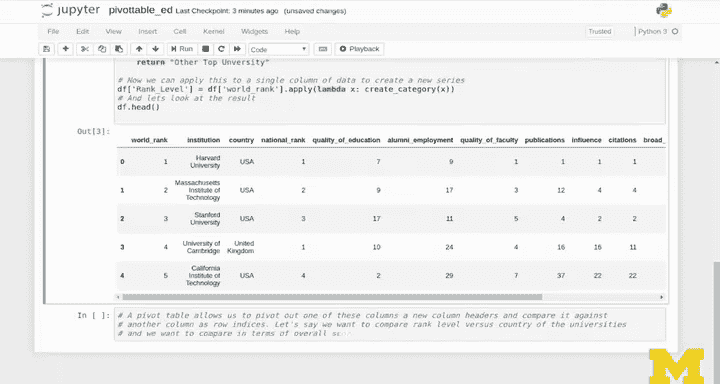

# 26：数据透视表 📊


在本节课中，我们将要学习如何使用Pandas库创建数据透视表。数据透视表是一种强大的数据汇总工具，它能帮助我们快速分析不同维度数据之间的关系。

## 概述

数据透视表是一种为特定目的汇总数据框中数据的方式。它大量使用了我们之前讨论过的聚合函数。数据透视表本身也是一个数据框，其行代表一个你感兴趣的变量，列代表另一个变量，而单元格则代表某个聚合值。

数据透视表通常还会包含边际值，即每行每列的总和。这让你能够一目了然地看到两个变量之间的关系。

## 在Pandas中查看数据透视表

我们将导入pandas和numpy库。

```python
import pandas as pd
import numpy as np
```

这里我们拥有《泰晤士高等教育》世界大学排名数据集，这是最具影响力的大学数据集之一。让我们导入这个数据集并查看其内容。

```python
dataframe = pd.read_csv('data/cwurData.csv')
dataframe.head()
```

我们可以看到每个机构的排名、国家、教育质量、其他指标以及总分。

假设我们想创建一个名为“排名等级”的新列，将世界排名1-100的机构归类为第一梯队，101-200的为第二梯队，201-300的为第三梯队，301名之后的则归类为“其他顶尖大学”。

你现在实际上已经掌握了足够的知识来完成这个任务。你可以暂停视频尝试一下。

以下是我的解决方案。我将创建一个名为`create_category`的函数，它将操作数据框中的第一列“world_rank”。

```python
def create_category(ranking):
    if 1 <= ranking <= 100:
        return 'First Tier Top University'
    elif 101 <= ranking <= 200:
        return 'Second Tier Top University'
    elif 201 <= ranking <= 300:
        return 'Third Tier Top University'
    else:
        return 'Other Top University'
```

现在我们可以将此函数应用于数据的单个列以创建新的序列。

```python
dataframe['rank_level'] = dataframe['world_rank'].apply(lambda x: create_category(x))
dataframe.head()
```

## 创建数据透视表

数据透视表允许我们将这些列中的一列转换为新的列标题，并将其与另一列作为行索引进行比较。



假设我们想比较大学的排名等级与国家，并希望通过总分来进行比较。

为此，我们告诉Pandas，我们希望值（values）是“score”，索引（index）是“country”，列（columns）是“rank_levels”。这里涉及三个要素。然后我们指定聚合函数，这里我们将使用`numpy.mean`来获取该国大学的平均评分。

```python
dataframe.pivot_table(values='score',
                      index='country',
                      columns='rank_level',
                      aggfunc=[np.mean]).head()
```

我们可以看到一个分层数据框，其中索引或行按国家排列，列有两个层级，顶层表示使用的是平均值，第二层是我们的排名等级。

在这个例子中，我们只关注一个变量（平均值），因此我们并不真正需要分层索引。我们注意到存在一些NaN值。例如，阿根廷的第一行，NaN值表明阿根廷只在“其他顶尖大学”类别中有观测值。

## 应用多个聚合函数

数据透视表不仅限于应用一个函数。你可以传递一个名为`aggfunc`的参数，它是一个要应用的不同函数的列表，Pandas将使用分层列名为你提供结果。

让我们尝试相同的查询，但也传入最大值函数。

```python
dataframe.pivot_table(values='score',
                      index='country',
                      columns='rank_level',
                      aggfunc=[np.mean, np.max]).head()
```

现在我们同时看到了平均值和最大值。

## 添加边际值

如前所述，我们还可以汇总给定顶层组内的值。例如，如果我们想查看国家的总体平均值（使用均值函数），并想查看最大值中的最大值。我们可以通过提供边际值来指示Pandas执行此操作。

我们的函数看起来基本相同，我们传入带有两个值的`aggfunc`，然后只需添加一个额外的参数`margins=True`。

```python
dataframe.pivot_table(values='score',
                      index='country',
                      columns='rank_level',
                      aggfunc=[np.mean, np.max],
                      margins=True).head()
```

## 查询数据透视表

数据透视表只是一个多层数据框，我们可以以与常规数据框类似的方式访问其中的序列或单元格。

让我们从之前的示例创建一个新的数据框。

```python
new_df = dataframe.pivot_table(values='score',
                               index='country',
                               columns='rank_level',
                               aggfunc=[np.mean, np.max],
                               margins=True)
```

然后让我们查看索引和列。

```python
print(new_df.index)
print(new_df.columns)
```

我们可以看到列是分层的，顶层列索引有两个类别（mean和max），较低层列索引有四个类别，即四个排名等级。

如果我们想获取每个国家第一梯队顶尖大学级别的平均分数，应该如何查询？我们只需要进行两次数据框投影：第一次针对平均值，第二次针对第一梯队。

```python
new_df['mean']['First Tier Top University'].head()
```

我们可以看到这里的输出是一个序列对象，我们可以通过打印类型来确认。请记住，当你从数据框中投影出单列值时，你会得到一个序列对象。

```python
print(type(new_df['mean']['First Tier Top University']))
```

如果我们想找到在第一梯队顶尖大学级别上平均分数最高的国家，可以使用`idxmax`函数。

```python
new_df['mean']['First Tier Top University'].idxmax()
```

`idxmax`函数并非数据透视表的特殊功能，它是序列对象的内置函数。本课程没有时间详细介绍所有Pandas函数和属性，我强烈鼓励你探索API以更深入地了解可用的功能。

## 使用堆叠（Stack）与反堆叠（Unstack）

如果你想改变数据透视表的形状，可以使用`stack`和`unstack`函数。堆叠是将最低层列索引转换为最内层行索引，而反堆叠是堆叠的逆操作，即将最内层行索引转换为最低层列索引。一个例子将有助于更清楚地说明这一点。

让我们先查看我们的数据透视表以刷新记忆。

```python
new_df.head()
```

现在让我们尝试堆叠，这应该将最低层列（即大学排名的梯队）移动到最内层行。

```python
stacked_df = new_df.stack()
stacked_df.head()
```

在这里我们可以看到该列基本上被转置到了行中。在原始数据透视表中，排名等级是最低层列，堆叠后，排名等级成为最内层索引，出现在国家之后。

现在让我们尝试反堆叠这个。

```python
unstacked_df = stacked_df.unstack()
unstacked_df.head()
```

这似乎将我们的数据框恢复到了原始形状。那么，如果我们连续反堆叠两次会发生什么？

```python
new_df.unstack().unstack().head()
```

我们实际上最终反堆叠到只剩下一列，因此返回的是一个序列对象。这个列只是一个值，其含义由操作、排名和国家的分层索引表示。

## 总结

本节课中我们一起学习了数据透视表。这是一个相当简短的描述，但它们在处理数值数据时极其有用，特别是当你试图以某种形式汇总数据时。

无论是你自己探索数据，还是为他人报告准备数据，你都会经常在不同的数据切片上创建新的数据透视表。当然，你可以将任何你想要的函数传递给聚合函数，包括你自己定义的函数。


数据透视表是数据分析和汇总的强大工具，掌握它将极大地提升你处理和分析结构化数据的能力。