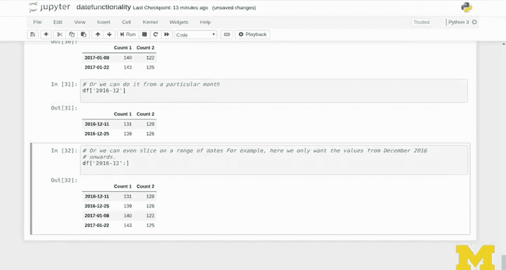

# 27：Pandas 日期与时间功能详解 📅


在本节课中，我们将学习 Pandas 库中处理日期和时间序列的强大功能。掌握这些功能对于进行时间序列分析至关重要，而 Pandas 在这方面提供了非常灵活和健壮的工具集。

Pandas 最初就是由 Wes McKinney 为处理金融时间序列数据而创建的，因此它在处理日期和时间方面非常出色。我们将从导入必要的库开始。

```python
import pandas as pd
import numpy as np
```

---

## 1. 核心时间类介绍

Pandas 有四个与时间相关的主要类：`Timestamp`、`DatetimeIndex`、`Period` 和 `PeriodIndex`。首先，我们来了解 `Timestamp`。

### Timestamp：单一时间点

`Timestamp` 代表一个单一的时间戳，将数值与特定的时间点关联起来。

例如，我们可以用一个字符串来创建一个时间戳：

```python
pd.Timestamp('9/1/2019 10:05AM')
```

我们也可以通过分别传递年、月、日、时、分等参数来创建：

```python
pd.Timestamp(2019, 12, 20, 0, 0)
```

`Timestamp` 对象拥有一些有用的属性。例如，`isoweekday` 可以返回星期几，其中 1 代表星期一，7 代表星期日。

```python
t = pd.Timestamp(2019, 12, 20, 0, 0)
t.isoweekday()  # 输出：5，表示星期五
```

我们也可以轻松地提取时间戳中的特定部分，如年、月、日、小时、秒等。

```python
t.year
t.second
```

---

上一节我们介绍了表示时间点的 `Timestamp`，本节中我们来看看如何表示一个时间段。

### Period：单一时间段

`Period` 类代表一个单一的时间跨度，例如特定的一天或一个月。

创建一个代表“2016年1月”的期间对象：

```python
pd.Period('1/2016')  # 粒度是 ‘M’ (月)
```

创建一个代表“2016年3月5日”的期间对象：

```python
pd.Period('3/5/2016')  # 粒度是 ‘D’ (日)
```

`Period` 对象封装了其粒度信息，因此在其上进行算术运算非常直观。例如，计算“2016年1月”之后的5个月：

```python
pd.Period('1/2016') + 5  # 结果是 ‘2016-06’
```

计算“2016年3月5日”之前的两天：

```python
pd.Period('3/5/2016') - 2  # 结果是 ‘2016-03-03’
```

---

## 2. 时间序列索引

了解了基本的时间对象后，我们来看看如何用它们来构建索引，这对于处理时间序列数据非常方便。

### DatetimeIndex

我们可以创建一个以 `Timestamp` 为索引的 Series。

```python
t1 = pd.Series(list('abc'), [pd.Timestamp('2016-09-01'),
                              pd.Timestamp('2016-09-02'),
                              pd.Timestamp('2016-09-03')])
type(t1.index)  # 输出：pandas.core.indexes.datetimes.DatetimeIndex
```

### PeriodIndex

同样，我们也可以创建以 `Period` 为索引的 Series。

```python
t2 = pd.Series(list('def'), [pd.Period('2016-09'), pd.Period('2016-10'), pd.Period('2016-11')])
type(t2.index)  # 输出：pandas.core.indexes.period.PeriodIndex
```

---

## 3. 转换与解析日期字符串

在实际数据分析中，我们经常遇到各种格式的日期字符串。Pandas 提供了 `to_datetime` 函数来智能地解析它们。

假设我们有以下格式各异的日期字符串列表：

```python
d1 = ['June 2013', 'August 29, 2014', '20150626', '7/12/16']
```

我们可以创建一个 DataFrame 并尝试转换这些日期：

```python
df_dates = pd.DataFrame(np.random.randint(10, size=(4,2)),
                        index=d1,
                        columns=list('ab'))
```

使用 `pd.to_datetime` 进行转换：

```python
pd.to_datetime(d1)
```

`to_datetime` 还支持参数来明确解析顺序，例如处理欧洲格式的日期（日/月/年）：

```python
pd.to_datetime('4.7.12', dayfirst=True)
```

---

## 4. 时间差与偏移量

### Timedelta：时间差

`Timedelta` 表示两个时间点之间的差异。

```python
pd.Timestamp('9/3/2016') - pd.Timestamp('9/1/2016')  # 输出：Timedelta('2 days 00:00:00')
```

我们也可以在时间戳上直接加减时间差：

```python
pd.Timestamp('9/2/2016 8:10AM') + pd.Timedelta('12 days 3 hours')
```

### DateOffset：日历偏移

`DateOffset` 与 `Timedelta` 类似，但它遵循特定的日历规则，支持更丰富的间隔类型，如“工作日”、“月末”、“月初”等。

```python
ts = pd.Timestamp('2016-09-04')
# 增加一周
ts + pd.offsets.Week()
# 移动到当月最后一天
ts + pd.offsets.MonthEnd()
```

---

## 5. 生成日期范围与重采样

### 使用 `date_range` 生成日期序列

`date_range` 函数可以方便地生成一个 `DatetimeIndex`。以下是生成频率的示例：

生成每两周一次（周日）的9个日期点：

```python
dates = pd.date_range('10-01-2016', periods=9, freq='2W-SUN')
```

生成10个工作日：

```python
pd.date_range('10-01-2016', periods=10, freq='B')
```

生成以6月为季度开始的12个季度点：

```python
pd.date_range('10-01-2016', periods=12, freq='QS-JUN')
```

### 在 DataFrame 中应用

让我们用生成的日期创建一个示例 DataFrame 并进行操作。

```python
dates = pd.date_range('10-01-2016', periods=9, freq='2W-SUN')
df = pd.DataFrame({'Count_1': 100 + np.random.randint(-5, 10, 9).cumsum(),
                   'Count_2': 120 + np.random.randint(-5, 10, 9).cumsum()},
                  index=dates)
```

**检查星期几：**

```python
df.index.weekday_name
```

**计算差值：**

```python
df.diff()
```

**重采样（Resampling）：** 将数据从高频聚合到低频（称为降采样）。

计算每月计数的平均值：

```python
df.resample('M').mean()
```

---

## 6. 基于时间的索引与切片

Pandas 允许使用字符串进行灵活的部分索引和切片。

**按年份索引：**

```python
df['2017']
```

**按年份和月份索引：**

```python
df['2016-12']
```

**按日期范围切片：**

```python
df['2016-12':]
```

---

## 总结




本节课我们一起学习了 Pandas 中处理日期和时间序列的核心功能。我们从四个基本时间类（`Timestamp`, `DatetimeIndex`, `Period`, `PeriodIndex`）入手，学习了如何创建、转换和解析日期时间数据。接着，我们探讨了表示时间间隔的 `Timedelta` 和遵循日历规则的 `DateOffset`。然后，我们掌握了使用 `date_range` 生成规则日期序列以及使用 `resample` 进行数据频率转换的方法。最后，我们学习了如何利用基于时间的索引和切片功能，高效地查询和筛选时间序列数据。这些功能共同构成了 Pandas 强大而灵活的时间序列处理能力，是进行数据分析，尤其是时间序列分析的基础。在后续课程中，我们将更深入地探讨重采样等高级主题。