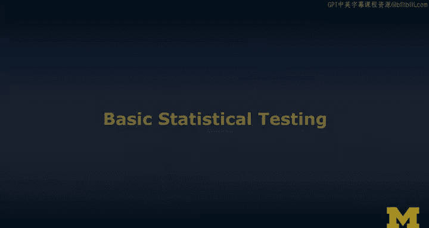
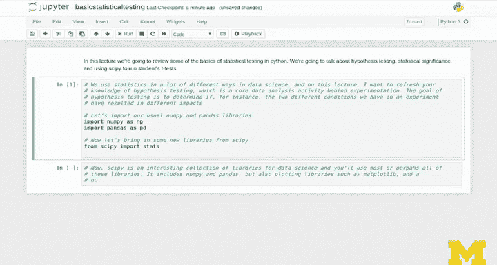

# 课程名称：Python用于数据科学实践（第28课）📊




## 概述：基础统计检验

在本节课中，我们将学习如何在Python中进行基础的统计检验。我们将讨论假设检验、统计显著性的概念，并使用SciPy库来运行学生t检验。数据科学中经常使用统计方法，本节课旨在回顾假设检验这一实验背后的核心数据分析活动。假设检验的目标是确定实验中的两种不同条件是否导致了不同的影响。

---

## 导入必要的库

首先，我们需要导入常用的NumPy和pandas库。接着，从SciPy库中导入统计模块。SciPy是一个有趣的数据科学库集合，它包含了NumPy和pandas，以及Matplotlib等绘图库和其他科学计算函数。



```python
import numpy as np
import pandas as pd
from scipy import stats
```

---

## 理解假设检验

当我们进行假设检验时，实际上涉及两个陈述。第一个是我们的实际解释，称为**备择假设**。第二个陈述是我们的解释不充分，称为**原假设**。我们的实际检验方法是确定原假设是否为真。如果我们发现组间存在差异，就可以拒绝原假设并接受备择假设。

---

## 加载并探索数据

让我们看一个例子。我们将使用一些成绩数据。首先创建一个新的数据框，读取CSV文件`grades.csv`，并查看其前几行。

```python
df = pd.read_csv('datas/grades.csv')
print(df.head())
```

数据框内有六项不同的作业。让我们查看一些数据摘要统计信息。

```python
print(df.shape)
```

---

## 分割数据

为了本次课程的目的，我们将总体分为两部分。假设在2015年12月底之前完成第一次作业的人称为“早完成者”，在此之后完成的人称为“晚完成者”。

```python
# 将提交时间列转换为datetime格式
df['assignment1_submission'] = pd.to_datetime(df['assignment1_submission'])

# 创建早完成者数据框
early_finishers = df[df['assignment1_submission'] < '2016-01-01']

# 查看早完成者数据
print(early_finishers.head())
```

现在，如何获取晚完成者的数据框呢？以下是一种方法：

```python
# 创建晚完成者数据框
late_finishers = df[~df.index.isin(early_finishers.index)]
print(late_finishers.head())
```

还有其他方法可以实现，例如复制第一个条件并更改符号，或者使用连接操作，或者编写一个函数并使用`.apply()`方法在数据框中添加新列。

---

## 比较均值

pandas数据框对象具有多种相关的统计函数。如果直接在数据框上调用`mean`函数，可以看到每项作业的平均值。

```python
print(df.mean())
```

现在，比较两个群体的均值。

```python
print(early_finishers['assignment1_grade'].mean())
print(late_finishers['assignment1_grade'].mean())
```

这些均值看起来非常相似，但它们相同吗？什么叫做“相似”？这就是学生t检验发挥作用的地方。它允许我们形成备择假设（它们是不同的）和原假设（它们是相同的），然后检验该原假设。

---

## 进行t检验

在进行假设检验时，我们必须选择一个显著性水平作为我们愿意接受的偶然性阈值。这个显著性水平通常称为**alpha**。在本例中，我们使用阈值0.05（即5%）。虽然这很常用，但它实际上是相当任意的。

SciPy库包含许多不同的统计检验和基于Python的假设检验形式。我们将使用`ttest_ind`函数进行独立样本t检验，这意味着两组中的群体彼此无关。

`ttest_ind`的结果是t统计量和p值。后者（概率值）对我们来说最重要，因为它表示原假设为真的概率（介于0和1之间）。

```python
from scipy.stats import ttest_ind

# 对第一次作业成绩进行t检验
t_stat, p_val = ttest_ind(early_finishers['assignment1_grade'], late_finishers['assignment1_grade'])
print(f"t统计量: {t_stat}, p值: {p_val}")
```

这里我们看到概率是0.18，高于我们的alpha值0.05。这意味着我们不能拒绝原假设。原假设是这两个群体相同，并且由于概率大于alpha，我们没有足够的证据确定性得出相反的结论。但这并不意味着我们已经证明群体是相同的。

---

## 检查其他作业

让我们检查其他作业的成绩。

```python
assignments = ['assignment1_grade', 'assignment2_grade', 'assignment3_grade', 'assignment4_grade', 'assignment5_grade', 'assignment6_grade']

for assignment in assignments:
    t_stat, p_val = ttest_ind(early_finishers[assignment], late_finishers[assignment])
    print(f"{assignment}: p值 = {p_val}")
```

看起来在这份数据中，我们没有足够的证据表明群体在成绩方面存在差异。

---

## 理解p值

然而，让我们看看这些p值，因为它们可以告诉我们一些信息，这些信息可能影响未来的实验设计。例如，其中一项作业（作业3）的p值约为0.1。这意味着如果我们接受11%的偶然相似性水平，这将被认为具有统计显著性。作为研究者，这提示我这里有几点值得考虑后续跟进。例如，如果我们参与者数量较少（这里并非如此），或者这项作业与我们的实验有独特关联，那么可能需要进行后续实验以更好地理解这一现象。

---

## p值的局限性

最近，p值因无法充分告诉我们正在发生的交互作用而受到批评，另外两种技术——置信区间和贝叶斯分析——正被更频繁地使用。p值的一个问题是，随着你进行更多测试，你很可能仅仅因为偶然性而得到一个具有统计显著性的值。

让我们通过一个小模拟来看看这一点。

首先，创建一个包含100列、每列100个数字的数据框。

```python
df1 = pd.DataFrame([np.random.random(100) for x in range(100)])
print(df1.head())
```

现在，创建第二个数据框。

```python
df2 = pd.DataFrame([np.random.random(100) for x in range(100)])
```

这两个数据框相同吗？也许更好的问题是：对于df1中的给定行，它与df2中的同一行相同吗？让我们看看。假设我们的临界值是0.1（即alpha为10%），我们将比较df1中的每一列与df2中相同编号的列，并报告p值小于10%的情况，这意味着我们有足够的证据说这些列是不同的。

让我们将其写成一个函数。

```python
def test_columns(alpha=0.1):
    num_different = 0
    for col in df1.columns:
        t_stat, p_val = ttest_ind(df1[col], df2[col])
        if p_val <= alpha:
            print(f"列 {col} 在 alpha={alpha} 水平上具有统计显著性差异 (p={p_val})")
            num_different += 1
    print(f"总共有 {num_different} 列不同，占总列数的 {num_different/len(df1.columns)*100:.1f}%")

test_columns()
```

有趣的是，我们看到实际上有很多列是不同的。事实上，这个数字看起来很像我们选择的alpha值。这是怎么回事？难道所有列不都应该相同吗？请记住，`ttest_ind`所做的只是检查两组数据在给定一定置信水平下是否相似。在我们的例子中是10%。你进行的随机比较越多，仅仅因为偶然性而相同的就越多。在这个例子中，我们检查了100列，所以如果我们的alpha是0.1，我们预计大约有10列会相同。

我们也可以测试其他alpha值。

```python
test_columns(0.05)
```

---

## 使用非正态分布

为了好玩，让我们使用非正态分布重新创建第二个数据框。我随意选择卡方分布。

```python
df2 = pd.DataFrame([np.random.chisquare(1, 100) for x in range(100)])
test_columns()
```

现在我们看到，所有或大多数列在10%的水平上检验都具有统计显著性。

---

## 总结


在本节课中，我们讨论了Python中假设检验的一些基础知识。我向大家介绍了SciPy库，你可以用它来进行学生t检验。我们还讨论了查看统计显著性时出现的一些实际问题。关于假设检验还有很多需要学习的内容，例如，根据数据的形状使用不同的检验方法，以及除了p值之外，还有不同的结果报告方式，如置信区间或贝叶斯分析。但这应该能让你对比较两个群体差异这一数据科学常见任务有一个基本的了解。