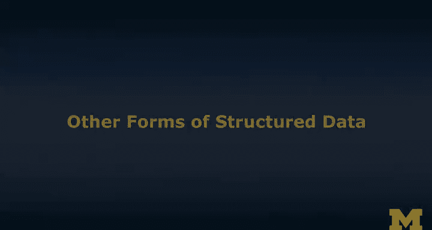
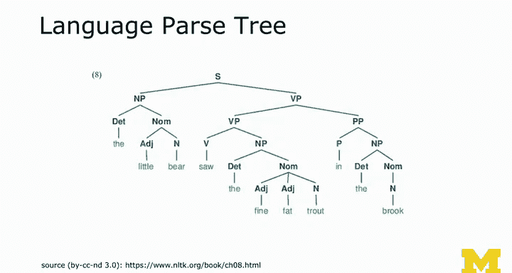

# 课程：Python用于数据科学实践（第29课）🌳 其他结构化数据格式




在本节课中，我们将要学习除了表格形式之外的其他数据抽象与结构化方式。我们将探讨网络图和树结构这两种常见的数据表示方法，并理解数据科学家如何在不同表示形式之间进行转换以应用已知的分析技术。

---

在之前的课程中，我们主要讨论了以表格形式构建数据，使用数据框作为我们的核心结构。这种形式建立在过去30年广泛使用的电子表格基础之上，是展示实例（有时称为观测值、实体，或在pandas中称为行）与其属性（通常称为特征或在pandas中称为列）之间关系的绝佳方式。

但重要的是要认识到，数据本身并非天生就是这种结构。表格数据表示法是我们数据科学家应用的一种抽象，它使我们能够更容易地构建具有特定属性的操作例程。这种抽象允许我们快速执行诸如汇总数据字段或应用机器学习算法等操作。

然而，还有许多其他形式的抽象需要我们了解，本节中我们将简要介绍其中几种。

---

## 网络图结构

我认为我们最常用的抽象形式之一是网络图。你可以将网络视为由具有属性的个体组成，并且这些个体与其他个体相连接，连接本身也具有属性。

以Twitter数据为例。个体用户拥有诸如Twitter用户ID、头像和姓名等属性，并且他们可以与其他个体连接。例如，我可能连接到Paul Resnick，因为我在Twitter上关注他；而他可能连接回我，因为他在Twitter上屏蔽了我。

因此，我们看到这些连接甚至可以具有某种方向性，连接上的属性（例如Paul是否屏蔽某人）在连接个体时是重要的区分因素，因为我们想要表示的是Paul屏蔽了我，而不是相反。

更一般地说，我们可以将网络视为由节点组成，这些节点可以代表任何事物：人、运动队、行星等，这完全取决于你的数据是什么。节点通过边连接，边可以是有向的或无向的。有时网络被称为图，有时节点被称为顶点，但从概念上讲，它们都是相同的东西。

对于你来说，真正重要的是要知道我们可以在不同表示形式之间进行转换。成为一名扎实的数据科学家意味着你能够将一种表示形式转换为另一种，以应用你可能已经掌握的技术。在与可能具有不同学科背景的各类客户和协作者交流时，这一点尤其重要。

对于网络，一种常见的第二种表示形式是邻接矩阵。在这种情况下，我们可能有两个矩阵，一个用于“关注”关系，一个用于“屏蔽”关系。行和列列出了我们可能具有关联的所有潜在人员。

在“关注”矩阵中，我的行和Paul的列之间可能有一个值为`True`，表示我关注Paul。而在“屏蔽”矩阵中，Paul的行和我的列之间可能有一个值为`True`。

我们可以像在本课程第一周所做的那样，在Numpy中表示这些矩阵。然后，我们可以使用诸如Python中的NetworkX等库来可视化这些网络，并应用特定算法来回答有趣的问题，例如：我和某位我不关注的院长（比如Bethiako）之间是否存在间接联系？

这在社会科学研究中被广泛用于理解影响力和社会联系，我本人在教育技术研究中也使用它来理解学习者的学习习惯如何影响他们的朋友。

但我不会在这里深入探讨网络，我只是想预示，这将是作为数据科学家工具包中的一种抽象，并且在这些抽象之间转换是很重要的。

---

## 树结构

实际上，你还会遇到一些特定的网络子类型。其中最常见的或许是树结构。在一般形式中，树可以被视为具有层次结构的网络，顶部有一个节点（我们称之为根节点），随后的节点出现在下面的层级中，并连接到上方的节点。

有时连接是单一的，即一个给定节点只能连接到一个上方的节点；有时连接是多个的，例如在家谱中，一个节点可以连接到两个父节点，通常用于表示遗传谱系。

实际上，尽管我们称这种结构为“树”，但我们并没有过多地模仿活树。通常活树的根在底部，而不是顶部。但我们确实使用了家谱中的术语，将节点称为具有兄弟姐妹、父母和自己的子女。所有这些语言仅用于描述节点与树中其他节点的关系（就节点的层级而言），而不是为了推断节点的其他属性（如节点具有的属性）。

不过，我们确实将树底部的节点称为叶节点。所以这有点奇怪地回到了森林学中树的概念。

像图和矩阵一样，树只是为我们提供了一种描述关系的语言，然后我们可以将其应用于不同的领域。

以下是树结构的一个例子：

一个你将了解到的树结构例子来自自然语言处理。在NLP中，通常将一段文本表示为解析树，这有助于消除歧义。

以下是Python最流行的文本处理库之一——自然语言工具包文档中的一个示例。他们选取了一个句子“the little bear saw a fine fat trout in the brook”，并根据英语语法构建了解析树。你可以看到叶节点是单词本身，每个单词都有一个父节点，即词性标签。

例如，“little”是形容词，“bear”是名词。这些节点都有一个共同的父节点。在本例中，它被归类为名词性短语，其父节点是名词短语。数据科学家然后可以使用这个解析树来找出单词之间的关系，例如哪些形容词指代特定的名词，这是产品评论分析中的一项重要任务。

---

## 总结与核心概念

如果有一个概念性的要点，我希望你能从本讲座中带走，那就是：这些结构是我们强加于底层数据的表示形式，我们从这些表示形式中推导出的数据含义，可能会根据我们决定如何应用该表示形式而改变。



数据科学家需要能够与广泛的其他利益相关者互动，因此需要能够灵活地构思和表示数据。

**核心概念总结：**
*   **网络/图**：由**节点**（实体）和**边**（关系）组成的数据结构。边可以是有向的或无向的。
    *   代码表示（邻接矩阵示例）：
        ```python
        import numpy as np
        # 一个简单的有向图邻接矩阵
        # 行i到列j为True表示从节点i到节点j有一条边
        adjacency_matrix = np.array([
            [False, True, False],  # 节点0连接到节点1
            [False, False, True],  # 节点1连接到节点2
            [True, False, False]   # 节点2连接到节点0
        ])
        ```
*   **树**：一种特殊的无环连通图，具有层次结构，包含**根节点**、**内部节点**和**叶节点**。
    *   公式/关系描述：对于树中的任意节点，从根到该节点存在唯一路径。每个节点（除根节点外）有且仅有一个父节点，但可以有零个或多个子节点。


本节课中，我们一起学习了网络图和树结构这两种重要的非表格数据抽象形式，理解了数据表示形式的灵活性及其在不同领域（如社交网络分析、自然语言处理）的应用，并认识到在不同表示形式之间进行转换是数据科学家的一项关键技能。