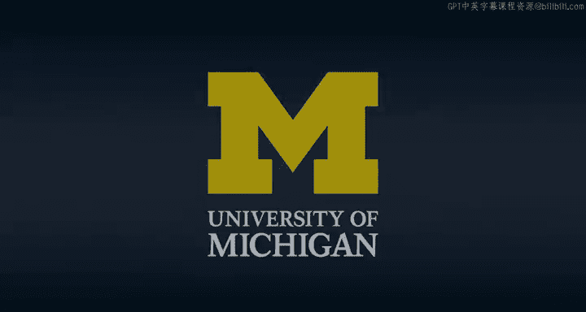
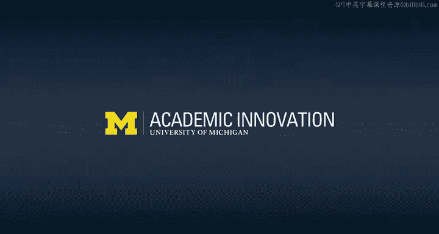

# 课程1：Python用于数据科学实践 - P32：Christopher Brooks教授介绍 👨‍🏫

在本节课中，我们将了解本系列课程的讲师Christopher Brooks教授的背景、研究兴趣以及他投身数据科学教育的初衷。

---

我是Chris Brooks，我是信息学院的研究助理教授。

同时，我也是学术创新办公室的学习分析与研究主任。

我是一名计算机科学家，主要研究领域是学习、学生成就与学生成功。

我的研究既涉及高等教育，也涵盖MOOCs等在线学习情境。

我童年时有一件事记忆犹新。

我的父亲是一名物理学家，因此我像许多孩子一样，也像我的孩子们现在所做的那样，会去大学体验校园生活及其提供的资源。

作为一名物理学家，他能够接触到万维网最早期的实例。

因此，我得以坐在那里，摆弄像NCSA Mosaic、早期版本的Netscape等工具。

我认为正是这种**连通性**，这种信息在科学世界中成为“一等公民”的理念，深深地吸引了我。

我们如今在数据科学中看到的这个新世界，其核心思想与此一脉相承。

现在，学习者甚至在学前阶段就开始培养相关能力，开始将**数据**视为探索世界的另一种方式。

对我而言，这一切始于很早的阶段。

在我年幼时，在大学里看到父亲的工作，并有机会接触计算机，这些经历为我播下了种子。

我很高兴能尝试将这种对数据和计算的热情带给尽可能多的人。

而这，正是这门《Python数据科学导论》课程的核心目标之一。

---

本节课中，我们一起了解了Christopher Brooks教授的学术背景及其与数据科学的渊源。他从小受家庭环境影响，接触到早期的互联网技术，从而对信息的连通性与力量产生了浓厚兴趣。如今，他致力于通过教育，将数据科学这种探索世界的新方式普及给更广泛的学习者。在接下来的课程中，我们将跟随他的指引，正式开启Python数据科学的学习之旅。