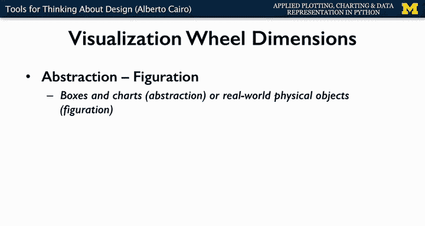
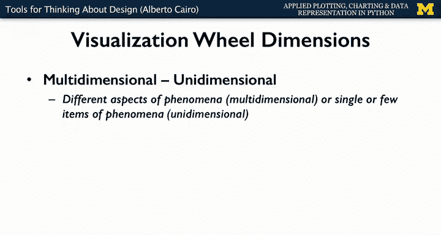

# 33：设计思维工具（Alberto Cairo） 📊

在本节课中，我们将学习Alberto Cairo在其著作《The Functional Art》中提出的一个设计思维工具——“可视化轮盘”。这个工具帮助我们理解在构建信息图表时面临的各种权衡与选择。

---

## 🎯 可视化轮盘概述

Alberto Cairo在其著作《The Functional Art》中，提供了一个用于思考信息图表设计权衡的工具。他称这个工具为“可视化轮盘”。

在这个概念化模型中，一个圆环有两个极点。顶部极点代表高度复杂的数据，这些数据在深层次上提供信息。而底部极点则提供更易访问的数据，但仅在浅层次上提供信息。

圆环中包含多个维度，这些维度描述了两种不同方法之间的权衡。虽然Cairo提供了许多有趣的维度，但需要注意的是，这是一个供设计师思考其可视化作品的工具，本身并非分析工具。

对于任何特定问题，你的需求可能会改变哪些维度是重要的，或者可能会引入你应该考虑的新维度。

Cairo实际上建议，我们在组织中的角色或专业背景也可能影响我们想要制作的图表类型。因此，我想问正在学习数据科学的你：你试图通过你的可视化作品触达谁？

---

## 🔍 深入探讨权衡维度

让我们深入探讨Cairo考虑的几个权衡维度。

以下是Cairo提出的几个关键设计权衡维度：

1.  **抽象与具象**
    高度具象的视觉作品使用现象的实际表现形式（如照片或绘图）来描述现象。随着表现形式变得不那么真实、更具概念性，重点就从具象转向抽象。

    
    

2.  **功能性与装饰性**
    一个完全功能性的图表没有任何修饰，更接近数据的直接表现。而一个高度装饰性的图表则具有更多的艺术修饰。对于所有这些维度而言，并没有绝对的好坏之分。装饰可能会增加观众思考视觉作品、探索其细微差别并形成心理联想的时间，这可能会增加熟悉度和记忆性。

3.  **密度与轻量**
    这个维度与所展示的信息量有关。在科学视觉作品中有很多很好的例子，其中一些图表旨在深入研究，而另一些则旨在快速补充叙述。比较杂志中的信息图表（读者可能更深入地参与内容）与同一杂志中的广告（读者可能只会快速浏览广告）时，可以看到这个维度在起作用。

    这里有一个来自我研究领域的例子，由哈佛大学和麻省理工学院发布，描述了edX大规模开放在线课程平台上用户的访问模式。

    

    花点时间研究这张图片。你能从这张图片中理解到什么？

    如果我们考虑Cairo的第三个维度，很难不说这是一个相当密集的图表。图表的主要部分是一个散点图，它有两个带标签的轴，左侧和底部的两个子图（直方图）也是如此。直方图的轴可能有点令人困惑，因为它们与散点图的轴重叠，但改变了度量单位和测量方向。例如，散点图顶部的X轴使用“访问章节的百分比”作为度量单位，并且随着你向图的右侧移动而增加。然而，图表左侧直方图的同一个X轴是以“千人”为单位，并且随着你向图的左侧移动而增加。图表上叠加了一些红线，将散点图大致分成四个象限，但由于标签极少，这些象限最终代表什么有点不清楚。

    无论这是否是一个好图表，它肯定会被视为密集图表的一个例子。

4.  **多维与单维**
    多维图表将现象作为一个整体来描述，并邀请观众探索现象的许多不同方面。而单维图表则专注于一个或少数几个项目，并以一种或多种方式探索它们。

    
    

5.  **原创性与熟悉性**
    在现代世界，我们习惯于看到大量不同类型的信息图表，比如条形图和折线图。以这些表现形式进行思考在很小的时候就被教授。例如，我快5岁的女儿前几天从学前班带回家一页纸，上面显示了一个条形图，这是她和同学们在课堂上制作的，用来庆祝了解美国选举。全班同学聚在一起，投票决定他们吃什么零食，是巧克力冰淇淋还是薄荷巧克力片冰淇淋。当然，薄荷巧克力片冰淇淋赢了，正如人们所预料的那样。但我想说的是，这些是以图形形式思考数据的基本方式，现在很早就开始教授了。这使得它们对广大人群来说很熟悉。😊

    然而，情况并非总是如此。可以说，条形图对大多数人来说都相当熟悉，但具有更多原创性的图表包含需要用户解释或研究的元素。

    这里有一张Charles Minard绘制的非常著名的图表。它描述了拿破仑1812年进军俄罗斯的情况。

    

    花点时间研究这张图表。 broadly speaking，这张图表中可视化了五种不同类型的信息。你看到了这五种信息中的多少种？

    以下是我看到的。首先，是地理元素，表现为沿途的各种河流和城镇。上部棕色条带的宽度代表拿破仑军队的规模，你可以看到它在战役开始时从422,000人缩减到法国人到达莫斯科时的仅100,000人。下部的黑色条带显示了拿破仑从俄罗斯的撤退，沿途有多个点，这些点与日期和摄氏温度相对应。我们看到随着军队规模缩小，条带急剧变细。

    因此，Minard可视化中的五种数据包括：位置、方向、温度、军队规模和日期。

6.  **新颖性与冗余性**
    冗余性是指图表倾向于以多种不同方式讲述同一个故事。例如，你可能在条形图中使用条形的高度（带有坐标轴）以及颜色来强调最大的条形。这个维度有点棘手。你不想让读者感到无聊或使你的图表过于复杂，但你确实希望以支持他们理解你所描述现象的方式来编码信息。在这个维度上，新颖性是指仅以一种方式描述图表中的每个现象。

---

## 📈 可视化轮盘的应用与反思

在可视化轮盘中没有对错之分，轮盘的目的是帮助你理解和比较你可能采取的可视化方法。

作为一项反思活动，Cairo建议你可以沿着这些维度中的每一个来绘制你的想法，然后将这些点连接起来创建一个雷达图。

在这里，Cairo提供了两个可视化轮盘的实际应用示例。在左侧，你可以看到更强调复杂视觉作品，那些密集、多维且高功能性的作品。在右侧的可视化轮盘中，有更多的装饰、轻量和具象元素。

Cairo认为，左侧的轮盘更能体现科学家和工程师所做的工作。而右侧的轮盘则更能体现艺术家、平面设计师和记者所做的工作。科学家和工程师如何看待数据可视化与艺术家和记者如何看待之间的这种张力是一个有趣的话题，我们将在下周结束时重新讨论。

---

## 🎓 总结与预告

在本节课中，我们一起学习了Alberto Cairo的“可视化轮盘”，这是一个帮助我们理解和权衡信息图表设计不同维度（如抽象与具象、功能与装饰、密度与轻量等）的思维工具。我们探讨了每个维度的含义，并通过实例加深了理解。

可视化轮盘是我们用来更好地比较两种不同信息可视化方式的工具之一。在下一讲中，我们将更深入地探讨，并看看你如何使用可视化轮盘来评估自己的图表。下一讲，我们将更深入一些，并考虑Edward Tufte关于什么构成良好可视化的一些启发式方法。