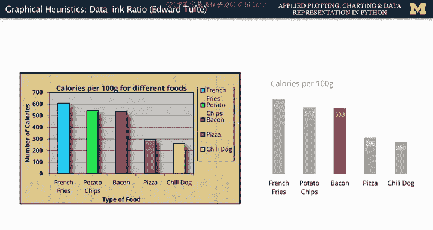

# 34：数据可视化原则 📊

在本节课中，我们将学习爱德华·塔夫特提出的两个重要图形启发式原则：**数据墨水比**和**图表垃圾**。这些原则旨在指导我们创建更清晰、更有效的数据可视化图表。

爱德华·塔夫特是关于如何设计定量信息视觉展示的开创性人物。事实上，这是他最受推崇的一本书的标题。我们强烈建议你查阅他的著作。在这本书中，他介绍了两个有趣的图形启发式原则：数据墨水比和图表垃圾。

## 什么是启发式？ 🤔

首先，什么是启发式？启发式是一个旨在指导决策的过程或规则。根据定义，它并非已知最优或完美，但在本质上是实用的。启发式原则旨在被遵循，直到你有理由偏离它们。

## 数据墨水比原则 ✍️

塔夫特的第一个图形启发式原则是**数据墨水比**。

塔夫特将**数据墨水**定义为一个图形的不可擦除的核心，即为了响应所代表数字的变化而排列的非冗余墨水。换句话说，数据墨水对于理解给定变量的意义是必不可少的。

塔夫特将**数据墨水比**定义为数据墨水量除以打印图形所需的总墨水量。

公式表示为：
`数据墨水比 = 数据墨水量 / 打印图形所需的总墨水量`

他并非真的建议我们去测量页面上的墨水量，而是建议我们移除那些没有为图表增添新信息的元素。

## 数据墨水比优化实例 🍽️

展示数据墨水比优化的最著名例子之一是由加拿大阿尔伯塔省埃德蒙顿市的信息可视化与设计公司 Darkhorse Analytics 完成的。他们整理了四个如何提高数据墨水比的例子，我们将在下一个阅读任务中链接这些例子。但在这里，我们将详细讲解第一个例子。

我们从一张关于食物项目及其卡路里含量的数据表开始。

以下是优化步骤：

**第一步：移除不必要的背景图像**
移除不需要的背景图像，因为它对理解图表没有价值。

**第二步：移除条形图后的灰色背景**
移除条形图后的灰色背景，因为它没有概念上的价值。

**第三步：消除冗余元素**
这包括移除图例，因为每个条形图都直接在坐标轴上标注了。同时，由于图像中已有大量关于食物项目卡路里的参考信息，可以精简标题和Y轴标签。

**第四步：移除无价值的边框**
这给我们留下了一个小得多的图像。有一些形成边框的粗线没有价值，也可以移除。

**第五步：谨慎处理颜色**
在图表中使用颜色是一个棘手的问题。本课程不会深入探讨色彩理论，但在与可能有色觉缺陷或色盲的人交流时，颜色是一个挑战。有一些应对策略，例如，过去的最佳实践是用图案（在图形中有时称为“阴影线”）代替颜色。但这会带来自身的挑战。相反，解决方案几乎总是移除所有颜色，只保留一种用于强调，并在文本中链接到该颜色。这样，即使脱离上下文查看图表的人也能感受到强调，而不会被数据的“彩虹”所淹没。因此，我们移除除培根以外的所有颜色，并假设文本中明确引用了该数据。

**第六步：移除三维效果和阴影**
三维条形图和投影也可以移除，因为它们没有增加额外价值。我们还可以移除整个“保龄球”效果。

**第七步：评估并移除网格线**
图像中仍然有很多网格线，但不太清楚这些网格线的价值是什么，所以我们将移除它们。网格线有时有价值，但通常只是一种干扰。现在，研究一下图像：我们感兴趣的数据点培根，与薯片或辣热狗之间的卡路里数差异是多少？仅仅移除线条并不会让阅读更容易。

**第八步：直接标注数据值**
由于这里的数据值相当简单，让我们直接在图形中标注每个条形图。现在，培根和薯片或培根和辣热狗之间的差异有多大？你当然需要做一些计算，但通过扫视图形并直接比较数字，你仍然可以快速估计出一个精确值。

## 优化成果 ✅

通过提高数据墨水比，我们不仅使图形更简单、更易读，而且增加了观看者看到的信息量。

我们鼓励你查看下一个阅读材料中链接的 Darkhorse Analytics 的其他例子，因为他们为各种不同的视觉元素（包括地图）进行了这种清理工作。

在下一讲中，我们将通过查看“图表垃圾”来继续探索塔夫特的启发式原则。

---

**本节课总结**：在本节课中，我们一起学习了爱德华·塔夫特提出的**数据墨水比**原则。我们了解了其定义和计算公式，并通过一个食物卡路里图表的逐步优化实例，学习了如何通过移除冗余背景、颜色、三维效果和网格线等非数据元素，来提高图表的清晰度和信息传递效率。记住，核心目标是最大化用于传达核心数据的“墨水”，让可视化更简洁、有力。