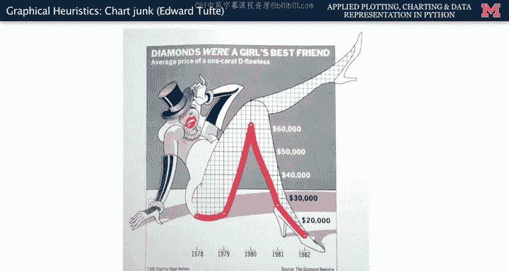

# 课程名称：Python用于数据科学实践（1-3课／共5课）｜Applied Data Science with Python
## 课程编号：P35 - 图形启发式：图表垃圾（Edward Tufte）📊

在本节课中，我们将要学习由爱德华·塔夫特提出的一个重要概念——“图表垃圾”。我们将了解图表垃圾的三种主要形式，并通过一项用户研究来探讨装饰性图表元素的实际效用。

---

爱德华·塔夫特向我们介绍的另一个启发式概念被称为图表垃圾。

塔夫特对图表垃圾的批评远比对其他形式的非数据墨水的批评更为严厉。事实上，他认为统计图表上的艺术装饰就像数据图形中的杂草。

他认为图表垃圾主要分为三种。第一种是无意的光学艺术。例如，图表特征的过度阴影或图案化，正如塔夫特在其著作《量化信息的视觉展示》中分享的这张经济学图表所示。

这些图案会使人的眼睛跳动并导致视觉疲劳。这种现象被称为莫尔条纹，这也是为什么在拍摄像本慕课这样的视频内容时，通常看不到人们穿条纹衬衫的原因，因为视频的低分辨率会加剧莫尔条纹问题。

塔夫特建议，与其为内容添加图案，不如直接在图表图形上添加标签。我们在Dark Horse Analytics的数据和G示例中看到了这种做法的应用。

第二种图表垃圾是网格。塔夫特认为网格作为数据墨水是不必要的，并且会与正在分享的实际数据产生竞争。细化、移除或降低网格线的饱和度，可以更容易地看到数据，而不会被页面上的大量线条所淹没。直接标记数据是减少这种图表垃圾的另一个好方法。

但我想重点关注的第三种图表垃圾，才是通常谈到图表垃圾时人们会想到的那种。塔夫特称之为“鸭子”。

广义上，他指的是非数据的创意图形，无论是线条艺术、照片，还是它们被包含在图表中。报纸和杂志是经常使用这类图像的地方。

一位知名的图形艺术家奈杰尔·霍姆斯曾使用“鸭子”以一种令人难忘且具有美学趣味的方式展示数据。他创作的最令人难忘的图像之一名为《钻石是女孩最好的朋友》，这张图出现在1982年的《时代》杂志上。

这张图显示了1978年至1982年钻石价格的趋势。虽然具体的美元金额很容易被遗忘，但由于图中女性腿部的形状，人们很容易记住趋势曾有一个峰值。

那么，“鸭子”真的是一种有用的启发式方法，还是仅仅因为鸭子本身令人难忘呢？

我曾是斯科特·贝特曼领导的一个团队的一员，我们希望更详细地理解这个问题，因此我们进行了一些用户测试。我已在本周的阅读材料中链接了完整的学术论文。

简而言之，我们向参与者提供了各种霍姆斯的图像，包括刚才展示的那张，这些图像可以被视为图表垃圾。我们也提供了一系列没有装饰性修饰、具有高数据墨水比的普通图表。

我们将24名受试者带入实验室，并分配他们查看霍姆斯风格或高数据墨水比条件下的图表。我们要求受试者通过一系列引导性问题来描述和总结这些图表。

随后进行了回忆测试，包括立即进行的测试，以及两到三周后的第二次测试。最后，我们使用眼动追踪来确定受试者在查看这些图表时注意力集中在何处。

我们的发现很有趣：虽然在立即测试时没有回忆差异，但两到三周后，对于展示“鸭子”图表垃圾的霍姆斯图表的回忆明显更好。此外，受试者主观上表示霍姆斯图表更令人愉快、更有吸引力、更容易记住且更容易记住细节。他们认为描述和记住霍姆斯图表的速度更快。未经修饰的设计在任何方面都没有比霍姆斯的设计表现得更好。

这是否意味着你应该在图表中使用装饰呢？也许吧。我不知道是否有人在更大、更多样化的人群中复制了我们的发现。当然，还有其他类型的图表垃圾，比如无意的光学艺术和网格，这些似乎确实是很好的启发式原则。但我认为这个故事还有更多内容有待讲述，更多细微差别有待厘清。

至此，你应该至少对设计师的观点，以及针对特定类型图表的用户研究有了一些思考。在你着手创建数据科学图形时，值得反思的不仅是你所使用的原则和你正在分享的结果，还包括你构思和创建图形的过程。

如今，借助像CrowdFlower和亚马逊土耳其机器人这样的众包服务，建立用户研究要简单得多。对于普通的数据科学家来说，测试更具装饰性的视觉效果是否可能更有效——无论是在时间、记忆性还是准确性方面，相比那些高数据墨水的图表——现在是非常合理的。

在下一讲中，我们将继续探讨塔夫特提出的另外两个概念：谎言因子和火花线。

---

本节课中我们一起学习了爱德华·塔夫特提出的“图表垃圾”概念，了解了它的三种主要形式：无意的光学艺术、冗余的网格以及被称为“鸭子”的装饰性图形。我们还通过一项用户研究探讨了装饰性元素对图表记忆性的潜在积极影响，并认识到在设计数据可视化时，需要在遵循简洁原则与考虑受众记忆和参与度之间做出平衡的判断。