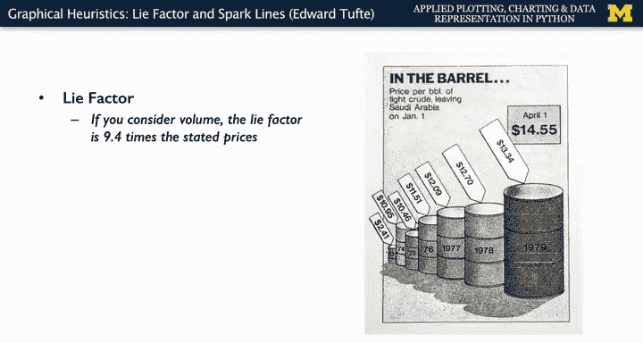

# 36：图形启发式：谎言因子与火花线（Edward Tufte）📊

在本节课中，我们将要学习数据可视化领域的两个重要概念：**火花线** 与 **谎言因子**。这两个概念由爱德华·塔夫特提出，旨在帮助我们更清晰、更诚实地呈现数据。

爱德华·塔夫特对简洁和极简主义的强调赢得了大量追随者。他被广泛认为是图表和图形可视化领域最具影响力的作家之一。

在他的著作《美丽的证据》中，他提出了一个将图表极简主义推向新高度的想法。他建议不应将图表作为一个需要单独研究的独立产物，而是应该将其简化并嵌入到讨论的上下文中。

他认为，一个小的图形，例如一个时间序列折线图，可以快速传达更多信息，这对读者来说是无价的。他将这些元素称为“火花线”，并称它们为“数据词汇”，这是一种弥合文本与图形之间差距的有趣方式。

上一节我们介绍了火花线的核心思想，本节中我们来看看它的具体应用和形式。

他建议火花线不仅可以直接在文本中表示，还可以与它们所描述的数据一起嵌入到表格中。这个想法变得如此自然，以至于被最常见的电子表格分析软件之一——微软Excel所采纳。

以下是纳斯达克证券交易所的表格数据图片，显示了四只科技股在一个月内的开盘价。

花点时间思考一下这些数据。哪只股票本月表现不佳，呈下降趋势？哪只股票本月表现良好，呈上升趋势？

如果我在下面的单元格中添加火花线，情况就一目了然了。在这里，你可以立即看到苹果公司股价下跌，本月表现不佳；而IBM股价上涨，本月表现良好。至于亚马逊和英特尔，趋势不太明确，我们看到整个月内有一些波动。

现在，这些火花线并不能帮助我们回答谁的股价最高，或者谁赢利或亏损最大，但它们确实让我们对数据背后的趋势有了一个总体感觉。实际上，火花线用于那些趋势或分布特征很重要的数据。

以下是火花线在谷歌财经网站上使用的另一个例子。

请注意，你实际上可以通过这些火花线快速放大查看分布的各个部分，因此它们不仅仅是数据的表示，更是一种与之交互的方法。

火花线有许多不同的用途，定制化界面（如电子游戏）就是一个很好的例子。我认为一个现代的火花线变体，被称为“SparkT”，非常巧妙。它使用Unicode块字符在Twitter分配的140个字符内显示条形图。

例如，这里有一位用户将她四月份的睡眠时间以条形图的形式发布在推文中。

上一节我们探讨了火花线，接下来我们将了解塔夫特的另一个重要原则：谎言因子。

我想与大家分享的最后一个塔夫特原则叫做“谎言因子”。谎言因子是图形中显示的效果大小除以数据中实际效果大小的比值。这通常是无意识地为了帮助讲述一个故事，然而，它会对观察者产生误导。

谎言因子有很多不同的例子。我认为1979年《时代》杂志上的这个例子提供了一个很好的说明。图中展示了不同年份的油桶，用以表示六年间的石油价格，但观察者不清楚一个油桶的大小与其他油桶的关系。部分原因是这里存在透视元素。这些油桶是大小不同，还是仅仅因为有些在前、有些在后而显得不同？是油桶的体积代表成本的增长，还是油桶的高度代表成本的增长？

火花线和谎言因子是爱德华·塔夫特为我们提供的另外两个理解和传达数据的工具。

本节课中我们一起学习了爱德华·塔夫特提出的两个关键可视化概念。**火花线** 是一种将小型趋势图嵌入文本或表格的极简方法，能快速传达数据趋势。其核心思想是 `data_word = text + sparkline`。而**谎言因子** 则是一个衡量图形失真程度的指标，其公式为 `lie_factor = (graphic_effect_size) / (data_effect_size)`，提醒我们在呈现数据时应保持诚实与准确。掌握这两个工具有助于我们创建更有效、更可信的数据可视化作品。