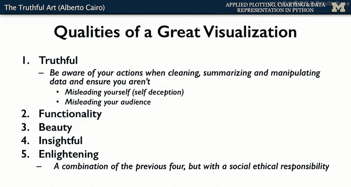

# 37：优秀信息图表的五个品质 📊

在本节课中，我们将学习阿尔贝托·开罗在其著作《真相的艺术》中提出的核心框架，该框架定义了优秀信息图表的五个关键品质。理解这些品质有助于我们创建更有效、更负责任的数据可视化作品。

---

## 概述：开罗的五品质框架

阿尔贝托·开罗的《真相的艺术》一书被认为是数据科学领域的必读之作。他将该领域众多专家的见解浓缩为一系列令人难忘的课程。虽然我们无法涵盖书中的所有内容，但本讲座将重点介绍该书的基础：一个用于评估信息图表质量的五部分框架。

重要的是，开罗指出这些品质并非彼此独立，而是相互关联的。因此，尽管我们倾向于简化分析，但在学习过程中请记住，不同的品质之间是相互作用的。

---

## 品质一：真实性 ✅

优秀可视化的首要品质是真实性。开罗承认，“真实”可能具有主观性，并且是一个连续体，某些事物可能比其他事物更真实，要确立绝对真实或许是不可能的。

但他认为，作为数据科学家，我们在维护真相方面有两项义务。

**第一项义务是对自己诚实。** 在清理和汇总数据时，我们所进行的活动是否会因为施加的限制而掩盖信息？我们应该明确考虑对数据所做的每一项修改，确保不会陷入他所说的“自我欺骗”。怀疑精神是数据科学家的一项重要技能。我们常常过于专注于寻找模式，以至于以不符合所描述现象本质的方式来简化或呈现数据。

**第二项义务是对我们的受众诚实。** 也就是说，在数据科学和信息可视化中，存在一些技术可以用来突出特定的数据片段。这确实是这些领域的一般目的。但如果我们剥夺了读者更全面探索现象的能力，就会引发怀疑和不信任。

开罗引用了一个由美国有线电视和电信协会发布的图表作为绝佳例子。该图表暗示放松监管后，有线电视公司的行业投资增加了四倍。然而，原图表存在几个问题：货币是否经过通货膨胀调整不明确；两个柱状图代表的时间跨度不同；图表缺失了1997和1998年的数据，且数据止于2003年，但信息却在2014年发布。

一个更诚实的视图是什么样的？开罗追踪数据并提供了一个折线图。从图中可以看到，监管之后确实有持续的投资，放松监管后投资略有下降，随后出现大幅飙升，接着从2002年后显著下降——而原图表排除了大部分下降时期的数据。

这里的教训是：虽然可能没有绝对真理，但存在比其他方式更真实的展示数据的方法。

---

## 品质二：功能性 ⚙️

需要考虑的第二个可视化品质是是否具有功能性。这同样是一个连续体。

我们之前见过一个例子，即由Dark Horse Analytics提供的关于NCRAT数据的幻灯片。如果你期望受众想要比较两个数据系列，直接标注它们是提高理解力的一种方式。

虽然有许多提高功能性的启发式方法，但我希望你们记住我们与Chart Junk进行的用户测试。我认为现在是理解特定情境下人类行为的激动人心的时刻。网络极大地提高了我们在不同人群中大规模测试社会和行为假设的能力，Cdflower和Mechanical Turk就是其中的两个例子。

理解某种可视化方法的功能性如何，不一定需要昂贵的民族志研究。现在通过众包直接测试假设要容易得多。

---

## 品质三：美观性 🎨

开罗分享的第三个可视化品质是是否美观。我认为这需要非常了解你的受众。基于人们的生活经历以及性别、文化等自身因素，会有不同的感知。构建一个美观的信息可视化体验涉及很多方面，这也取决于情境和背景因素。

例如，如果你在为一份报告制作图表，你选择的颜色、样式，甚至字体选择，可能更多地与美观性相关，而非功能性。但这些元素的相互作用是难以忽视的。

我想知道，美观性这个广泛的主题是否是“图表垃圾”与“记忆性”问题中的一个混淆因素？虽然塔夫特认为图表垃圾会分散注意力并产生误导，但贝特曼等人的研究表明，它可以使可视化作品更令人难忘。这种脱节是否是信息图表中美观性的问题？

关于美观性和信息，这里有一个或许能阐明这一品质的临别思考。最受欢迎的技术杂志之一《连线》以其整版的信息图表而闻名。在《连线》的网站上，他们将这些文章标记为“信息色情”，指的是他们希望读者在阅读文章时产生的那种发自内心的反应。

---

## 品质四：启发性 💡

开罗提出的第四个品质是信息图表应具有启发性。它们不应仅仅复制数据和表格，而应吸引观看者，使其产生“啊哈！”或“我发现了！”的时刻。

我主要在学术论文的背景下思考这一点，这是我大部分工作的领域。新手作者在这方面的一个常见问题是，为他们拥有的每一份数据都包含一个图表。这完全没有必要，会增加冗余并导致读者疲劳，但正确的图表能迅速阐明研究结果。

在我的领域，同行评审很常见，但评审者没有大量时间进行完整评审。在翻阅提交的论文时，评审者看到一幅跃然纸上的图像并立即获得洞见，这为他们理解论文其余部分要讲述的更细致入微的故事做好了准备。

---

## 品质五：教化性 🌟

开罗提出的最后一个可视化品质是信息图表应具有教化性。这与启发性不同。事实上，开罗认为这一品质由前四个品质（真实、功能、美观、启发）构成，但它是独立的，因为它增加了一个社会责任的维度。

---

## 总结与课程结束

“信息可视化在道德上是中立的吗？”这个问题可能没有明确的答案。但毫无疑问，开罗提出的优秀可视化的五个品质——真实、功能、美观、启发、教化——非常值得考虑。开罗还有更多优秀的作品，在本讲座之后，我布置了他的阅读材料以及一个讨论问题，鼓励你们就信息可视化与数据科学相关的道德中立性发表看法。

本周的课程到此结束。我们很快地涵盖了大量材料，但我真的相信，阿尔贝托·开罗和爱德华·塔夫特这两位作者，为我们将在课程第二周重点关注的实用数据科学技能奠定了坚实的基础。