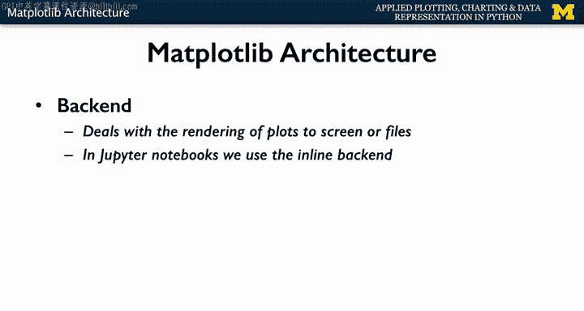
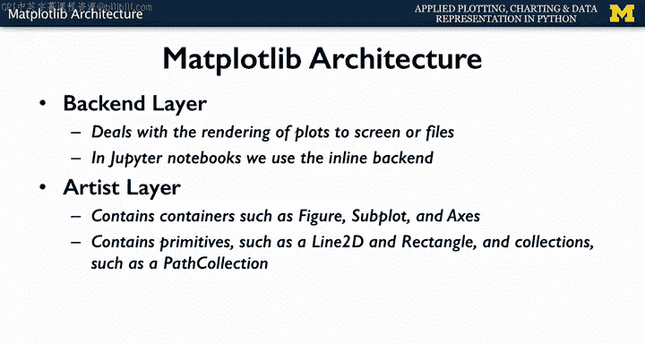
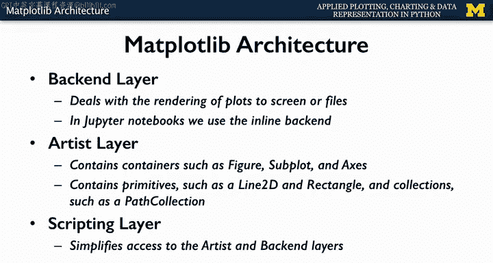

# 📊 课程名称：Python用于数据科学实践（第3课）｜Matplotlib架构解析


在本节课中，我们将要学习Matplotlib的核心架构。理解其层次结构对于高效使用这个强大的绘图库至关重要。我们将从后端层开始，逐步深入到艺术家层和脚本层，并探讨程序化与声明式可视化方法的区别。

## 🏗️ Matplotlib的层次结构

我们将像使用Pandas一样，在Jupyter Notebook中使用Matplotlib。Jupyter为Matplotlib提供了一些专门的支持，这是通过使用IPython魔术命令 `%matplotlib inline` 启用的。

在Jupyter Notebook中，IPython魔术命令是辅助函数，它们负责设置环境，以便启用基于Web的渲染。Matplotlib本身在Jupyter环境之外也能很好地工作，但本课程我们将重点介绍其在Web环境中的使用，部分原因是Jupyter在数据科学实践中已变得非常流行。

当你运行带有 `inline` 参数的魔术函数 `%matplotlib inline` 时，实际上发生的是Matplotlib被配置为在浏览器中渲染。这种配置被称为**后端**，Matplotlib有许多不同的后端可用。



一个**后端**是一个抽象层，它知道如何与操作系统环境（无论是操作系统本身还是像浏览器这样的环境）交互，并知道如何渲染Matplotlib命令。实际上，有许多不同的交互式后端，但也有被称为**硬拷贝后端**的后端，它们支持渲染为可缩放矢量图形（SVG）或PNG等图形格式。


并非所有后端都支持所有功能，尤其是交互式功能，我们将在本课程后面部分简要提及。

## 🔧 后端层

让我们导入Matplotlib库（我们将以 `plt` 作为别名导入），并调用 `plt.get_backend()` 来确保我们正在使用正确的后端。

```python
import matplotlib.pyplot as plt
print(plt.get_backend())
```

你会注意到Matplotlib有很多非Python风格的命名约定。特别是，你将使用 `get` 和 `set` 模式来访问变量，这种访问器模式在Java等语言中更常见。这只是你需要习惯的事情，但请记住，在Jupyter Notebook中你可以按Tab键进行自动补全，这可以帮助你找到所需的函数。

现在，我们不会在后端层花费太多时间，但了解它很重要。例如，如果你在Mac OS上，使用Matplotlib时的默认后端可能是 `MacOSX`，而在Linux上，默认后端可能是 `GTK`。

## 🎨 艺术家层

接下来我们将花费大部分时间的层是**艺术家层**。艺术家层是围绕绘图和布局原语的抽象。

可视化的根源是一组容器，其中包括一个**图形**对象，该对象包含一个或多个**子图**，每个子图又包含一个或多个**坐标轴**。最后一个对象——**坐标轴**，是你最常与之交互的对象，例如更改给定轴的范围或在上面绘制形状。

需要简要说明一下，尤其是在这个有来自世界各地、英语可能不是其母语的学员参与的全球课堂中。Matplotlib严重依赖 `axes` 对象，它是 `axis` 的复数形式。但Matplotlib也有一个 `axis` 对象，而一个 `axes` 实际上由两个 `axis` 对象组成：一个用于X（水平）维度，一个用于Y（垂直）维度。因此，你可能会听到我比平时更刻意地发音这两个词（`axes` 和 `axis`），以帮助大家更容易理解。

艺术家层还包含**原语**和**集合**。这些是基础的绘图项，比如矩形、椭圆或线条，以及项的集合，例如**路径**，它可能将多条线组合成一个多边形形状。集合很容易识别，因为它们的名称往往以 `collection` 结尾。

值得花点时间看看有哪些类型的艺术家可用。以下是Matplotlib文档中关于艺术家的一张图片。你会看到艺术家对象有很多子对象，其中一个叫做 `patches.Patch`。这个名字来源于该项目的Matlab根源，一个 `Patch` 是任何具有面颜色和边缘颜色的二维对象。`Patch` 类的子类就是我们讨论过的原语。

好的，所以Matplotlib有两层：**后端层**，它了解底层图形例程，可以渲染到屏幕或文件，我们的大部分工作将使用 `inline` 后端；以及**艺术家层**，它描述原语、集合和容器，知道图形如何由子图组成，以及对象在给定坐标轴坐标系中的位置。

有了这些，我们实际上就可以开始构建图形并渲染它们了。



## 📝 脚本层


但还有一层对我们数据科学家来说尤其重要，这被称为**脚本层**。你看，如果我们要编写一个使用Matplotlib的应用程序，我们可能永远不会关心脚本层，但这一层有助于简化和加速我们与环境的交互，以便快速构建图表。

坦率地说，它通过为我们做一堆“魔法”来实现这一点。一个人能否有效使用Matplotlib，通常取决于他对脚本层这种“魔法”的理解程度。我们在本课程中使用的脚本层叫做 `pyplot`。

这就描述了Matplotlib的层次结构：有一个处理实际绘图的**后端**，后端之上有一组描述数据如何排列的**艺术家**，以及一个实际创建这些艺术家并将它们编排在一起的**脚本层**。

## 🤔 程序化与声明式可视化



在继续之前，我还想再讨论一个话题，那就是**程序化**与**声明式**可视化库（以及更广泛的用户界面）之间的区别。

`pyplot` 脚本层是一种构建可视化的**程序化**方法，我们告诉底层软件我们希望它执行哪些绘图操作来渲染我们的数据。

也存在**声明式**的数据可视化方法。HTML就是一个很好的例子。它不是向后端渲染代理（对于HTML来说是浏览器）发出一连串的命令，而是将文档格式化为文档中关系的模型，通常称为DOM（文档对象模型）。这是创建和表示图形界面的两种根本不同的方式。

例如，流行的JavaScript库D3.js就是声明式信息可视化方法的一个例子，而Matplotlib的 `pyplot` 则是程序化信息可视化方法的一个例子。

在下一讲中，我们将开始动手制作一些图表。但在那之前，我希望你查阅一下John Hunter和Michael Droettboom的一篇文章。虽然现在有点过时，但这篇文章发表在《开源应用架构》第二卷中，为Matplotlib的架构提供了更多背景信息。

## 📚 总结


本节课中，我们一起学习了Matplotlib的三层核心架构：**后端层**负责与系统交互和渲染；**艺术家层**定义了图形、坐标轴、原语和集合等绘图元素；**脚本层**（特别是 `pyplot`）提供了简化、程序化的接口来快速创建图表。我们还探讨了程序化与声明式可视化方法的区别。理解这些层次将帮助你更高效、更灵活地使用Matplotlib进行数据可视化。