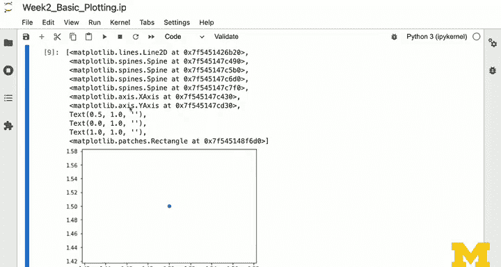

# 40：Matplotlib基础绘图 🎨


在本节课中，我们将要学习Matplotlib库的基础知识，了解其架构的不同层次，并掌握使用脚本层进行基本绘图的方法。我们将从设置后端开始，逐步探索如何创建图表、添加数据点以及理解Matplotlib在幕后是如何工作的。

---

### 后端设置

在之前的Matplotlib版本中，我们会在Jupyter中使用一种名为“NB A”的后端样式。但现在情况已经改变，我们使用一个内联后端引擎。你不需要深入了解其细节，但知道可以自行查看是有帮助的。

让我们导入Matplotlib并检查今天将使用的后端。

```python
import matplotlib as mpl
mpl.get_backend()
```

运行上述代码会告诉我们正在使用哪个模块。今天，我们使用的是 `backend_inline` 模块，这是目前在Jupyter中通常使用的后端。

---

### 开始绘图之旅：使用plot函数

我们将通过使用 `plot` 函数制作图表来开始我们的绘图之旅。一个图表包含两个轴：底部的x轴和垂直的y轴。

首先，导入pyplot脚本层，通常别名为 `plt`。我们将要运行的、针对pyplot模块的所有函数，都是其架构中脚本层的一部分。

让我们通过查看文档字符串来了解一下 `plot` 函数。

```python
import matplotlib.pyplot as plt
plt.plot?
```

运行此命令后，Jupyter会为我们查找并显示该函数的文档字符串。你可以看到方法签名 `plot.plot`，它包含 `*args`、`scalex`、`scaley` 和 `**kwargs` 参数。文档内容非常详尽，与在线文档一致。

---

### 理解函数参数

对于不熟悉Python函数声明的人来说，带有 `*args` 和 `**kwargs` 参数的函数可能有些晦涩。`*args` 表示该函数支持任意数量的未命名参数。`**kwargs` 则表示它支持任意数量的命名参数。这使得函数声明非常灵活，因为你可以传入任意数量的参数，无论是否命名。但这使得我们难以知道应该使用哪些合适的参数。

继续阅读文档，我们看到在这种情况下，参数将被解释为 **X， Y** 对。让我们从这里开始。

---

### 绘制第一个数据点

让我们尝试在位置 **(3, 2)** 绘制一个数据点。

```python
plt.plot(3, 2)
```

返回值是绘图对象本身，Jupyter会自动在笔记本中显示并渲染它。然而，我们没有看到任何数据点，这有点奇怪。原来，`plot` 的第三个参数应该是一个字符串，用于指定我们希望如何渲染该数据点。让我们使用一个句点 `.` 来表示一个点。

```python
plt.plot(3, 2, '.')
```

现在，我们的数据点显示出来了。文档告诉我们不同的字符将如何渲染，这里我们只是使用句点作为标记。

---

### 关于后端和交互性

你会注意到，后续对 `plot` 的调用并没有更新我们之前的可视化。我们使用的后端不是交互式的，因此这些后续调用会在笔记本中创建新的图表作为新的单元格。这是迭代式探索数据的一种便捷方式。

---

### Matplotlib的架构：脚本层与艺术家层

Matplotlib库的一些混淆之处往往源于此。在上节课中，我解释了存在一个艺术家层，它包含带有子图、坐标轴和数据点的图形，它们都作为“补丁”渲染在这些坐标轴上。但我们在这里并没有实际看到任何这些对象，我们只是在一个名为 `plot` 的模块上调用了一个函数。这是怎么回事？

虽然pyplot脚本接口为你管理了许多这些对象，它会跟踪最新的图形、子图和坐标轴对象，但它实际上隐藏了这些方法的一些细节。pyplot模块本身有一个名为 `plot` 的函数，但它将对此函数的调用重定向到当前的坐标轴对象。这造成了显著的学习曲线，你会在许多网络教程和Stack Overflow上看到人们对于这两种显示图形的方法感到困惑。

在数据科学工作流中，我认为更常见的是像我们刚才那样使用这个脚本层，但花点时间了解一下另一种更冗长的面向对象方法也是值得的。

---

### 面向对象方法（艺术家层接口）

实际上，虽然有些人称之为Matplotlib对象API，但我认为更准确的说法是直接与艺术家层接口。

下面我将做一个小演示。首先，我将导入一个名为 `FigureCanvasAgg` 的新后端，然后引入 `Figure` 对象，这是我们将要使用的顶级对象。

```python
from matplotlib.backends.backend_agg import FigureCanvasAgg
from matplotlib.figure import Figure

fig = Figure()
canvas = FigureCanvasAgg(fig)
```

然后，我们可以直接向这个图形添加一个子图。我们将在未来的课程中更多地讨论子图。这里的数字 `1, 1, 1` 实际上意味着我们想添加一个图。`add_subplot` 的返回值是坐标轴对象，它包含绘图方法，我们通常称之为 `ax`。

```python
ax = fig.add_subplot(111)
```

现在，我们可以开始绘图了。我们可以像往常一样在坐标轴上绘图。

```python
ax.plot(3, 2, '.')
```

最后，我们有了这个图形，但我们的后端实际上无法直接在Jupyter Lab中渲染它。记住，我们这里的后端是 `FigureCanvasAgg`。所以我们必须将其保存到一个PNG文件。

```python
canvas.print_png('test.png')
```

执行后，你看不到任何东西。所有这些对象都已创建，但除了保存在文件中，它们没有在任何地方渲染。我们可以使用一个快速的HTML单元格魔法来执行并查看渲染的图像。

```python
%%html

```

这比使用脚本层要多做很多工作，但你可以看到效果是相同的。要在这里使用HTML单元格魔法，我们只需在单元格开头加上 `%%html`，这告诉Jupyter将剩余的代码渲染为HTML。

---

### 脚本层的工作原理

重要的是要注意，脚本层并非魔法，它只是为我们做了一些幕后工作。例如，当我们调用 `plt.plot` 时，脚本层实际上会查看当前是否存在图形，如果没有，则创建一个新的。然后它返回该图形的坐标轴对象。

我们不必存储任何这些，因为我们总是可以使用 `gcf` 函数（代表“获取当前图形”）来访问当前图形。类似地，我们有另一个函数 `gca`（获取当前坐标轴），它将返回当前的坐标轴以供渲染。

让我们用pyplot创建一个新图形，获取坐标轴并设置一些XY限制。

```python
plt.figure()
plt.plot(3, 2, 'o')  # 使用圆圈标记
ax = plt.gca()
ax.axis([0, 6, 0, 6])
```

现在我们可以看到点被渲染了，它看起来有点不同，并且如果你回头看，x轴和y轴的坐标值已经被约束了。

---

### 组合图表的基础知识

你可以在任何时候向坐标轴对象添加“艺术家”。当我们调用 `plot` 函数时，pyplot实际上正在为我们做这件事。它根据字符串确定我们想要的形状、与该形状关联的位置，并创建一个“补丁”对象并将其添加到坐标轴。

如果我们在渲染之前对 `plot` 函数进行后续调用，数据实际上将作为不同的序列添加，并适当着色。

```python
plt.figure()
plt.plot(1.5, 1.5, 'o')
plt.plot(2, 2, 'o')
plt.plot(2.5, 2.5, 'o')
```

现在你可以看到我们有三个不同的点排成一条线，并且我们的坐标轴被约束以适应这些数据。

---

### 探索坐标轴的子对象

很多复杂性对你来说是隐藏的，但你可以通过坐标轴对象更进一步，甚至可以获得坐标轴包含的所有子对象。

我们可以使用 `get_children` 函数来实现这一点，我想向你展示一下这是什么样子，因为我认为知道它的存在是很有趣的，即使你不会经常使用它。

```python
ax = plt.gca()
ax.plot(1.5, 1.5, 'o')
print(ax.get_children())
```

对于这个图像，我们实际上有很多东西：一个 `Line2D` 对象、一堆 `Spine` 对象、一个 `XAxis` 对象、一个 `YAxis` 对象。你可以在文档中查找每一个。在这种情况下，包含在坐标轴中的 `Line2D` 对象实际上是我们的数据点。我们还有这些 `Spine` 对象，它们是框架边框的实际渲染，包括所有刻度标记、两个坐标轴对象和一堆文本（图表的标签）。甚至还有一个 `Rectangle`，那实际上是坐标轴的背景。

---



### 总结与展望

本节课我们一起学习了Matplotlib的基础知识。我们了解了如何设置后端、使用 `plt.plot` 函数创建基本图表、理解脚本层与面向对象方法的区别，以及如何探索图表的内部结构。

我们进行了一次关于如何高效使用Matplotlib并制作第一个图表的快速导览。实际上，你可能不会花很多时间去获取单个“艺术家”或与“Spine”对象交互，但如果你愿意，你可以这样做。这个系统并非魔法，我们已经走过了如何更好地调查以理解底层实际发生的过程。

在下一讲中，我们将介绍Matplotlib中一些不同的内置图表选项。