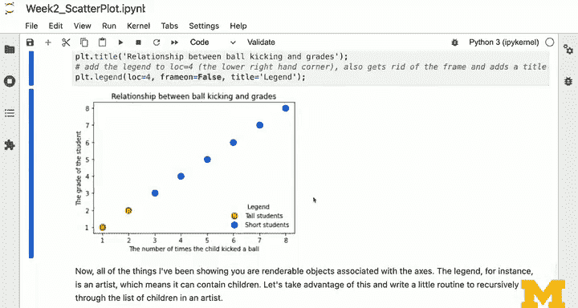

# 41：散点图绘制 🎯

在本节课中，我们将要学习如何使用Matplotlib库绘制散点图。我们将从回顾上一讲的知识点开始，然后深入探讨散点图的基本绘制方法、自定义属性，以及如何操作和理解Matplotlib的底层结构。

---

### 回顾与基础概念

上一节我们介绍了`plot`函数，它生成一系列点并在坐标轴对象上渲染。

Matplotlib在脚本层实际上有许多有用的绘图方法，对应我们可能想要使用的不同图表类型。我们不会在这里介绍所有方法，但会涉及几个主要的。

无论如何，我们需要记住在上一讲中学到的几点内容。

首先，Pylot使用`gcf`函数获取当前图形，然后使用`gca`函数获取当前坐标轴。Pylot会为你跟踪所有这些坐标轴对象。但不要忘记它们的存在，我们可以在需要时获取它们来执行操作。

其次，`pyplot`模块的API与坐标轴对象的API完全一致，因此你可以直接调用`pyplot`模块的`plot`函数，这实际上是在底层调用坐标轴对象的`plot`函数。

最后，请记住Matplotlib中大多数函数的声明都带有一组开放的关键字参数。你可以使用许多不同的属性来控制这些关键字参数，但你在文档中不会为每个函数找到它们的描述。这可能有点令人沮丧，因为你最终只能通过示例来学习。

本周我将开始穿插使用一些这样的参数，以演示Matplotlib文档及其价值。你可以使用问号查看每个函数的文档。

考虑到这些，让我们继续首先讨论散点图。

---

### 散点图基础

散点图是一种二维图，类似于我之前展示的线图。`scatter`绘图函数将X轴值作为第一个参数，Y轴值作为第二个参数。

如果两个参数相同，我们会得到这些点沿对角线整齐排列的效果。

和之前一样，我将导入Matplotlib的`pyplot`模块作为`plt`，并引入该脚本接口。

我还将导入NumPy，稍后会用到它。Matplotlib实际上非常依赖这些NumPy数组，因此你会看到很多使用它的例子。

我要做的第一件事是创建一些模拟数据。我将创建一个包含八个数据点的列表，从1到8，然后从中创建一个数组。接着，我将使其对称，因此`y`值将与`x`相同。

然后，我想为这个单元格创建一个全新的图形，并让Matplotlib生成一个散点图。这与`plt.plot`函数类似，但此处的底层对象不是`Line2D`。

我们可以看到这些点的整齐排列，对称且沿对角线分布。X轴和Y轴已被Matplotlib自动约束以适应我们的数据。

现在，`scatter`不像`plot`那样将项目表示为系列，相反，我们实际上可以传递一个颜色列表，该列表对应于给定的点。

让我们使用一些基本的列表运算来创建一个新列表，长度略少于我们所需的数据点数，并将所有这些值设置为绿色，然后我们将最后一个点设置为红色。

我们使用相同的数据1到8。现在我还想创建这个列表：绿色、绿色、绿色……一直到最后一个红色。我本可以直接在这里硬编码这个列表，但我在文档中写出来是为了让你能看到。你也可以只取一个包含字符串“green”的单元素列表，然后乘以我们数据长度减1，这将在这里创建七个绿色元素，然后我只需向其附加一个红色。我只是想向你展示，你可以在这里使用正常的NumPy参数。

然后我们将创建一个新图形，这次当我们调用`scatter`时，我们将传入X和Y。我将在这里展示一个新参数`S`代表大小，然后我将传入我们为这些点所需的颜色列表。

我们看到我们得到了所有这些点。它们稍微大了一点。除了最后一个点是红色的，其他都是绿色的。

---

### 数据组织模式

将数据点分离到列表中是Matplotlib中一个相当常见的模式。你有一组项目，但它们实际上被描述为跨多个不同数据源的相同切片。

熟悉面向对象编程的人可能期望每个数据点实际上都有自己的实例来表示，该实例封装了它的所有属性。例如，一个点具有x值、y值、颜色和大小。但这里的情况并非如此。

这就是为什么了解我们在第一门课程中讨论过的列表推导式和Lambda表达式会很有用。同样重要的是`zip`函数和列表解包。因为这在Python数据科学领域非常常见，我将在这里稍微离题讨论一下。

回想一下，`zip`方法接受多个可迭代对象，并根据索引匹配元素，从中创建元组。因此，如果我们有两个数字列表，`zip`将取每个列表的第一个元素创建一个元组，然后取每个列表的第二个元素创建另一个元组，依此类推。

还要记住，`zip`具有惰性求值，因为它在Python 3中实际上是一个生成器。这意味着如果我们想看到迭代`zip`的结果，我们需要使用`list`函数，我们称之为“实现”生成器。

让我在这里演示一下。我们将使用`zip`函数创建一个新的生成器，传入两个数字列表。当我们将这个生成器转换为列表时，我们会看到一个成对元组的列表。

我有两个列表在这里，1到5和6到10。我把它们传入`zip`，其返回值实际上是一个生成器。然后在这里我将打印该生成器的列表，这将“实现”生成器，它实际上会遍历生成器并创建新列表，并产生这个输出。

现在，我们可以再做一次。但这次，我们可以使用解包而不是列表。我有完全相同的生成器函数，创建了完全相同的生成器，但这次我调用`print`，并且我使用`zip_generator`加星号。在这种情况下，它实际上将该集合解包为位置参数。你会看到我们得到了所有相同的对：(1,6), (2,7), (3,8)……但它们不是一个单一的列表，而是单独的参数。

将点数据存储为元组很常见，你应该熟悉能够将数据转换为此形式以及从此形式转换回来。

如果我们想将数据转换回两个列表，一个包含X分量，一个包含Y分量，我们可以使用带`zip`的参数解包。当你向函数传递一个列表或可迭代对象并在其前面加上星号时，每个项目实际上都会从可迭代对象中取出并作为单独的参数传递。

好了，这是一个关于一个有价值工具的简短离题，在Python的实际数据操作和清理中你会经常看到它。

---

### 绘制多个数据系列

现在让我们回到绘图。让我们取这两个列表，并使用`scatter`将它们作为一个新图形绘制。我们不是将它们绘制为一个数据系列，而是对列表进行切片，并将它们绘制为两个数据系列。

与之前为每个数据点设置颜色不同，如果我们愿意，我们可以用单个值为每个系列着色。我们还可以做一些事情，比如更改整个系列的颜色或透明度，当然也可以添加描述性标签。

在这个例子中，我将创建一个新图形。然后我将用红色绘制一个“高个子学生”的数据系列，使用X和Y的前两个元素。所以我只取之前的`x`变量和`y`变量，记住这是切片符号，它只取出两个元素，即前两个元素。我将大小设置为100，颜色设置为红色。如果你像这样只传递一个项目，这将把所有项目着色为红色。然后我设置了一个标签“tall students”。然后我将为这里的“矮个子学生”做同样的事情，但实际上是从第二个元素开始，也就是第三个位置，因为我们从零开始索引。我将把它设为蓝色。让我们执行它。

我们可以看到图像中有两个红色的高个子学生，然后所有这些蓝色的矮个子学生。你会注意到标签目前没有显示，它实际上只是为每个系列内部保存着，我稍后会讲到这一点。但现在让我们更多地讨论坐标轴的属性。

---

### 坐标轴标签与图例

坐标轴通常有标签来解释它们代表什么或它们描述的单位。图表也往往有标题。所以让我们把这些放到位。由于`pyplot`镜像了坐标轴对象的大部分API，我们可以直接在`pyplot`对象上进行这些调用。

所以我要做完全相同的事情，创建一个新图形。我将创建我们的两个散点图。现在如果我只想添加一个标签，我将添加X轴标签。所以它会出现在底部。“孩子踢球的次数”是我在这里写的。然后我们也可以为Y轴添加一个标签。我们可以直接使用`plt.xlabel`、`plt.ylabel`和`plt.title`。在底层发生的是，`plt`正在调用`gca`获取当前坐标轴，然后调用`set_xlabel`和`set_ylabel`。

让我们也添加一个图例。你会看到Matplotlib将把我们的图例放在左上角，并在那里放置一些关于我们学生的视觉信息。所以我这里有完全相同的代码，只是复制粘贴了它。但在这里我将添加图例。要做到这一点，我们只需调用`plt.legend`。它指示我们应该添加该图例，并使用数据上已存在的标签。所以如果你有那些标签，Matplotlib就会使用它们。

如果你查看图例的文档，你会看到有许多不同的参数，其中一个叫做`loc`，值为4实际上会将其放在坐标轴的右下角。我们还可以去掉边框，添加标题，并进行任意数量的不同视觉转换。

所以我在这里取了完全相同的代码，现在对于`plt.legend`，我不是告诉Matplotlib随意处理，而是将其位置设置为4。我说我想要边框关闭，所以`frameon=False`，并且我为图例设置了一个标题。

---

### 探索Matplotlib底层结构

到目前为止，我向你展示的所有东西都是与坐标轴关联的可渲染对象。例如，图例是一个“艺术家”，这意味着它可以包含子对象。

让我们利用这一点，写一个小例程来递归地遍历艺术家及其子对象列表。

这是一个有趣的活动，我喜欢用它来真正演示Matplotlib在底层是如何工作的。所以我们将从Matplotlib导入`Artist`类。再次强调，在你进行常规数据科学工作时不会这样做，但有时你想调试一个图表或图形，并想真正理解它在底层是如何构建的，我认为这非常强大。所以我们只是要创建这个名为`rec_g`的递归函数。它将接受某个艺术家和某个深度参数。它将检查传入的对象是否是艺术家，如果是，它将只打印出它的名字，然后它将使用`get_children`递归地调用自身。所以我们在这里使用了一些有趣的东西。我们打印出几个空格，然后是深度，然后是艺术家的名字。所以我们会得到一个漂亮的缩进列表。

最后，让我们在传奇艺术家上调用这个函数，看看图例实际上是由什么组成的。

你可以看到那个简单的小图例，一个小标题，一个小盒子，几个点，作为一个艺术家，实际上是由许多不同的用于绘制的偏移框，以及文本区域和路径集合组成的。

我想让你从这里带走的是，Matplotlib所做的事情并没有什么神奇之处。对脚本接口的调用只是创建图形、子图和坐标轴。然后用各种艺术家填充这些坐标轴，这些艺术家是后端渲染器，被输出到屏幕或我们之前看到的文件等其他媒介。

---

### 总结与展望

现在，虽然你95%的时间都会愉快地在脚本层创建图表和图形，但为了另外5%的时间，理解库在底层的工作原理很重要。

你将使用这些知识的时候是当你想要对图表有非常精细的控制，并创建你自己的图表函数时。在本课程结束时，你将有机会这样做。

在下一讲中，我们将回到线图，再创建几个，然后进入条形图。

---

本节课中我们一起学习了如何使用Matplotlib绘制散点图，包括基本绘制、自定义颜色和大小、处理多个数据系列、添加坐标轴标签和图例，并初步探索了Matplotlib的底层对象结构，为后续更复杂的图表制作打下了基础。