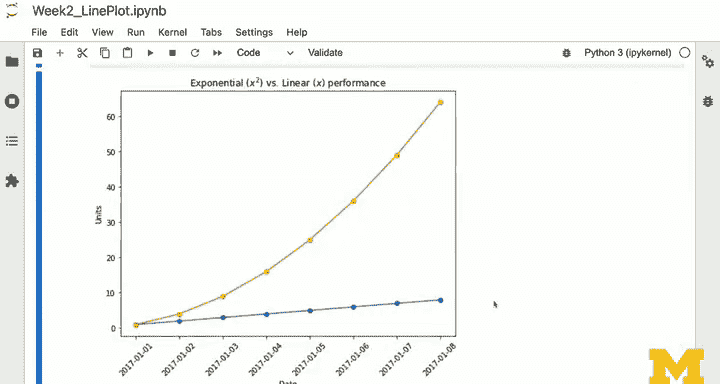

# 📊 课程名称：Python用于数据科学实践（1-3课／共5课）｜第42课：折线图绘制

在本节课中，我们将学习如何使用Matplotlib库绘制折线图。折线图是数据可视化中常用的图表类型，特别适合展示数据随时间或其他连续变量的变化趋势。我们将从基础绘制开始，逐步介绍如何添加多个数据系列、设置图表样式、处理日期数据以及添加高级功能，如填充区域和数学公式标签。

---


## 📈 折线图基础

上一节我们介绍了散点图，本节中我们来看看折线图。我们已经多次见过折线图，但它们看起来像散点图。事实上，我展示的第一个图表就是折线图，因为我们使用`plot`函数创建折线图。它会渲染多个数据系列，并用线条连接每个系列中的数据点。在第一个例子中，我只展示了一个点，所以没有看到任何线条。

让我们直接开始。与之前看到的散点图相比，折线图有几个新特点。


首先，我们只向`plot`函数提供了Y轴值，没有提供X轴值。然而，`plot`函数足够智能，能够理解我们的意图，并使用数据系列的索引作为X值。这在需要快速绘图时非常方便。

其次，我们看到图表识别出这是两个数据系列，并且来自不同系列的数据点和连接线颜色不同。这与散点图不同，散点图需要我们直接标记这些线条。

---

## 🛠️ 绘制多系列折线图

现在，我们将导入Matplotlib的Pyplot模块，并使用NumPy创建数据。

```python
import matplotlib.pyplot as plt
import numpy as np
```

我们将创建一个线性增长的数据系列和一个二次增长的数据系列作为演示。

```python
linear_data = np.arange(1, 9)
exponential_data = linear_data ** 2
```

这次，我将使用迷你格式化语言来描述标记和线条的渲染方式。之前你看到我使用`O`，它只创建圆形标记。但我们可以在前面加上破折号，以在圆形标记之间使用实线。

注意，我传递数据后跟每个系列的格式化字符串。我们将看到两个数据系列的结果：底部的线性系列和顶部的二次系列。

```python
plt.plot(linear_data, '-o', exponential_data, '-o')
```

这看起来有点奇怪，值得研究一下。这里我调用`plot`，传入数据，告诉图表如何渲染数据。然后我传入另一组数据，并告诉它如何渲染。我们可以为任意多的数据系列重复此操作。

我们可以看到这两个数据系列，二次和线性数据，被绘制在那里。

---

## ➕ 添加额外线条

现在很容易扩展这个图表并添加任意新线条。例如，我将使用`--r`，它告诉`plot`添加红色的虚线。

```python
plt.plot(linear_data, '-o', exponential_data, '-o')
plt.plot([1, 2, 3, 4], '--r')
```

我必须把它放在后续行吗？不，我可以直接在这里添加额外的参数。我只是想展示你可以这样做。

现在你可以看到我们有两个最初的数据系列，但现在我们有第三个系列，它基本上没有标记，只有虚线。

你注意到我做了什么吗？我没有调用`plt.figure`。默认情况下，Pyplot脚本接口会在你尝试做某事时调用`plt.gcf`。如果没有图形，它会为你创建一个。默认配置的Jupyter Lab会在每个单元格执行后自动关闭图形。这意味着Pyplot每次都会为我们创建一个新图形。这是一个很大的时间节省。

---

## 🏷️ 添加标签和图例

我们可以使用常规的轴函数为整个图形创建标签，也可以创建图例。但由于我们没有像散点图那样标记数据点，我们需要在添加图例本身时创建图例条目。

我喜欢在直接添加系列时标记我的数据点，但你不必这样做。我想展示这一点，因为你会看到很多不同的例子。当然，这些顺序大多无关紧要，因为它是在实际渲染之前设置这些轴对象。

这里我将在有任何数据之前创建一个X标签、Y标签和标题。事实上，这里的第一个将在我们做任何事情之前创建一个新图形和新轴对象并设置标签。

然后我将添加一个图例，并说图例中有三个东西：基线、竞争和我们。然后我将进行你刚才看到的完全相同的`plot`调用。

```python
plt.xlabel('X轴')
plt.ylabel('Y轴')
plt.title('示例折线图')
plt.legend(['线性数据', '指数数据', '额外数据'])
plt.plot(linear_data, '-o', exponential_data, '-o')
plt.plot([1, 2, 3, 4], '--r')
```

你可以看到它在这里很好地渲染，我们有一些数据，有其他数据，还有标题。

---

## 🎨 填充区域

这是介绍Matplotlib的`fill_between`函数的好时机。这个函数并非折线图专用，但通常与折线图一起使用以突出显示某个区域。我想在这个上下文中介绍它。

假设我们想突出显示绿色和蓝色曲线之间的差异。我们可以告诉轴使用`fill_between`函数在这些系列之间绘制颜色。

我可以有相同的代码：X标签、Y标签、标题、图例、绘图。然后现在我们需要获取当前的轴对象并调用`fill_between`。

我们没有为`plot`调用指定任何X值。默认情况下，它将使用传递的列表或数组的索引。所以我实际上将使用它已经使用的相同数据点范围，这是对称的。然后我们将把它作为我们的下界和上界，以及我们想要绘制的颜色。为了好玩，我将添加透明度。

```python
ax = plt.gca()
ax.fill_between(range(len(linear_data)), linear_data, exponential_data, facecolor='blue', alpha=0.25)
```

这里我说`plt.gca`，获取当前轴，然后调用`fill_between`。我想让你创建一个从线性数据的范围，那是一堆数字，那是我们的X值。这是我们的线性数据和指数数据。我想让你将这个填充区域的颜色设置为蓝色，并设置alpha为0.25。线性和指数数据将分别显示这个的下界和上界。

这渲染得很好，我们有这条蓝线，橙线，点，还有这个很好的填充阴影区域，我们还有所有的标题等等。我们的图表在功能上真的变得更加复杂了。

---

## 📅 处理日期数据

最有可能的是，你有一系列X值和Y值，你正在查看绘图，通常对于折线图，这以X轴上的日期时间形式出现。在早期版本的Matplotlib中，这很痛苦，你可以回到我之前关于这个的讲座视频，但实际上我已经能够大大缩短这个，因为Matplotlib正在不断发展。

所以让我们把这里的X轴改为一系列八个日期时间实例，间隔一天。

我将使用之前见过的NumPy的`arange`函数，你会在Stack Overflow问题、教科书或像这样的示例视频中经常看到这个。我将要求一个以天为间隔的日期排列，所以我给出开始日期和结束日期作为时间，然后将D类型设置为日期时间64，然后`arange`将创建那个排列。

```python
dates = np.arange('2017-01-01', '2017-01-09', dtype='datetime64[D]')
```

现在我只是重新绘制我们的线性和指数数据，所以我们有我们的观察，我们的线性数据，我们的观察和我们的指数数据。再次强调，这对于不习惯位置参数的人来说可能非常陌生。之前我们有数据格式化，然后数据格式化。现在因为我们希望这些日期沿着底部，我们有那些日期，数据格式化，日期，数据格式化。所以`plot`的参数位置随着我们指定的参数数量而变化，这些参数的格式在许多编程语言中非常非正统，包括许多Python，但它在Python中得到支持，这真的说明了Matplotlib在MATLAB中的根源。

这产生了一个相当不错的图形，有我们想要的日期。日期重叠得很厉害。这里有几件事我们可以做，例如，一切都来自2017年，所以我们可以采取简单的方法，只是遍历并更改标签，去掉年份，然后添加一个X轴标签，澄清这都是2017年的。这相当合理，但我想向你展示Matplotlib的几个功能，以及我们如何处理文本。

---

## 🔧 自定义刻度标签

轴对象有很多有趣的属性，你应该在作业中使用其中一些，我鼓励你现在去文档中探索它们，因为你开始掌握一些技能并理解如何构建这些基本图表。

例如，你可以获取网格线，主要和次要刻度的位置等等。就像所有艺术家一样，一个轴有一堆子对象，它们本身就是艺术家。事实上，如果你在Coursera的Jupyter Lab笔记本上跟着这个讲座，为什么不暂停视频并运行我们之前写的`rec_gc`函数，探索这个X轴对象上有哪些艺术家，它实际包含什么。

不过，我想展示的是，你可以使用`get_ticklabels`函数访问刻度的文本。每个刻度标签都是一个文本对象，它本身是一个艺术家，这意味着你可以使用许多不同的艺术家函数，一个特定于文本的是能够设置旋转函数，它允许以度为单位设置旋转。所以让我们遍历轴标签并更改每一个以旋转它。

```python
ax = plt.gca()
for label in ax.xaxis.get_ticklabels():
    label.set_rotation(45)
```

这看起来很容易。它很快，很流畅，你可以想象如果我们想要，我们可以如何进一步自定义这个。所以现在让我们重新添加我们的标题。

完全相同的事情，但现在我添加了底部的标签，X，Y和标题。我倾向于在底部添加我的标签，但这只是习惯，正如你之前看到的，你可以在任何时候添加它们。

好了，我们在Matplotlib中有了非常易读的日期。

---

## 📝 文本和可读性

当我们谈论文本和可读性时，让我分享另外两个见解。第一个涉及方程。Matplotlib与LaTeX有相当强的联系，LaTeX是数学家和科学家使用的排版语言。这意味着你可以直接在标签上使用LaTeX的一个子集，Matplotlib会将它们渲染为方程。

例如，这里我们可以设置轴的标题，以便其中直接有一个X平方。为此，我们用美元符号转义到LaTeX数学模式。注意，无论你是否安装了LaTeX，这都有效。很长一段时间，你在Mac OS或Windows上不会安装LaTeX，但有了完整的LaTeX安装，你实际上对文本格式有显著的控制。

对于第二个见解，我想谈谈图形本身的大小。为什么我们看这些小的邮票大小的图形？这取决于你的屏幕尺寸和分辨率。但关键是我们可以告诉Matplotlib，当我们第一次制作那个图形时，通过传递参数，我们希望图形是某个大小。

在这个下一个例子中，我将以英寸指定它，但你可以使用各种其他尺寸，你可以将它们设置为厘米或DPI等等。

所以这次我将显式创建一个新图形，但我将传入这个`figsize`关键字参数作为一个元组，我将使它为8逗号6，这意味着8英寸乘6英寸。然后我将从上面放入我通常的数据，所以这基本上是从上面复制和粘贴的，但我想在这里展示标题，当你想转义到LaTeX数学模式时，你可以只放美元符号，然后放在任何文本格式化字符串内，然后放你想要的。所以在LaTeX中这意味着X的二次方，你不必在LaTeX中做这个，LaTeX本身就是一个巨大的学习曲线，但对于基本公式来说，它很好，当然，如果你在科学行业，你可以做更广泛的事情。

```python
plt.figure(figsize=(8, 6))
plt.plot(dates, linear_data, '-o', dates, exponential_data, '-o')
plt.xlabel('日期')
plt.ylabel('数值')
plt.title('带有日期和$X^2$公式的图表')
```



---


## 🎯 总结

本节课中我们一起学习了如何使用Matplotlib绘制折线图。我们从基础绘制开始，逐步掌握了添加多个数据系列、自定义线条和标记样式、添加标签和图例的方法。我们还探讨了如何处理日期时间数据、旋转刻度标签以提高可读性，以及如何在图表中使用LaTeX渲染数学公式。最后，我们学习了如何调整图形尺寸以适应不同的展示需求。这些技能将帮助你创建更专业、更易读的数据可视化图表，无论是用于报告还是数据探索。