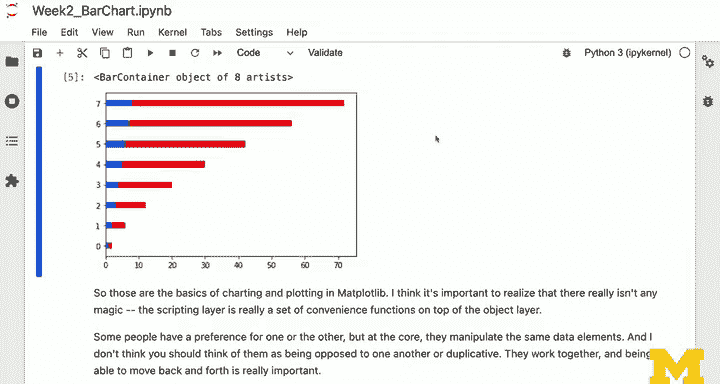

# 📊 课程 13：柱状图绘制


在本节课中，我们将学习如何使用 Matplotlib 库绘制多种类型的柱状图。我们将涵盖基本柱状图、分组柱状图、误差棒、堆叠柱状图以及水平柱状图的创建方法。

---

## 基本柱状图绘制

Matplotlib 支持多种柱状图。在最一般的情况下，我们可以通过传入 X 轴坐标参数和柱体高度参数来绘制柱状图。

以下是绘制基本柱状图的步骤。

首先，我们导入必要的库并创建一些线性数据。

```python
import matplotlib.pyplot as plt
import numpy as np

# 创建线性数据
linear_data = np.array([1, 2, 3, 4, 5, 6, 7, 8])
# 生成 X 轴标签
x_vals = np.arange(len(linear_data))
```

接着，我们使用 `plt.bar` 函数绘制柱状图。`x_vals` 是 X 轴的位置，`linear_data` 是柱体的高度。

```python
plt.bar(x_vals, linear_data, width=0.3)
plt.show()
```

运行上述代码，我们将得到一系列从 0 开始、高度从 1 递增到 8 的蓝色柱体。请注意，由于我们使用了 `np.arange` 函数，X 轴标签实际上是 0 到 7。

---

## 绘制分组柱状图

上一节我们介绍了基本柱状图，本节中我们来看看如何绘制分组柱状图。要添加第二组柱体，我们需要再次调用 `plt.bar` 函数，并调整新柱体的 X 轴位置，以避免与第一组柱体重叠。

以下是具体步骤。

首先，我们创建第二组数据（例如指数数据）并计算其 X 轴位置。

```python
# 创建第二组数据（指数数据）
exponential_data = linear_data ** 2

# 调整新柱体的 X 轴位置（向右偏移一个柱体宽度）
new_x_vals = x_vals + 0.3
```

然后，我们分别绘制两组柱体。

```python
# 绘制第一组柱体
plt.bar(x_vals, linear_data, width=0.3)
# 绘制第二组柱体
plt.bar(new_x_vals, exponential_data, width=0.3, color='red')
plt.show()
```

这样我们就得到了一个分组柱状图。但当前的图表可能不够美观，因为 X 轴标签位于柱体左侧而非居中。虽然可以使用 `align` 参数来调整单个柱体的对齐方式，但在处理多组数据时，手动计算位置会非常繁琐。

---

## 为柱状图添加误差棒

除了基本柱状图，Matplotlib 还支持为每个柱体添加误差棒，这通常用于表示数据的波动范围（例如标准差）。

以下是添加误差棒的方法。

首先，我们生成一组随机误差值。

```python
import random

# 为线性数据生成一组随机误差值（范围 1 到 4）
linear_err = [random.randint(1, 4) for _ in range(len(linear_data))]
```

然后，在绘制柱状图时，通过 `yerr` 参数传入误差值。

```python
plt.bar(x_vals, linear_data, width=0.3, yerr=linear_err)
plt.show()
```

运行代码后，每个柱体上方将显示一个误差棒。由于误差值是随机的，你的图表可能与示例略有不同。Matplotlib 会自动调整图表范围以容纳误差棒。

---

## 绘制堆叠柱状图

上一节我们处理了分组柱状图的位置问题，本节中我们来看看更简单的堆叠柱状图。堆叠柱状图用于显示累积值，同时保持数据系列的独立性，且无需手动调整柱体位置。

以下是创建堆叠柱状图的步骤。

我们使用相同的两组数据。绘制第二组柱体时，通过 `bottom` 参数将其底部设置为第一组柱体的高度。

```python
# 绘制第一组柱体（底部）
plt.bar(x_vals, linear_data, width=0.3, color='blue')
# 绘制第二组柱体（堆叠在第一组之上）
plt.bar(x_vals, exponential_data, width=0.3, bottom=linear_data, color='red')
plt.show()
```

这样，红色柱体将从蓝色柱体的顶部开始绘制，形成堆叠效果。两组数据共享相同的 X 轴坐标。

---



## 绘制水平柱状图

最后，我们可以将垂直柱状图转换为水平柱状图。这需要使用 `plt.barh` 函数，并将参数名称从 `width` 和 `bottom` 相应地改为 `height` 和 `left`。

以下是创建水平堆叠柱状图的方法。

```python
# 绘制水平堆叠柱状图
plt.barh(x_vals, linear_data, height=0.3, color='blue')
plt.barh(x_vals, exponential_data, height=0.3, left=linear_data, color='red')
plt.show()
```

通过上述代码，我们得到了一个基本的水平堆叠柱状图。参数 `left` 在这里的作用与垂直柱状图中的 `bottom` 类似，用于指定柱体的起始位置。

---

## 总结与核心概念

本节课中我们一起学习了 Matplotlib 中柱状图绘制的核心知识。需要理解的是，Matplotlib 的脚本层（如 `plt.bar`）实际上是对象层上的一组便捷函数。两者操作的是相同的数据元素，它们协同工作而非相互对立。

以下是本课的核心操作总结：
*   **基本柱状图**：使用 `plt.bar(x, height)`。
*   **分组柱状图**：多次调用 `plt.bar` 并手动调整 `x` 值。
*   **误差棒**：在 `plt.bar` 中使用 `yerr` 参数。
*   **堆叠柱状图**：在后续 `plt.bar` 调用中使用 `bottom` 参数。
*   **水平柱状图**：使用 `plt.barh` 函数，参数对应为 `height` 和 `left`。

本模块介绍了一些基础图表：散点图、折线图和柱状图。虽然还有更多高级图表将在后续模块探讨，但这些是构建数据可视化能力的良好基础。本模块的作业具有一定挑战性，旨在让你解决真实世界的数据可视化问题。你需要结合第一门课程中学到的 Pandas 库知识和新掌握的 Matplotlib 技能，提出一个优雅的解决方案。最终成果应该是一份可以放入作品集的作品。