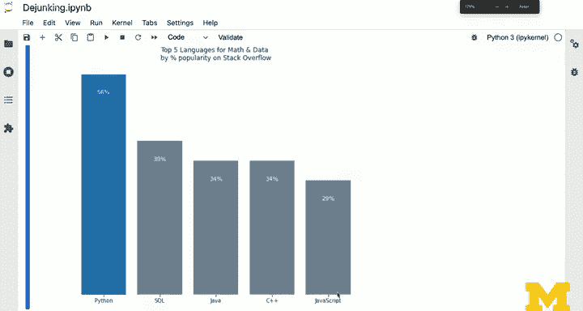

# 课程名称：Python用于数据科学实践（1-3课／共5课）｜Applied Data Science with Python
## 课程编号：P44 - 图表去冗余处理 📊


在本节课中，我们将学习如何应用Tufte的数据墨水比和图表垃圾原则，对一个常规的Matplotlib图表进行优化，使其更加清晰和高效。

我们将使用Jupyter Notebook逐步演示所有步骤。过程中会穿插视频测验，你可以先尝试自己解决问题，再看讲解。Matplotlib的设计者也认为图表垃圾和数据墨水比非常重要。事实上，Matplotlib已经显著进化，有了许多合理的默认设置，但掌握轴对象、脚本与对象层，以及查阅文档解决问题的能力，依然能让你高度自定义图表。

现在，让我们开始吧。

我们将使用Stack Overflow上关于编程语言流行度的数据来绘制图表，这里使用的是2016年的原始数据。

首先，导入必要的库并准备数据。

```python
import matplotlib.pyplot as plt
import numpy as np
```

这里考虑了五种编程语言：Python、SQL、Java、C++和JavaScript。我们将使用`numpy`的`range`函数生成排名作为x轴位置，并手动输入流行度数值。

```python
languages = ['Python', 'SQL', 'Java', 'C++', 'JavaScript']
positions = np.arange(len(languages))
popularity = [56, 39, 34, 34, 29]
```

接下来，创建一个基础的条形图。

```python
plt.figure(figsize=(10, 8))
bars = plt.bar(positions, popularity, align='center')
plt.xticks(positions, languages)
plt.ylabel('Popularity')
plt.title('Programming Language Popularity')
plt.show()
```

运行上述代码，你会得到一个默认样式的图表。


现在，我们面临第一个挑战：图表周围的边框框架显得有些沉重且不必要。根据Tufte的数据墨水比原则，我们应该移除这些多余的“墨水”。

请思考一下，你会如何尝试解决这个问题？可以暂停视频自己动手试试。


我的解决方案是获取当前坐标轴，然后遍历所有边框线，将其可见性设置为`False`。这样边框对象依然存在，但不会被渲染出来。

```python
# 在创建图表的基础代码后，添加以下内容
ax = plt.gca()
for spine in ax.spines.values():
    spine.set_visible(False)
```

这个改动让图表看起来更轻量了一些，但变化不大。所有条形都是蓝色，这无助于区分它们。我们正在比较这些条形，但它们颜色相同。

因此，下一步是将所有硬黑色线条变为灰色，同时将条形颜色也改为灰色。但为了让排名第一的Python语言突出显示，我们将其保留为原来的蓝色。

以下是修改后的代码：

```python
plt.figure(figsize=(10, 8))
bars = plt.bar(positions, popularity, align='center', color='slategray')

# 将第一个条形（Python）设置为蓝色
bars[0].set_color('#1f77b4')

plt.xticks(positions, languages)
plt.ylabel('Popularity')
plt.title('Programming Language Popularity')

# 移除边框
ax = plt.gca()
for spine in ax.spines.values():
    spine.set_visible(False)

plt.show()
```

现在图表看起来清晰多了。Python被突出显示，同时我们仍能看清所有条形的高度，并参考X轴和Y轴。整个图表感觉轻量、透气，数据墨水比较低。


但是，让我们再看看Y轴。为什么不直接移除它，并将数值直接标注在对应的条形上呢？这是优化数据标签的一个原则，可以避免读者费力地在Y轴和条形之间来回对照猜测高度。

你打算如何实现？请暂停视频尝试一下。


我的解决方法如下。基础代码相同，但在设置X轴刻度后，通过传递一个空列表来隐藏Y轴刻度值。

```python
plt.yticks([])  # 移除Y轴刻度标签
```

移除Y轴标签很容易，但为条形添加数据标签则需要更多步骤。我们需要遍历每个条形，获取其高度，然后创建一个包含数据信息的新文本对象并渲染到屏幕上。

```python
# 在创建条形图并设置样式后，添加以下循环来标注数值
for bar in bars:
    height = bar.get_height()
    ax.text(bar.get_x() + bar.get_width()/2., height - 5,
            f'{int(height)}%',
            ha='center', color='white', fontsize=11)
```

解释一下这段代码：我们获取条形的高度，然后计算文本的x位置（条形x坐标加上宽度的一半）和y位置（高度减去5个像素单位）。接着，创建一个包含高度整数值和百分号的字符串标签。最后，设置文本水平居中、颜色为白色（因为条形是灰色或蓝色）、字体大小为11。

处理Matplotlib图表时，经常需要进行这类数学计算来自定义布局，尤其是在处理文本定位时，可能需要一些尝试和调整。


现在，这个图表看起来比最初那个好多了。我们可以清楚地看到Python与其他语言的对比，所有语言都得到了呈现，每个人都能直接看到每种语言的具体数值。图表非常轻量，易于嵌入报告或演示文稿中。


以上就是全部内容。通过一系列简单的步骤，可以让你的条形图更具可用性。



观看视频时，你是否找到了不同的实现方法？或者你是否以其他方式解决了问题？也许你认为还可以应用Tufte或Cairo的其他原则，让这个简单的可视化图表更具可读性和直观性。

欢迎到讨论区与我和其他同学分享你的想法。


本节课中，我们一起学习了如何应用数据墨水比原则优化Matplotlib图表。具体步骤包括：移除不必要的图表边框、调整颜色以突出重点数据，以及移除Y轴并将数值直接标注在条形上。这些技巧能有效提升图表的清晰度和信息传递效率。