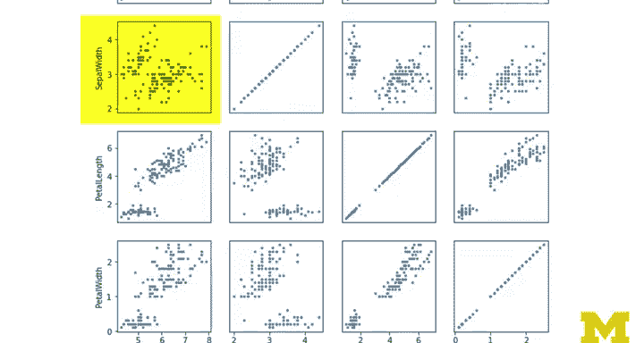

#  45：子图系统详解 🐍


在本节课中，我们将深入学习Matplotlib的子图系统。我们将探讨如何在同一图形中创建并排的多个图表，这对于数据比较和可视化探索至关重要。

## 概述

在第一模块中，我们讨论了优秀可视化的基本原则。在第二模块中，我们开启了Matplotlib Python库的学习，从架构开始，并学习了最常见的图表类型：散点图、折线图和条形图。在本模块中，我们将进行更深入的探讨，讨论同一图形中的多个图表、交互、动画，以及你在数据科学旅程中会发现有用的更多不同类型的图表。

如果你一直在完成作业，你无疑已经访问过课程讨论论坛、Stack Overflow并阅读了Matplotlib API文档。我想指出，Matplotlib邮件列表是另一个很好的支持资源。课程中将发布关于如何浏览该列表的资源。对于开源项目来说，通常有两个不同的邮件列表：一个供开发者使用，一个供用户使用。用户列表是我们询问有关如何使用该工具包的大部分问题的地方。但我真的鼓励你也看看开发者档案，以了解这个项目是如何演变的，并看看幕后的情况。

## 深入子图

到目前为止，我们一直在使用单个轴对象来绘制单个图表或图形。有时，并排显示两个复杂的图表以进行视觉比较，并让观众得出自己的理解是很有用的。Matplotlib在单个图形对象内处理这个问题。

首先，我们将渲染设置回笔记本中，然后导入我们的pyplot模块和NumPy，因为本模块中两者都需要。

```python
import matplotlib.pyplot as plt
import numpy as np
```

我想看看并展示文档的样子。请记住，如果你想知道某个函数的更多信息，可以像这里一样在函数后面加上问号。

```python
plt.subplot?
```

我们看到它在这里被渲染出来，可以看到我们有`plt.subplot`，它接受参数和关键字参数，我们有了文档字符串，然后可以看到关于不同参数及其含义以及如何使用它们的各种信息。这应该与网络文档相同，但会非常具体于你安装的版本，因此你不必尝试弄清楚你正在使用哪个版本。

## 创建基本子图

如果我们查看`subplot`的文档，我们会看到第一个参数是行数，第二个参数是列数，第三个是绘图编号。在Matplotlib中，一个概念性的网格被覆盖在图形上，而`subplot`命令允许你在此网格的不同部分创建轴。

例如，如果我们想要并排的两个图，我们将使用参数`1, 2, 1`调用`subplot`。这将允许我们使用一行两列，并将第一个轴设置为当前轴。

让我们开始操作。创建一个新图形，然后创建一个具有一行两列的新子图。pyplot将绘制的第一个轴对象是左侧的轴。

```python
plt.figure()
plt.subplot(1, 2, 1)
data = np.array([1, 2, 3, 4, 5])
plt.plot(data)
```

我们得到了左侧的细长图。现在，如果我们第二次调用`subplot`，我们可以指示我们也想在右侧绘图。

```python
plt.subplot(1, 2, 2)
exp_data = np.exp(data)
plt.plot(exp_data)
```

现在我们有了两个图，每个都有自己的轴对象。在Matplotlib中，通常的做法是存储从`subplot`返回的轴对象，然后你可以再次调用`subplot`，并且可以随时返回到该轴，因此你可以在脚本中的轴对象之间来回切换。你不必先处理一个轴的所有内容，然后再处理下一个，依此类推。

看看这个图形。你注意到这个图像有什么奇怪的地方吗？特别是回想一下我们课程的第一周。这两个图像有不同的Y轴值。如果我们没有找到一种方法在两个图之间锁定这些轴，这可能会产生问题并可能误导读者。

## 共享坐标轴

当你创建一个新的子图时，实际上可以指示你希望使用`sharex`和`sharey`参数共享X轴和Y轴或两者。让我们清理一下并尝试这个。

```python
fig = plt.figure()
ax1 = plt.subplot(1, 2, 1)
ax1.plot(data)

ax2 = plt.subplot(1, 2, 2, sharey=ax1)
ax2.plot(exp_data)
```

现在我们有了并排的两个图，并且我们锁定了Y轴。你可以看到左侧的图被稍微压缩了一点，这使得右侧的数据高得多这一点更加清晰。

## 子图参数语法

那些一直密切关注的人会注意到，我第二次使用了`subplot`函数，但没有传入三个参数，我只传入了一个。Matplotlib开发者允许你使用三个参数（如我们开始时使用的`1, 2, 1`）或单个参数（如我现在使用的`122`）来指定你想要的图的行、列和编号。在这种情况下，百位值是第一个参数，十位值将被视为第二个参数，个位值是第三个参数。

坦率地说，我不太喜欢第二种语法，它感觉相当粗糙，虽然它确实节省了输入两个逗号，但实际上它限制了每个参数只能是一位数。计算机科学领域的人可能会觉得这种表示法有些不对劲，我必须说每次看到它我都会感到困扰。但我希望你能意识到它，这样当你在Stack Overflow或文档中遇到它时，你就能读懂它。

需要记住的一个重要事实是，矩阵中绘图位置的索引从1开始，而不是0，这与使用NumPy等工具时的惯例不同。因此，如果你正在遍历矩阵或列表来创建子图，请记住从位置加一开始。

## 使用 `subplots` 函数

有一个很好的函数叫做`subplots`（注意是复数），它允许你一次获取多个轴对象，我认为这非常棒。你可以设置所有想要的子图，获取所有这些轴的引用，然后开始填充它们。

如果我们想要一个所有X和Y范围都锁定的3x3网格，我们可以相当简单地做到这一点。我将使用元组解包创建一个3x3的子图网格。

```python
fig, axes = plt.subplots(3, 3, sharex=True, sharey=True)
axes[1, 1].plot(data)
```

语法看起来可能有点奇怪，因为我们直接解包了`subplots`函数的结果，但这确实是构建一个所有内容共享坐标轴的网格的有效方法。结果看起来很不错。但请注意，此方法会关闭Y轴和X轴标签，除了位于图形左侧或底部的图。这实际上是故意的。你正在共享坐标轴，因此Matplotlib试图使其更具可读性，为你的每个图提供更多空间。

## 遍历创建子图

当然，我们实际上可以遍历一个列表并一次绘制一个图，如果我们不想存储对轴的引用，也可以不存储。

```python
plt.gcf()
for i in range(1, 7):
    if i not in [3, 5]:
        ax = plt.subplot(2, 3, i)
        ax.text(0.5, 0.5, str(i), ha='center', va='center')
```

我们可以看到这里有两行三列，并且在第1、2、4和6个绘图位置有数字，而不是第5或第3个。那些是空白的。这里我们没有共享任何坐标轴，所以每个图都有自己的坐标轴值。

## 散点图矩阵

现在我们理解了为什么图形中有轴的抽象，因为一个图形可能有多个轴对象，显示数据的多个视图。一个常见的数据科学可视化探索技术称为散点图矩阵。这对于快速浏览多个不同变量之间的关系特别有用。

散点图矩阵实际上类似于Edward Tufty所称的“小倍数”：一组查看相关数据的可视化，但将数据切片成不同的小可视化，以便你可以同时看到“树木”和“森林”。

让我们看一个散点图矩阵，我将手动制作它，并使用Iris数据集中的一些数据。

```python
import pandas as pd

df = pd.read_csv('iris.csv')
columns = ['sepal_length', 'sepal_width', 'petal_length', 'petal_width']

fig, axes = plt.subplots(len(columns), len(columns), figsize=(10, 10))

for i in range(len(columns)):
    for j in range(len(columns)):
        ax = axes[i, j]
        ax.scatter(df[columns[i]], df[columns[j]], s=5)
        ax.xaxis.set_visible(False)
        ax.yaxis.set_visible(False)

        if i == len(columns) - 1:
            ax.xaxis.set_visible(True)
        if j == 0:
            ax.yaxis.set_visible(True)
```

我们有一个很好的散点图矩阵示例，可以轻松比较萼片和花瓣的长度和宽度，并一目了然地寻找趋势。一个突出的趋势是，花瓣宽度（底部行）与花瓣长度（第三列散点图）有相当线性的关系。如果你比较萼片宽度和萼片长度（例如，看第二行第一列），情况似乎并非如此。

## 总结



在本节课中，我们一起学习了Matplotlib强大的子图系统。我们探讨了如何使用`subplot`和`subplots`函数在单个图形中创建多个坐标轴，学习了共享坐标轴以进行有效比较的方法，并手动创建了一个散点图矩阵来可视化多变量关系。理解子图是创建复杂、信息丰富的仪表板和探索性数据分析图的关键。在下一个模块中，我们将利用关于子图的新知识，同时向你介绍一个非常基础的数据科学图表：直方图。