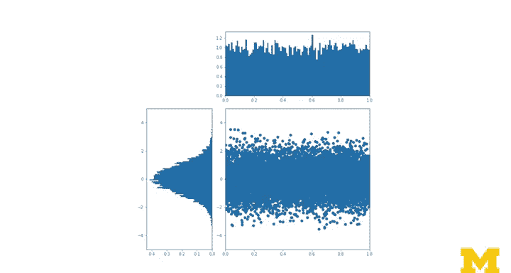

# 📊 课程16：直方图绘制


在本节课中，我们将学习如何使用Python的Matplotlib库绘制直方图。直方图是一种条形图，用于展示数据分布的频率。我们将从基本概念开始，逐步深入到如何通过调整参数（如分箱数量）来优化图表，并最终学习如何使用网格布局创建包含多个子图的复杂可视化图表。

---

## 📈 直方图基础

直方图是一种条形图，它展示了给定现象的频率。一个很好的例子是概率分布。例如，在本系列课程的第一部分，我们提到了随机分布、均匀分布、正态分布和卡方分布之间的区别。

概率函数可以可视化为一条曲线，其中Y轴表示某个特定值出现的概率，X轴表示该值本身。这被称为**概率密度函数**。

Y轴的值被限制在0到1之间，其中0表示给定值没有出现的可能性，1表示该值总是会出现。X轴的值根据分布函数进行标记，在正态分布的情况下，通常以标准差为单位。

直方图就是一种条形图，其中X轴是给定的观测值，Y轴是该观测值出现的频率。

因此，我们应该能够通过从分布中采样来绘制给定的概率分布。现在，回想一下，采样意味着我们将从分布中选取一个数字，就像掷骰子或从一副牌中抽出一张牌。随着我们反复进行这个过程，我们就能更准确地描述分布。

---

## 💻 通过代码理解采样

让我们停止空谈，通过编写一些代码来实际观察这个过程。

我将像往常一样导入`matplotlib`和`numpy`。现在，我将从正态分布中抽取一些样本，并将四个不同的直方图绘制为子图。

首先，我将创建一个2x2的图形网格。在这种情况下，我们不希望子图之间共享Y轴，因为我们有意查看不同样本大小的数量。但我确实希望共享X轴。因此，我在`subplots`函数中设置了`sharex=True`。然后，我得到了这个很好的轴对象集合。

```python
import matplotlib.pyplot as plt
import numpy as np

fig, ax = plt.subplots(2, 2, sharex=True)
```

现在，我们主要关心的是分布看起来有多均匀。因此，我们将遍历一个包含四个不同值的列表：10、100、1000和10000，并从正态分布中抽取样本。请记住，`numpy.random.normal`函数只是基于这个基础的正态分布创建一个数字列表。

```python
sample_sizes = [10, 100, 1000, 10000]

for i, a in enumerate(ax.flatten()):
    # 从正态分布中抽取样本
    samples = np.random.normal(size=sample_sizes[i])
    # 在当前轴上绘制直方图
    a.hist(samples)
    a.set_title(f'Sample Size: {sample_sizes[i]}')

plt.tight_layout()
plt.show()
```

让我们看一下结果。第一个图只有10个样本，所以它看起来非常锯齿状。在我的版本中，我认为没有人会说这显然是一个正态分布。但当我们增加到100个样本时，情况有所改善，但仍然看起来有点向右倾斜。你的结果可能略有不同，因为这是一个随机过程。你应该在自己的笔记本上运行这段代码并进行比较。

然后，在1000和10000个样本的图中，分布似乎变得更加平滑。但如果我们仔细观察，会发现10000个样本图中的条形实际上比10或100个样本图中的条形更宽。那么，这是怎么回事？为什么底部轴上的条形会发生变化？

---

## 🧮 理解分箱

默认情况下，Matplotlib中的直方图使用10个分箱，也就是10个不同的条形。在这里，我们创建了一个共享的X轴。随着我们从分布中抽取更多样本，我们更有可能得到远离均值的异常值。因此，对于n=10，10个分箱最多只能捕获10个唯一值。而对于n=10000，许多值必须被合并到一个分箱中。

让我们用分箱宽度设置为100来执行相同的函数，这样我们实际上就会有100个不同的分箱。这里的代码看起来都一样，唯一改变的是在绘制每个直方图时，我指定了`bins=100`。

```python
for i, a in enumerate(ax.flatten()):
    samples = np.random.normal(size=sample_sizes[i])
    # 指定使用100个分箱
    a.hist(samples, bins=100)
    a.set_title(f'Sample Size: {sample_sizes[i]}')
```

现在我们可以看到，10000个样本的图看起来比所有其他图都平滑得多，而10个样本的图显示每个样本基本上都在自己的分箱里。我们只有10个样本，但我们愿意查看10个不同的分箱，所以它们基本上都落在同一个分箱里。

这引出了一个重要的问题：在使用直方图时，应该绘制多少个分箱？恐怕答案并不那么明确。这两种图都是真实的。一个是在粗粒度上的数据可视化，另一个是在更细粒度上的可视化。当我们以最细的粒度（例如10000个分箱）查看数据时，直方图对于决策制定基本上变得无用，因为它们没有显示样本之间的任何趋势，而只是显示了样本大小本身。这类似于使用均值和标准差等汇总统计量来描述总体样本。这些值是粗略的，它们是否合适，很大程度上取决于你的问题和兴趣。

---

## 🎨 使用网格布局创建复杂图表

现在，我想利用我们新学到的直方图和子图知识，向你介绍更灵活的`GridSpec`子图布局。`GridSpec`允许你将一个轴映射到网格中的多个单元格，从而可以创建一些看起来非常自定义的可视化效果。

例如，让我们在这里创建一个散点图，其中Y值来自正态分布，X值来自随机分布。

```python
# 创建一些随机数据
y_vals = np.random.normal(size=10000)
x_vals = np.random.random(size=10000)
```

仅仅看这个散点图，并不完全清楚每个轴的实际分布是什么，但我们实际上可以添加两个较小的直方图来使这一点更加清晰。

让我们直接开始做这件事。我将定义一个3x3的网格，总共9个单元格。我希望第一个直方图占据右上角的空间，第二个直方图占据左下角两个空间并旋转到侧面。原始的散点图则可以占据右下角的2x2正方形。

要使用这个`GridSpec`，我们首先必须导入它，然后创建我们想要的整体形状的新`GridSpec`。

```python
from matplotlib.gridspec import GridSpec

# 设置图形大小
fig = plt.figure(figsize=(10, 10))
# 创建3x3的网格规格
gs = GridSpec(3, 3, figure=fig)

# 创建子图
# 顶部直方图：第0行，第1列到最后一列
ax_top = fig.add_subplot(gs[0, 1:])
# 侧面直方图：第1行到最后一行，第0列
ax_side = fig.add_subplot(gs[1:, 0])
# 主散点图：第1行到最后一行，第1列到最后一列
ax_main = fig.add_subplot(gs[1:, 1:])
```

当我们添加子图内的新项目时，不是指定三个数字（行、列和位置），而是传入我们希望覆盖的`GridSpec`对象的元素。这里非常重要，因为我们使用的是列表的元素，所有的索引都从0开始，所以使用切片来表示列表的开头或结尾是非常合理的。

`GridSpec`使用方括号索引运算符按行和列进行索引。因此，我们将在第0行创建第一个子图和直方图，覆盖第一个元素、中间位置，然后一直到该行的末尾。这里我决定它将是顶部的直方图。对于侧面的直方图，我想从第1行开始，但实际上一直延续到行元素的末尾，但我想将其限制在第0列。最后，这个散点图我想放在右下角。

让我们看一下布局。但现在我们需要用一些数据来填充它。首先，我们要处理散点图，然后我去处理顶部直方图（用于散点图的X值），然后是侧面直方图（用于Y值）。我们希望那个侧面直方图能够对齐，所以我将通过设置方向来旋转布局。由于这很常见，Matplotlib实际上有一个`orientation`参数，所以我可以将该图中的所有值都横向显示。

```python
# 填充数据
ax_main.scatter(x_vals, y_vals, alpha=0.5)
ax_top.hist(x_vals, bins=100, density=True)
ax_side.hist(y_vals, bins=100, orientation='horizontal', density=True)

# 调整侧面直方图的X轴，使其看起来是从数据中“生长”出来的
ax_side.invert_xaxis()

# 调整坐标轴范围以去除空白
ax_top.set_xlim(0, 1)
ax_side.set_ylim(-5, 5)
ax_main.set_xlim(0, 1)
ax_main.set_ylim(-5, 5)

plt.tight_layout()
plt.show()
```

通过这个图表，我们可以立即清楚地看到我们实际上有两种不同的分布。顶部直方图的Y轴值或底部直方图的X轴值我们并不真正关心，因为这些都是概率密度直方图，我们只关心相对值。在Matplotlib中，我们可以通过设置`density=True`来做到这一点。这样，它就不太关心观测的实际频率，而更关心这些频率的概率或比率。

我们还可以反转左侧直方图的X轴，这可能使其更清晰，因为它代表了右侧的数据，这使得它看起来像是从散点图数据中“生长”出来的。我们可以直接在坐标轴上使用`invert_xaxis`函数来实现这一点。最后，如果我们回头看，会发现坐标轴上有一点空白，并且自动添加了一些填充，这似乎是不必要的，可能还有点令人困惑。我们可以通过更改坐标轴限制来消除这种情况。

---

## 🔄 迭代式可视化过程

我处理数据、调查数据以及如何绘制或查看数据的方法，实际上是一个迭代的过程。我不会坐下来就确切地知道我想看到什么，但随着我发现、思考或观察事物，我可以使用Matplotlib来改变它的呈现方式。这在Jupyter笔记本中效果非常好。

数据和网格规格与上面相同，子图以及所有侧面直方图、顶部直方图和右下角散点图也都相同。但然后我想获取那个侧面直方图并反转其X轴，接着我只想更改坐标轴限制以消除空白。因此，我将在这里遍历顶部直方图和右下角的所有坐标轴，将X轴范围设置为0到1，将Y轴范围设置为-5到+5。

我们可以看到，我们的顶部直方图是随机的，相当均匀，而Y值的直方图确实看起来像正态分布。事实上，这张图粗略地看起来像我们在本课程第一个模块中看到的来自MIT和哈佛关于OC参与度研究的图像。现在你应该很清楚，我们如何调整这个图表的各个方面，如果我们想让它看起来更像那个参与度图像，我们实际上可以尝试添加标题到这些子图，使其更类似于MIT和哈佛出版物中的标题，或者改变单个点的大小，因为我们处理的是相当大的数据，所以可以让点变小一些，或者改变样式，你能改变图表的颜色以模仿MIT和哈佛的颜色吗？用你新学到的Matplotlib技能试一试，查阅API文档，看看你能创造出什么。

---

## 📝 总结



在本节课中，我们一起学习了直方图的基本概念及其在可视化数据分布中的应用。我们通过代码实践了如何从分布中采样并绘制直方图，理解了分箱数量对图表效果的影响。最后，我们探索了使用`GridSpec`创建复杂多子图布局的方法，并了解了如何通过迭代调整来优化最终的可视化效果。希望你现在对使用Matplotlib进行数据可视化有了更深入的理解。