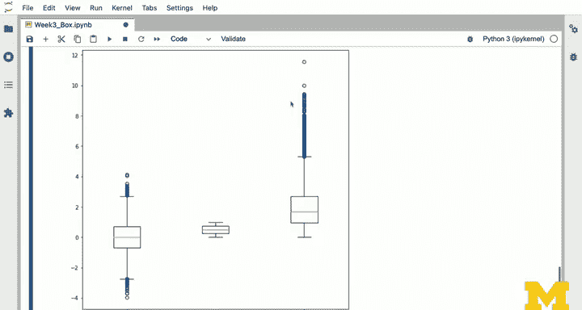

# 课程名称：Python用于数据科学实践（第3课）｜Applied Data Science with Python
## 课程编号：P47 - 17_箱线图绘制 📊


在本节课中，我们将要学习如何使用Matplotlib库绘制箱线图。箱线图是一种简洁展示数据分布和汇总统计信息的强大可视化工具，在数据科学中极为常见。

### 箱线图简介 📦

箱线图，有时也被称为盒须图，是一种以简洁方式展示不同样本聚合统计信息的方法。

箱线图的目标是通过可视化所谓的“五数概括法”来总结数据的分布情况。这五个数包括：极值（通常是数据的最小值和最大值）、中心（通常是数据的中位数）以及数据的第一和第三四分位数。

数据的分位数将其大致划分为四个大小相似的区间。第一和第三四分位数的标记（有时也称为“铰链”）展示了数据的中间50%部分。

通过箱线图，我们可以在一个相当简洁、紧凑的可视化表示中感知数据的权重分布。

### 在Matplotlib中绘制箱线图 🎨

上一节我们介绍了箱线图的基本概念，本节中我们来看看如何在Matplotlib中实际绘制它。

首先，我们需要导入必要的库：pandas、matplotlib和numpy。

```python
import pandas as pd
import matplotlib.pyplot as plt
import numpy as np
```

接下来，我将使用numpy创建三个不同的样本：一个来自正态分布，一个来自均匀随机分布，一个来自伽马分布。这样我们就可以观察这些分布在五数概括法下的差异。

```python
normal = np.random.normal(size=10000)
random = np.random.random(size=10000)
gamma = np.random.gamma(2, size=10000)
```

然后，我将把这些数据放入一个pandas数据框中，并分别命名为“normal”、“random”和“gamma”。

```python
df = pd.DataFrame({'normal': normal, 'random': random, 'gamma': gamma})
```

让我们看看数据框的样子。每个样本都有10000个数据点。我们可以看到正态分布、随机分布和伽马分布的样本。

pandas有一个方便的函数叫做`describe`，它允许我们查看五数概括法以及其他一些我们感兴趣的汇总统计信息。

```python
df.describe()
```

我们可以看到，这些分布之间的均值差异很大。正态分布的均值非常接近0（因为我们在生成时没有指定参数）。随机分布的均值接近0.5（因为它在0到1之间均匀选取随机值）。伽马分布的均值则在2左右。我们还可以看到标准差、最小值、最大值以及四分位数值（25%、50%、75%）。

`describe`函数显示了最小值、最大值和三个百分位数。这些百分位数值构成了所谓的**四分位距**。

以下是数据被划分为四个区间的解释：
*   第一四分位数（Q1）是数据的25%分位点。
*   第二四分位数（Q2）是数据的中位数，即50%分位点。
*   第三四分位数（Q3）是数据的75%分位点。
*   第四四分位数是Q3到最大值之间的数据。

与标准差类似，四分位距是衡量数据变异性的一个指标，通常使用箱线图来绘制。

在箱线图中，数据的均值或中位数被绘制为一条直线。形成两个箱体：一个在上方，代表50%到75%的数据组；一个在下方，代表25%到50%的数据组。然后，细线（须）被相应地延伸到最小值和最大值。

### 绘制基本箱线图 ✏️

当然，看一个箱线图比描述它要简单得多。这里，我们只需选择我们感兴趣的一列数据，并将其传递给pyplot的`boxplot`函数。

```python
plt.boxplot(df['normal'])
```

Matplotlib使用numpy数组处理数据，但pandas是构建在numpy之上的，因此可以无缝衔接。你可以传入一个pandas列，因为它底层实际上就是一个ND数组。

你会看到Matplotlib打印出一堆关于“artists”的信息。通常我们并不想看到这些，但有时了解绘图底层的构建过程会很有帮助。

如果我们想抑制这个输出，只需在最后一条语句的末尾加上一个分号。这是一个Jupyter Notebook的小技巧，它可以抑制单元格中最后一个变量的打印输出。但请注意，这不是标准的Python语法。

```python
plt.boxplot(df['normal']);
```

这样我们就得到了一个基本的箱线图。

### 绘制多组数据的箱线图 📈

现在，让我们把另外两个样本也添加到箱线图中。遗憾的是，我们不能直接将整个pandas数据框传递给Matplotlib。相反，我们必须提取这些列，并将它们作为一个值列表传入。

以下是具体做法：

```python
plt.boxplot([df['normal'], df['random'], df['gamma']]);
```

我们可以看到三个分布。注意，我们没有对比例进行归一化，所以看起来有点奇怪。例如，观察伽马分布，我们可以看到它的尾部非常长，最大值离得很远。

### 添加嵌入子图（Inset Axes） 🔍

让我们通过绘制伽马分布的直方图来更仔细地观察它。我将以此为契机演示一个叫做“嵌入坐标轴”的功能。

回想一下，我们有一个图形，里面有一个子图。由于我们没有对子图做任何复杂的设置，这意味着我们只有一个坐标轴对象。实际上，我们可以在一个图形内的另一个坐标轴之上叠加一个新的坐标轴。我们可以通过在图形本身上调用`inset_axes`函数并传入我们想要创建的新坐标轴的详细信息来实现。

我们传入的详细信息是新坐标轴在原始图形XY空间中的位置，以及这个新坐标轴绘图的宽度和高度。

以下是创建嵌入子图的步骤：

```python
fig = plt.figure()
# 在主图上绘制箱线图
plt.boxplot([df['normal'], df['random'], df['gamma']])

# 创建一个嵌入坐标轴
# 参数：[左下角x坐标, 左下角y坐标, 宽度, 高度] (均为相对于主图的比例，0到1之间)
ax2 = plt.gca().inset_axes([0.6, 0.6, 0.35, 0.35])
# 在嵌入坐标轴上绘制伽马分布的直方图
ax2.hist(df['gamma'], bins=100, density=True)
# 将y轴刻度标签移到右侧，避免与主图冲突
ax2.yaxis.tick_right()
plt.show()
```

这样，在一个图形中，我们既有三个不同分布的箱线图，又有一个漂亮的小嵌入图像显示了最右侧箱线图（伽马分布）的直方图。

再次记住，每个箱线图都是我们的五数概括法：中间的红线是中位数，两边的箱体分别代表25%的数据，而延伸出去的“须”则到达数据的最大值和最小值。

### 识别异常值 ⚠️

我们通常希望查看箱线图时，不是看最小值和最大值，而是强调异常值。如何检测异常值取决于具体方法，有多种机制来确定一个观测值是否为异常值。

如果我们查看Matplotlib的文档，其默认的异常值检测方法是：所有大于**上铰链（第三四分位数） + 1.5 * IQR** 或小于**下铰链（第一四分位数） - 1.5 * IQR** 的数据点都被视为异常值。其中，**IQR（四分位距）** 就是两个铰链之间的距离，它包含了50%的数据。

如果我们省略之前添加到`boxplot`调用中的`whis`参数，我们将看到使用此方法识别的异常值。

```python
plt.figure(figsize=(8, 6))
plt.boxplot([df['normal'], df['random'], df['gamma']])
plt.show()
```

箱线图中的每个圆圈代表一个单独的异常值观测点。

箱线图是数据科学家将使用的更常见的图表之一，Matplotlib对不同类型的箱线图有广泛的支持。Matplotlib文档是关键，你可以在课程资源中找到API链接，其中描述了如何使用箱线图功能。

### 总结 📝



本节课中我们一起学习了箱线图的原理及其在Matplotlib中的实现。我们了解了五数概括法，学会了绘制单个及多个数据组的箱线图，探索了使用嵌入坐标轴来增强可视化效果，并理解了箱线图中异常值的默认识别方法。箱线图是快速理解数据分布和识别潜在异常值的核心工具，掌握它将为你的数据探索分析提供有力支持。