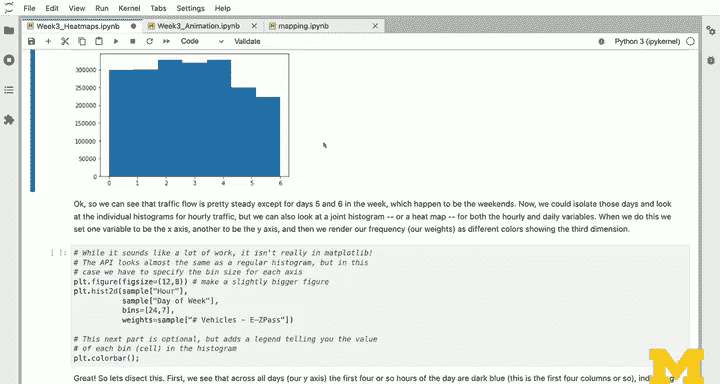
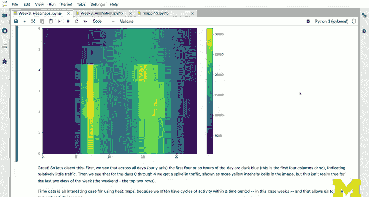

# 课程3：热力图可视化 📊


在本节课中，我们将学习如何使用热力图来可视化三维数据，并理解其适用场景与限制。热力图是一种强大的工具，尤其适合展示具有空间或顺序关系的二维数据上的第三维信息。

---

## 什么是热力图？


上一节我们介绍了数据可视化的基础，本节中我们来看看热力图。热力图是一种可视化三维数据的方法，它利用了数据维度在空间上的邻近性。

在修订本课程时，我曾考虑删除热力图部分，因为我见过太多糟糕的热力图示例。问题是，当数据合适时，热力图确实非常强大。天气数据就是一个很好的例子：你有两个维度（纬度和经度），我们可以在这之上叠加第三个维度（例如温度或降雨量），并通过颜色的强度来指示这个维度。

事实上，任何具有二维空间属性的数据都天然适合用热力图表示。例如，研究人员和营销专家经常使用眼动追踪的注视点来理解人们在网站上观看的内容。

但是，当维度之间没有连续关系，或者至少没有顺序关系时，热力图就会失效。例如，为分类数据使用热力图是完全错误的。它会误导观众通过空间邻近性来寻找模式和顺序，而任何此类模式都纯粹是虚假的。

我决定将这部分内容保留在课程中，因为它确实有用。我使用订单数据构建了一个新示例。无论如何，让我们来谈谈Matplotlib中的技术。

在Matplotlib中，热图本质上是一个二维直方图，其中X和Y值表示可能的点，而绘制的颜色是观测值的频率。

---

## 准备数据与环境

以下是开始之前需要导入的库和功能。

```python
import matplotlib.pyplot as plt
import numpy as np
import pandas as pd
from datetime import datetime
```

在这个例子中，我想向你展示纽约市的一些交通数据，这些数据全部来自纽约市开放数据门户。我将把这些数据读入一个数据框，然后将日期列转换为日期时间格式。

```python
# 读取数据
df = pd.read_csv('nyc_traffic_data.csv')  # 假设文件名为 nyc_traffic_data.csv
# 转换日期列
df['Date'] = pd.to_datetime(df['Date'])
```

让我们查看一下数据。如果你在Coursera上跟随学习，加载可能需要一点时间，因为这实际上是一个相当大的数据集。

现在我们来看一下。这里有广场标识符，这些是设置交通摄像头的不同区域。然后我们有日期，并且实际上按一天中的小时细分。对于每个广场，数据中的每个小时都被细分，这里可能有大约10年的数据。然后他们有两个不同的方向：进站（此处显示为“I”）和出站（针对广场），以及两个不同的数字：一个是E-ZPass的计数（我们最终称之为密度），另一个是Vtoll（一个不同的收费系统）。所以这是两个不同的收费系统。

---

## 基础数据探索：直方图

让我们精简数据，并用直方图进行一些基础探索性数据分析。

假设我对单个广场（一个摄像头位置）和2017年初的一些日期感兴趣。我将在这里编写一个pandas查询来提取这些数据。

```python
filtered_df = df.query('PlazaID == 5 and Date > "2016-12-31" and Date < "2017-05-01"')
```

这种语法可能看起来与我们第一门课程中的有些不同。这是查询数据框的另一种方式，它使用一个名为`numexpr`的库来将查询作为字符串接收并应用于数据框。如果你熟悉SQL，它的语法有点像SQL，但有很多小注意事项。我想向你介绍它，以便你了解，但你完全可以使用我在课程1中展示的常规布尔掩码方法。实际上，现在是暂停视频、打开笔记本并尝试的好时机：你能根据我所说的和你所看到的，利用你已有的布尔掩码知识重写这个查询吗？

我们这里有“一天中的小时”，让我们来看看一天中活动的直方图。

由于一天有24小时，我将把`bins`设置为24，并且我想看到我们的频率（每个柱的权重）作为使用这个E-ZPass系统的车辆数量。这个系统自动为使用道路的司机计费，并且数据中的个体观察结果已经为我们汇总好了。在这里，我们只需调用`plot.hist`。我将指定一个数组或pandas中的列（因为pandas构建在Numpy数组之上）作为`hour`，这些值将从0到23。我想要24个`bins`，因为我知道一天有24小时，并且我将设置`weights`等于另一列`vehicles_easypass`。

```python
plt.hist(filtered_df['Hour'], bins=24, weights=filtered_df['Vehicles_EZPass'])
plt.xlabel('Hour of Day')
plt.ylabel('Vehicle Count (EZPass)')
plt.title('Hourly Traffic Volume at Plaza 5')
plt.show()
```

我看到两个高峰：早上7:30左右和下午3点左右开始直到6点。所以这是纽约的交通高峰时间，这符合我们的预期。

在这个例子中，我们的“小时”是有序的，从0开始到23，贯穿一天，所以以这种连续直方图的方式查看数据是有意义的。

但我们还有“星期几”，这也是有序的（周一到周日）。所以让我们提取星期几并查看其直方图。

我们可以使用pandas的datetime功能`.dt`从日期列中提取星期几。请记住，pandas中的单个列是一个Series对象，它实际上有一个`.dt`属性，为我们存储了许多日期时间转换功能，因为这实际上是一个非常常见的需求。在这种情况下，我们想获取这个日期列，访问这些日期时间功能，我们只想从中获取星期几。

我将把它分配到一个名为`day_of_week`的新列中，这将返回一个介于0和6之间的数字（取决于星期几）。然后，一旦我们有了这个，我们就可以稍微调整一下我们的直方图：将`bins`设置为7，表明我们对星期几感兴趣，并且我们仍然继续查看E-ZPass的数字。

```python
filtered_df['day_of_week'] = filtered_df['Date'].dt.dayofweek
plt.hist(filtered_df['day_of_week'], bins=7, weights=filtered_df['Vehicles_EZPass'])
plt.xlabel('Day of Week (0=Monday)')
plt.ylabel('Vehicle Count (EZPass)')
plt.title('Weekly Traffic Volume at Plaza 5')
plt.xticks(range(7), ['Mon', 'Tue', 'Wed', 'Thu', 'Fri', 'Sat', 'Sun'])
plt.show()
```

我们可以看到，除了第5天和第6天（恰好是周末），交通流量相当稳定。现在，我们可以隔离这些天，查看每小时交通的单独直方图，但我们也可以查看小时和日变量的联合直方图或热力图。

---

## 创建热力图

当我们这样做时，我们设置一个变量为x轴，另一个为y轴，然后我们使用不同的颜色渲染我们的频率（权重）来显示这第三个维度。虽然听起来工作量很大，但在Matplotlib中，API看起来几乎与常规直方图相同。

但在这种情况下，我们必须为每个轴指定`bins`的大小，并在这里将图形设置得更大一些以便于阅读，然后我们只需调用`hist2d`而不是`hist`。我们传入我们的x和y：在x轴上，我想查看小时；在y轴上，我想查看星期几。然后对于`bins`，我们必须告诉它有24个`bins`对应小时，7个对应星期几。我们保持`weights`不变。

```python
plt.figure(figsize=(10, 6))
# 创建二维直方图（热力图）
counts, xedges, yedges, im = plt.hist2d(filtered_df['Hour'],
                                         filtered_df['day_of_week'],
                                         bins=[24, 7],
                                         weights=filtered_df['Vehicles_EZPass'])
plt.colorbar(im) # 显示颜色条
plt.xlabel('Hour of Day')
plt.ylabel('Day of Week (0=Monday)')
plt.title('Heatmap: Traffic Volume by Hour and Day at Plaza 5')
plt.yticks(range(7), ['Mon', 'Tue', 'Wed', 'Thu', 'Fri', 'Sat', 'Sun'])
plt.show()
```

接下来的部分实际上是可选的，但它告诉Matplotlib向我们显示一个颜色条，一个告诉我们这些权重的图例。



很好，让我们剖析一下这个图。首先，我们看到在所有天中，我们的y轴（即前四行左右）的前几个小时是深蓝色的。这表示前四列左右，表明交通量相对较少。这是有道理的，那个时候开车的人不多。

然后我们看到，对于第0到第4天（周一到周五），交通量出现高峰。这些在图像中显示为更偏黄色的强度单元格。但对于最后两天（周末，即最上面两行），情况并非如此。

时间数据是热力图的一个有趣用例，因为我们经常在一个时间段内有活动周期。在这种情况下，我们有天和周，这使我们能够拥有这两个不同的有序维度。

---

## 练习与总结

现在是你尝试的好时机，看看你是否能查看不同的维度，比如月份。你能绘制一个热力图，其中一个轴是月份，另一个轴是，比如说，一个月中的周吗？试一试。



---


本节课中我们一起学习了热力图的可视化方法。我们了解到热力图非常适合展示具有空间或顺序关系的二维数据上的第三维信息，例如时间序列中的小时和星期几。我们通过纽约市交通数据的实例，演示了如何使用Matplotlib的`hist2d`函数创建热力图，并解读了其中的模式。记住，避免对分类数据使用热力图，因为这会产生误导。