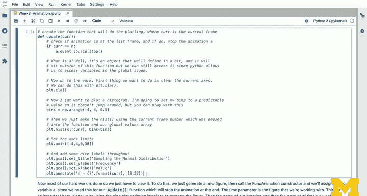
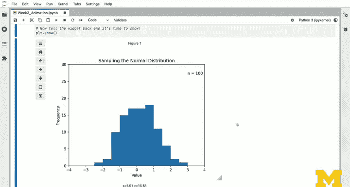

# 课程三：Python数据科学应用 🎬 第19讲：动画制作

在本节课中，我们将学习如何使用Matplotlib库创建动态图表。我们将从静态图像转向动画，探索如何通过逐步采样来可视化数据分布的形成过程。

---

之前我们主要关注静态图像，但Matplotlib确实支持动画功能。

这需要在Jupyter Notebook中使用一个名为`ipympl`的独立库，我已经为大家安装好了。

动画功能依赖于这个库，因为它为我们提供了一个新的后端——`widget`后端。

现在让我们启用它。在Jupyter中启用新后端，我们使用Matplotlib的魔术函数。这是一个为我们编写的函数，以百分号开头，是一个单元格函数。我们输入`%matplotlib widget`，这表示使用widget后端初始化Matplotlib。你必须在笔记本的最开始，或者在使用Matplotlib之前执行此操作，一旦设置就无法更改。

我还将导入一些其他必要的库，包括`numpy`。

同时，我将导入`matplotlib.animation`模块，并命名为`animation`，我们将使用它。

Matplotlib的动画模块包含了构建动画的重要辅助工具。对于今天的讨论，我们将使用最重要的对象——`FuncAnimation`。它通过迭代调用一个由你定义的函数来构建动画。该函数的任务是清除坐标轴对象并重绘动画的下一帧。

然后，这些帧被堆叠在一起，形成一个可播放的视频。

我喜欢在密歇根大学的课堂上使用这个演示，向学生展示如何从分布中采样。我们将构建一个基础动画，从正态分布中抽取100个样本。

现在让我们生成数据。我将设置`n = 100`，这是样本数量。

然后，我将创建`x`作为样本列表，我们将从随机正态分布中抽取这些样本。

接下来，我们需要创建执行绘图功能的函数。我将这个函数命名为`update`，你可以随意命名。Matplotlib的`FuncAnimation`对象将每隔几毫秒调用此函数，并传入从0开始的帧编号。我们可以将其用作我们称为`x`的值数组的索引。

我们首先要检查当前帧是否已到达列表末尾。如果是，我们将告诉动画停止。我们通过调用附加在此`FuncAnimation`对象上的事件源对象的`stop`方法来实现。

让我们来看看具体实现。

我将创建执行绘图的函数，命名为`update`，它将传入`curr`参数，`curr`是当前帧，是一个从0开始的整数值。

我首先要检查动画是否到达最后一帧。如果是，我将停止动画。因此，如果`curr`等于`n`（即100），那么我将调用`a.event_source.stop()`。这里的`a`是什么？实际上，它是我们稍后将定义的一个对象，它将位于此函数外部，但由于Python允许我们访问全局作用域中的变量，我们仍然可以访问它。

现在开始实际工作。我们首先要清除当前坐标轴，可以通过调用`plt.cla()`（清除坐标轴）来实现。

现在我只想绘制一个直方图，但我会将`bins`（柱状图的分箱）设置为一个可预测的值，这样它就不会跳动。你可以调整这个值，我将使用`np.arange(-4, 4, 0.5)`。

然后，我们将使用传入函数的当前帧编号进行`hist`调用。这里，我将从`x`中切片出数据，即直到当前帧的所有数据。第一次循环时只有一个项目，第二次循环时有两个项目，第三次循环时有前三个项目，依此类推。我将始终将`bins`设置为100，这样分箱数就不会跳动。我还想设置坐标轴的限制。最后，我将添加一些漂亮的标签，使其看起来更美观。

我们的大部分繁重工作已经完成，但现在我们需要查看它。为此，我们只需生成一个新图形，然后调用`FuncAnimation`构造函数，并将其赋值给变量`a`，因为我们需要能够在刚刚编写的`update`函数中停止它。

第一个参数是我们正在处理的图形。这并不十分重要，因此我们将使用`pyplot`脚本接口来管理图形。

然后是函数名称和我们希望更新之间的时间间隔。我将设置为100毫秒，这个速度应该较快但不会太快。

一旦我们全部设置好，启动实际上非常快。我将调用`animation.FuncAnimation`，并传入一个图形。记住，`plt.figure()`将创建一个新图形。我也可以使用`plt.gcf()`（获取当前图形），或者创建一个存储在对象中的图形然后传入该对象。这里有很多选项。

然后传入我们使用的函数引用，在这个例子中是`update`（我们编写的函数，如果你更改了名称，可以在这里更改），接着是我们的时间间隔（以毫秒为单位）。最后，我们告诉widget后端是时候开始展示了。

我们可以看到，我们从`x`中提取这些值，并逐渐构建出该分布的样子。如果你在自己的系统上运行此代码，应该会看到不同的结果，但大致应该与此相似。它很可能不同，因为我没有设置种子值，所以我们得到的是不同的随机值。这很好地演示了当你从分布中采样时，随着样本数量增加，它越来越清晰地呈现出传统的钟形曲线形状。

我们看到这个后端还提供了其他一些功能，我们可以保存图像、平移图像等等，这些功能在各种不同情况下都很有用。

好的，我们完成了。这是一个很好的例子，展示了如何使用动画`FuncAnimation`来演示从分布中采样的过程。

与动画包中的大多数其他类一样，`FuncAnimation`是`Animation`对象的子类。

`Animation`对象有一个方便的函数，允许你将图像写入文件，即`save`函数。但这需要额外的第三方库，如`FFmpeg`，安装和设置可能需要一些时间。不过，结果是你可以相当轻松地将动画直接从Jupyter网络编程环境导出为M4V、MOV、动态GIF等格式。

想象一下，一个包含四个子图的图形动画，每个子图对应一种我们可能感兴趣理解的分布类型，这实际上会非常酷。我想我们可以在一个子图中绘制正态分布的样本，在另一个子图中绘制伽马分布的样本，也许再绘制几个参数化分布，比如具有不同标准差水平的正态分布。

这实际上将是练习你在本模块中学到的技能的好方法，因为它要求你使用直方图管理带有动画的多个子图。如果你想接受这个挑战，我将在课程页面中提供一个链接，指向一个可选的练习笔记本供你查看。

---

在本节课中，我们一起学习了如何在Jupyter Notebook中使用Matplotlib的`FuncAnimation`工具创建动画。我们了解了启用`widget`后端、定义更新函数来绘制每一帧、以及控制动画流程的基本步骤。通过构建一个从正态分布逐步采样的动画示例，我们直观地看到了数据分布是如何随着样本增加而逐渐形成的。