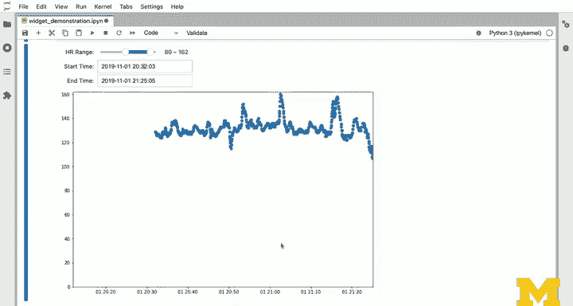

# 50：交互组件演示 🎛️


在本节课中，我们将学习如何在Jupyter Notebook中使用交互式组件（Widgets）。这些组件允许我们在笔记本内创建简单的仪表板，从而更直观地探索和分析数据。我们将重点介绍`interact`装饰器的使用，并通过一个真实的骑行数据集来演示如何创建交互式图表。

---

## 导入必要的库

首先，我们需要导入一些必要的库。我们将使用`ipywidgets`库来创建交互式组件，`pandas`来处理数据，以及`matplotlib`来进行绘图。

```python
from ipywidgets import interact
import ipywidgets as widgets
import pandas as pd
import matplotlib.pyplot as plt
```

## 加载数据集

接下来，我们将加载一个真实的骑行数据集。这个数据集包含了骑行过程中的时间戳和各种传感器数据，如位置、海拔、速度、心率等。

```python
df = pd.read_csv('biking_data.csv', index_col='timestamp')
df.head()
```

## 数据预处理

并非所有列都适合用折线图进行可视化。因此，我们将筛选出数值类型的列，以便后续进行交互式绘图。

```python
potential_columns = [col for col in df.columns if df[col].dtype != 'object']
```

## 创建绘图函数

现在，我们将创建一个绘图函数`plot_data`。这个函数可以绘制一列或两列数据。如果传入一列数据，它将用默认的蓝色绘制；如果传入两列数据，它将用蓝色和红色分别绘制，并确保x轴（时间）相同，而y轴可以不同。

```python
def plot_data(column_names):
    fig, ax = plt.subplots(figsize=(10, 6))
    ax.set_title(' vs '.join(column_names))
    
    if len(column_names) == 2:
        ax.plot(df.index, df[column_names[0]], color='blue', label=column_names[0])
        ax_twin = ax.twinx()
        ax_twin.plot(df.index, df[column_names[1]], color='red', label=column_names[1])
        ax.set_ylabel(column_names[0])
        ax_twin.set_ylabel(column_names[1])
    else:
        ax.plot(df.index, df[column_names[0]], color='blue', label=column_names[0])
        ax.set_ylabel(column_names[0])
    
    plt.show()
```

## 使用`interact`装饰器

为了使绘图函数具有交互性，我们可以使用`interact`装饰器。装饰器是Python中一种特殊的函数，它可以修改或增强其他函数的行为。`ipywidgets`库提供的`interact`装饰器允许我们为函数参数创建交互式控件。

以下是使用`SelectMultiple`小部件创建交互式绘图的示例：

```python
@interact(column_names=widgets.SelectMultiple(
    options=potential_columns,
    value=[potential_columns[0]],
    description='Columns'
))
def interactive_plot(column_names):
    plot_data(column_names)
```

运行上述代码后，Jupyter Notebook会显示一个下拉列表，允许用户选择一列或多列数据进行可视化。图表会根据用户的选择动态更新。

## 更多交互示例

除了`SelectMultiple`小部件，我们还可以使用其他类型的小部件，如`IntRangeSlider`和`Text`小部件，来创建更复杂的交互式图表。

例如，我们可以创建一个允许用户根据心率范围和时间范围筛选数据的交互式图表：

```python
@interact(
    heart_rate_bounds=widgets.IntRangeSlider(
        min=80,
        max=200,
        value=[80, 100],
        step=1,
        description='Heart Rate'
    ),
    start=widgets.Text(value=df.index.min(), description='Start Time'),
    end=widgets.Text(value=df.index.max(), description='End Time')
)
def plot_heart_rate(heart_rate_bounds, start, end):
    filtered_df = df[(df['heart_rate'] >= heart_rate_bounds[0]) & 
                     (df['heart_rate'] <= heart_rate_bounds[1]) &
                     (df.index >= start) & 
                     (df.index <= end)]
    
    fig, ax = plt.subplots(figsize=(10, 6))
    ax.scatter(filtered_df.index, filtered_df['heart_rate'], alpha=0.5)
    ax.set_xlabel('Time')
    ax.set_ylabel('Heart Rate')
    ax.set_title('Heart Rate Over Time')
    plt.show()
```

在这个示例中，用户可以通过滑块调整心率的范围，并通过文本框输入起始和结束时间来筛选数据。图表会根据用户的选择动态更新，从而帮助用户更深入地探索数据。

---

## 总结

本节课中，我们一起学习了如何在Jupyter Notebook中使用交互式组件（Widgets）来创建动态的数据可视化图表。我们介绍了`interact`装饰器的基本用法，并通过实际示例演示了如何利用`SelectMultiple`、`IntRangeSlider`和`Text`等小部件来增强数据探索的交互性。



交互式组件为数据科学工作流增添了强大的可视化工具，使用户能够更直观、更灵活地分析数据。虽然`ipywidgets`库仍在不断发展中，但其现有功能已足够强大，值得我们在日常工作中尝试和应用。

希望你能进一步探索`ipywidgets`库的其他功能，并与同学分享你的发现和创作。