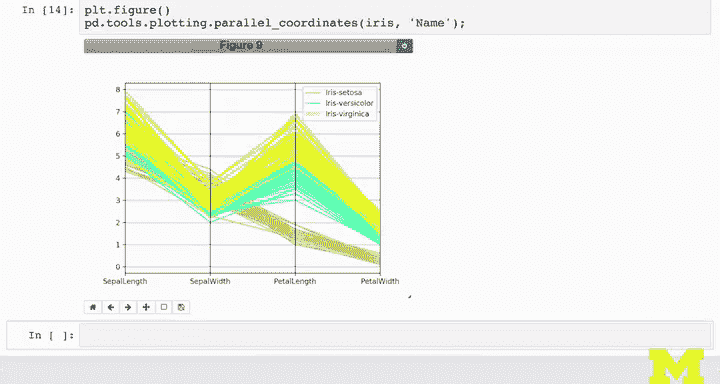

# 课程名称：密歇根大学《Python用于数据科学实践》第21课 - Pandas绘图方法 📊


在本节课中，我们将要学习如何使用Pandas内置的可视化功能来快速探索和展示数据。Pandas的绘图功能基于Matplotlib，但提供了更简洁的接口，特别适合处理Series和DataFrame。

## 概述：Pandas绘图基础

上一节我们介绍了Matplotlib的基本使用，本节中我们来看看Pandas如何在其基础上提供便捷的绘图方法。Pandas的绘图方法能帮助我们快速生成图表，是数据探索阶段的得力工具。

首先，Pandas在底层使用了Matplotlib，因此我们可以通过设置Matplotlib的样式来改变Pandas图表的默认外观。

Matplotlib自带多种预定义样式，我们可以从中选择以更改图表的默认样式。由于Pandas基于Matplotlib，这也会改变Pandas图表的默认样式。

我们可以使用 `plt.style.available` 来查看所有可用的预定义样式。这里我们选择 `seaborn-colorblind` 样式，它将图表的默认颜色改为对色觉障碍更友好的调色板。

## 创建示例数据

在深入可视化之前，让我们先创建一个DataFrame作为示例数据。

首先，我们设置随机数生成器的种子，以确保数据可重现。

```python
import numpy as np
import pandas as pd

np.random.seed(0)
```

接下来，我们添加三列随机时间序列数据。我们可以通过对随机数进行累积求和来生成数据。NumPy的 `cumsum` 函数可以完成数组的累积求和。

```python
dates = pd.date_range('2017-01-01', periods=365)
df = pd.DataFrame(
    np.random.randn(365, 3).cumsum(axis=0),
    columns=['A', 'B', 'C'],
    index=dates
)
df['B'] = df['B'] + 20
df['C'] = df['C'] - 20
```

我们使用 `date_range` 将索引设置为2017年的每一天。现在，让我们更直观地查看这些数据。

## 使用Plot方法绘图

要绘制数据，我们可以在DataFrame上使用 `plot` 方法。Series和DataFrame的 `plot` 方法只是 `plt.plot()` 的一个简单封装。

当我们调用 `df.plot()` 时，会得到DataFrame中所有列的折线图，并带有标签。

```python
import matplotlib.pyplot as plt
plt.style.use('seaborn-colorblind')

df.plot();
```

请注意，由于我们使用了新样式，颜色与默认的Matplotlib颜色略有不同。同时，注意这个Jupyter Notebook技巧：在绘图调用末尾添加分号可以抑制不必要的文本输出，这在常规Matplotlib中也适用。

## 选择不同的图表类型

`DataFrame.plot` 允许我们绘制多种不同类型的图表。我们可以通过向 `kind` 参数传递值来选择所需的图表类型。

让我们尝试创建一个散点图，使用df的A列和B列。

```python
df.plot(kind='scatter', x='A', y='B');
```

我们通过向 `kind` 参数传递 `'scatter'` 来更改图表类型。这等同于使用点标记参数调用 `plt.plot()` 绘制A列和B列。

你也可以通过使用 `DataFrame.plot.kind` 方法而不是提供 `kind` 关键字参数来选择图表类型。

## 创建复杂的散点图

现在，让我们尝试创建更复杂一点的图表。这次，我们想创建一个点的大小和颜色都变化的散点图。

我们将使用 `df.plot.scatter` 方法。

```python
df.plot.scatter(
    x='A',
    y='C',
    c='B',        # 颜色基于B列的值
    s=df['B']*2,  # 大小基于B列的值（放大2倍）
    colormap='viridis' # 使用viridis色图
);
```

这里，我们可以看到A列和C列相互对照绘制，点的大小和颜色根据B列的值变化。`viridis` 色图在视觉上特别舒适。

因为 `df.plot.scatter` 返回一个Matplotlib的 `AxesSubplot` 对象，我们可以像操作Matplotlib返回的对象一样对其进行修改。

例如，让我们看看将XY子图的长宽比设置为相等时的效果。

```python
ax = df.plot.scatter(x='A', y='C', c='B', s=df['B']*2, colormap='viridis')
ax.set_aspect('equal')
```

将长宽比设置为相等可以让观察者更容易看出序列A的范围比序列C小得多。

## 其他有用的图表类型

使用Pandas，我们还可以轻松绘制箱线图、直方图和核密度估计图。

以下是每种图表的简要介绍和示例：

核密度估计图在数据科学应用中非常有用，当你希望从给定样本中推导出平滑、连续的函数时。

```python
# 绘制箱线图
df.plot(kind='box');

# 绘制直方图
df.plot(kind='hist', alpha=0.7, bins=30);

# 绘制核密度估计图
df.plot(kind='kde');
```

## 可视化高维数据

Pandas还拥有有助于可视化大量数据或高维数据的绘图工具。

让我们通过加载经典的鸢尾花数据集来探索其中几个工具。

```python
url = "https://archive.ics.uci.edu/ml/machine-learning-databases/iris/iris.data"
iris = pd.read_csv(url, header=None)
iris.columns = ['sepal_length', 'sepal_width', 'petal_length', 'petal_width', 'species']
```

鸢尾花数据集是一个经典的多元数据集，包含三种鸢尾花数百个样本的萼片长度、萼片宽度、花瓣长度和花瓣宽度。

### 散点图矩阵

Pandas有一个绘图工具，允许我们从DataFrame创建散点图矩阵。散点图矩阵是一种以成对方式比较DataFrame中每一列与其他列的方法。

让我们用它来可视化鸢尾花DataFrame，看看能从数据中获得什么见解。

```python
from pandas.plotting import scatter_matrix

scatter_matrix(iris, alpha=0.8, figsize=(10, 10), diagonal='hist');
```

散点图矩阵在不同变量之间创建散点图，并在对角线上绘制直方图。这使我们能够快速看到数据中一些更明显的模式。

观察散点图，似乎点存在一些明显的分组，这可能表明存在一些聚类现象。

虽然这看起来令人印象深刻且确实有用，但请意识到，如果你想，你在过去两周已经获得了手动构建此类图表的所有技能。这不过是一个4x4的子图网格，其中一些是直方图，另一些是散点图。

### 平行坐标图

让我们看看Pandas中的另一个绘图工具，它将帮助我们可视化多元数据。Pandas包含一个用于创建平行坐标图的绘图工具。

平行坐标图是可视化高维多元数据的常用方法。数据集中的每个变量对应于一条等距的平行垂直线。然后，每个观测值的每个变量的值通过线连接起来。

在此示例中，按花的种类对线进行着色，使观察者更容易看到任何模式或聚类。

```python
from pandas.plotting import parallel_coordinates

plt.figure(figsize=(10, 6))
parallel_coordinates(iris, 'species', colormap='viridis');
```

例如，查看我们的鸢尾花数据集，我们可以看到花瓣长度和花瓣宽度是两个能相当清晰地区分不同物种的变量，山鸢尾的花瓣最长最宽，而维吉尼亚鸢尾的花瓣最短最窄。

## 总结



本节课中我们一起学习了Pandas强大的内置可视化功能。我们了解了如何设置图表样式、使用 `plot` 方法快速绘制折线图、散点图、箱线图等。我们还探索了用于高维数据探索的高级工具，如散点图矩阵和平行坐标图。这些工具能帮助我们在数据科学工作流中快速获得对数据的直观理解。

在下一个视频中，我们将学习Seaborn，一个用于统计绘图的强大包。