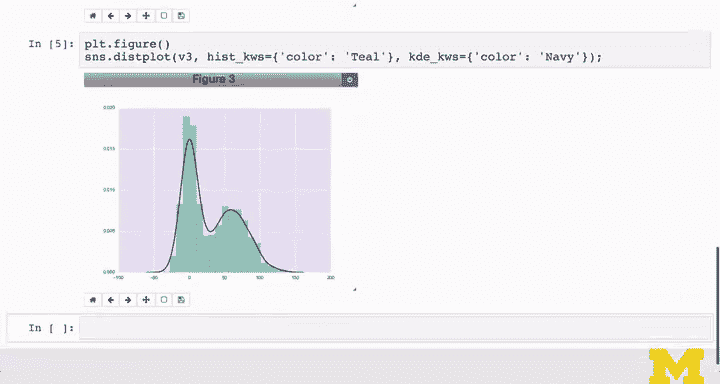
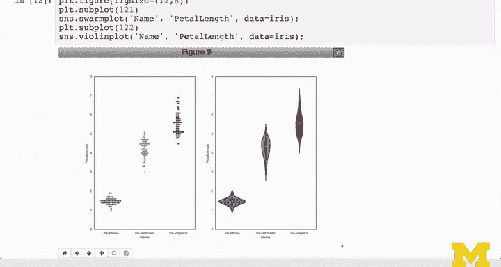

# 52：Seaborn可视化库 📊


在本节课中，我们将要学习Seaborn，这是一个基于Matplotlib的Python数据可视化库。我们将了解它如何美化默认图表，以及如何简化复杂图表的创建过程。

---

## 概述

Seaborn本质上是Matplotlib的一个封装。它为默认的数据可视化图表添加了更美观的样式，并使得创建特定类型的复杂图表变得更加简单。

为了开始学习，我们首先导入Seaborn库。

```python
import seaborn as sns
```

---

## 设置数据与基础直方图

上一节我们介绍了Seaborn的基本概念，本节中我们来看看如何用它来创建和美化基础图表。首先，我们需要生成一些示例数据。

以下是生成两个相关数据序列的步骤：

1.  设置随机数种子以确保结果可复现。
2.  创建第一个序列 `v1`，它包含1000个来自均值为0、标准差为10的正态分布的随机数。
3.  创建第二个序列 `v2`，它是 `v1` 的两倍，再加上1000个来自均值为60、标准差为15的正态分布的随机数。

```python
import numpy as np
import pandas as pd

np.random.seed(0)  # 设置随机种子
v1 = pd.Series(np.random.normal(0, 10, 1000))
v2 = pd.Series(2 * v1 + np.random.normal(60, 15, 1000))
```

现在，让我们并排绘制这两个变量的直方图。我们可以设置 `alpha=0.7` 使直方图半透明，避免相互遮挡。对于 `bins` 参数，我们可以传入一个由 `np.arange` 生成的序列来指定具体的分箱边界，这有助于确保两个直方图使用相同的分箱大小进行比较。我们还会添加图例来区分两个变量。

观察直方图，我们可以快速看出 `v1` 的均值低于 `v2`，并且 `v2` 的数据分布比 `v1` 更分散。值得注意的是，即使我们只使用了Matplotlib进行绘图，仅仅导入Seaborn这一操作就已经将图表的样式从Matplotlib的默认风格改变为Seaborn的风格。

---

## 堆叠直方图与核密度估计图



接下来，让我们以另一种方式可视化这些直方图。首先，我们将 `v1` 和 `v2` 放在一个列表中传入绘图函数，并将直方图类型设置为 `barstacked`。设置 `normed=True` 会将直方图归一化为概率密度。


然后，我们创建一个组合了 `v1` 和 `v2` 的新变量 `v3`，并在堆叠直方图的上方绘制其核密度估计图。核密度估计图用于估计变量 `v3` 的概率密度函数，将其与 `v1` 和 `v2` 的堆叠直方图叠加，可以帮助我们理解这两种可视化方式之间的关系。

Seaborn为这类图表提供了一个便捷的函数 `sns.distplot`。让我们看看它是如何工作的。我们可以传入想要可视化的变量，以及用于设置图表各个组成部分的关键字参数。

```python
v3 = pd.concat([v1, v2])  # 合并数据
sns.distplot(v3, hist_kws={'color': 'teal'}, kde_kws={'color': 'navy'})
```

---

## 联合分布图

现在，让我们看一个Seaborn为复杂图表提供便捷接口的例子：联合分布图。联合分布图会创建一个散点图，并在每个坐标轴上显示对应变量的直方图。实际上，你在第二模块中已经见过联合分布图，并且自己手动创建过。

要创建联合分布图，我们只需输入 `sns.jointplot` 并传入两个序列 `v1` 和 `v2`。设置 `alpha=0.4` 有助于可视化重叠的点。联合分布图允许我们同时观察两个变量的单独分布以及它们之间的关系。通过联合分布图，我们可以看到 `v1` 和 `v2` 似乎是呈正相关的正态分布变量。

因为Seaborn基于Matplotlib，我们可以使用Matplotlib工具来调整图表。Seaborn中的一些绘图函数返回一个Matplotlib轴对象，而另一些则对整个图形进行操作，并生成包含多个面板的图表，返回一个Seaborn网格对象。在这两种情况下，都可以使用Matplotlib来进一步调整图表。

例如，`sns.jointplot` 返回一个Seaborn网格对象。我们可以使用 `grid.ax_joint` 从中提取出一个Matplotlib轴子图对象，然后使用 `set_aspect('equal')` 将纵横比设置为相等。

---

## 六边形箱图与二维核密度图

六边形箱图是直方图的双变量对应物。六边形箱图显示落在六边形箱内的观测数量。`sns.jointplot` 包含一种六边形箱样式，我们可以通过向 `kind` 参数传入 `'hex'` 来使用它。六边形箱图样式适用于相对较大的数据集。

可视化数据集分布的另一个好选择是核密度估计图。你可以将二维KDE图视为六边形联合分布图的连续版本。

首先，我们使用 `sns.set_style('white')` 告诉Seaborn使用不同的样式。之后的所有图表都将关闭灰色网格线。

现在，我们将像之前一样创建一个联合分布图，但这次将 `kind` 参数设置为 `'kde'`。最后，设置 `space=0`，这会将边缘分布直接绘制在散点图的边框上。

我们可以看到，Seaborn有一些内置选项可以轻松实现自定义，并为我们提供了易于创建且美观的图表，用于探索数据的分布。

---

## 分类数据可视化：鸢尾花数据集

在本教程的最后一部分，让我们加载鸢尾花数据集，看看Seaborn如何处理分类数据的可视化。

与Pandas类似，Seaborn有一个内置函数可以创建散点图矩阵。我们传入鸢尾花数据框，使用 `hue` 参数告诉它将 `name` 映射到不同的颜色，并告诉它沿对角线使用KDE图而不是默认的直方图。

观察散点图矩阵，可以清楚地看到数据集中存在一些聚类。看起来花瓣长度和花瓣宽度是区分观测值的良好选择，而萼片宽度则不是一个强区分因子。使用散点图矩阵查看数据框是探索性数据分析中一个非常有用的工具。

我想展示的最后一个图表叫做小提琴图。你可以把小提琴图看作是一个信息更丰富的箱线图。为了演示，让我们将小提琴图与小提琴图旁边的蜂群图一起绘制，你可以将蜂群图视为分类数据的散点图。

首先，创建一个新的图形和一个子图。接下来，创建蜂群图，传入 `name`、`petal_length` 和 `iris` 数据框。对于下一个子图，我们再次创建小提琴图，传入 `name`、`petal_length` 和 `iris` 数据框。

观察蜂群图，每个物种都有自己的列，每个观测值的花瓣长度都被显示出来，更常见的值表现为簇中较宽的部分，很像直方图。小提琴图就像是一个箱线图，两侧各有一个旋转的核密度估计。小提琴图比箱线图传达了更多的信息，并且能够显示箱线图无法传达的分布中的特定现象，例如多峰性。



---

## 总结

本节课中我们一起学习了Seaborn可视化库。Seaborn不仅增加了新的样式和视觉元素，还引入了新的功能，如联合分布图、散点图矩阵和小提琴图。Seaborn正在积极开发中，易于安装，这使其成为数据科学家工具包中不可或缺的一部分。

但请记住，这些功能是建立在Matplotlib之上的，并且很大程度上使用的是Matplotlib的绘图元素。因此，如果你对新的统计可视化有任何想法，或者在出版物或期刊中读到过相关的内容，你应该有能力创建自己的可视化工具包。


Seaborn教程到此结束。祝你绘图愉快！📈