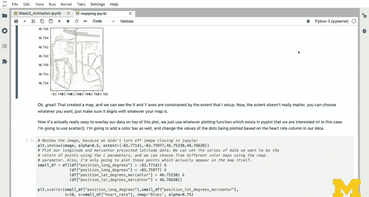

# 课程23：地理信息与地图绘制 🗺️


在本节课中，我们将学习如何将地理数据可视化。我们将探索两种不同的方法：一种是在静态地图图像上叠加数据点，另一种是使用交互式地图库来创建动态、可缩放的地图。

---

## 概述

以书面形式捕捉物理景观特征，或许是信息可视化最古老、最常见的例子之一，至今仍在使用。地理信息系统（GIS）是高度专业化且复杂的，由无数独特的技术和工具组成。在本讲中，我们将初步涉足这个世界，展示如何利用GIS在计算叙事中获取洞察。

我们将从导入几个常用库开始：Pandas、NumPy和Matplotlib的Pyplot接口。我们还会通过设置RC参数来设定一些Matplotlib的默认值，以确保在整个分析过程中图形尺寸保持一致。请务必在开始使用Matplotlib之前，在笔记本的顶部进行此设置。

```python
import matplotlib.pyplot as plt
import numpy as np
plt.rcParams['figure.figsize'] = [16, 8] # 设置图形尺寸为16x8英寸
```

---

## 加载和检查数据

现在，我将导入一些关于骑行的数据。这是一个有趣的数据集，名为 `wipeout.csv`。我将用Pandas读取它，并查看一下。

```python
import pandas as pd
data = pd.read_csv('wipeout.csv')
data.head()
```

该数据由纬度和经度、时间戳（看起来大约是秒级频率）以及测量值（如心率、每分钟心跳次数、增强海拔高度（可能以英尺为单位）、速度等）组成。

---

## 理解坐标与投影

在绘制地图时，我们首先需要考虑经度和纬度。数千年来，制图师们提出了不同的方法，将一个基本是圆形的球体转换成二维矩形，这些方法被称为“投影”。如果你要处理大量制图数据，无疑需要学习其中一些投影。

我并非这些不同投影和地图坐标存储方式的专家，但即使在这个简单的例子中，数据看起来也有些奇怪：为什么我们只有一个数字？我习惯在使用谷歌地图时看到带有小数点或小数位的数字。

原来，这个特定的数据源试图以无符号整数的形式捕获最大精度。因此，我们首先需要将这些数据转换为更传统的十进制格式。为此，你需要查阅文档来确定如何进行转换，但这里我将为你省去这一步，因为我已经知道方法了。

```python
# 将坐标转换为更常见的GPS坐标格式
data['position_lat_degrees'] = data['position_lat'] * 180 / (2**31)
data['position_long_degrees'] = data['position_long'] * 180 / (2**31)
```

但这并不能完全满足我们的需求。地球是近似球形的，而我们要在屏幕上查看它，屏幕是平面的。因为我们将在二维图像上绘图，所以希望使用墨卡托投影。我将分享将纬度（以度为单位）转换为平面墨卡托投影的代码，这实际上来自OpenStreetMap项目。

```python
import math
def lat_to_y(lat):
    return math.log(math.tan(lat / 360.0 * math.pi + math.pi/4.0)) / (math.pi / 180.0) * 20037508.34 / 180.0

data['position_lat_degrees_mercator'] = data['position_lat_degrees'].apply(lat_to_y)
```

最后，我想删除任何缺失值。目前这是一个简化处理，在实践中可能并非最佳选择，但我只是想稍微减少数据量。

```python
data = data.dropna()
```


---

## 方法一：在静态地图图像上叠加数据

我想展示的第一个绘图方法可能是最简单的。其核心思想是，我们将在一个轴对象后面渲染一张图像，然后在这个轴对象上使用常规的绘图功能。为此，我们需要一张图像，并且需要知道该图像的坐标边界。然后，我们可以设置所谓的“范围”，它代表了地图的边界。这意味着轴对象后面的图像将与轴对象本身使用相同的坐标系，绘图将被锁定。

首先，我通过从OpenStreetMap导出获得了我的图像，并将其保存在Coursera中，名为 `map.png`。你也可以直接从OpenStreetMap获取地图。为了显示它，我们将使用Pyplot的 `imread` 函数，并与 `imshow` 配对使用。

```python
# 读取地图图像
map_img = plt.imread('map.png')

# 显示图像并设置其范围（坐标边界）
plt.imshow(map_img, extent=[-122.55, -122.35, 37.68, 37.85])
plt.show()
```



很好，这创建了一张地图，我们可以看到x轴和y轴受我设置的范围约束。范围本身并不重要，你可以选择任何值，只需确保它与你的地图对齐即可。在这种情况下，我知道我从OpenStreetMap导出的地图的范围是什么。

---

### 在地图上叠加数据

现在，将我们的数据叠加到这个图上实际上非常简单。我们只需使用Pyplot中我们感兴趣的任何绘图函数。在这种情况下，我将使用散点图函数，并添加一个颜色条，根据数据中的心率列来改变绘制点的颜色。

以下是具体步骤。首先，我重新显示图像（因为在Jupyter中，默认情况下每个单元格运行后会关闭图像）。然后，我使用经度和墨卡托投影后的纬度数据，通过 `c` 参数指定点的颜色序列，并通过 `cmap` 参数选择不同的颜色映射。同时，我只绘制那些实际出现在地图上的点。

```python
# 重新显示地图
plt.imshow(map_img, extent=[-122.55, -122.35, 37.68, 37.85])

# 筛选出在地图范围内的数据点
mask = (data['position_long_degrees'].between(-122.55, -122.35)) & \
       (data['position_lat_degrees_mercator'].between(37.68, 37.85))
filtered_data = data[mask]

# 绘制散点图，颜色表示心率
scatter = plt.scatter(x=filtered_data['position_long_degrees'],
                      y=filtered_data['position_lat_degrees_mercator'],
                      s=10, # 点的大小
                      c=filtered_data['heart_rate'],
                      cmap='Blues',
                      alpha=0.6)

# 添加颜色条和标签
plt.colorbar(scatter, label='Heart Rate (BPM)')
plt.title('Cycling Route with Heart Rate Overlay')
plt.show()
```

很好！我们得到了一张地图，上面绘制了一些点，显示了不同的心率测量值。观察这张图，你会发现颜色较浅、透明度较高的圆圈接近每分钟100次心跳，而颜色较深、实心的圆圈接近每分钟135次心跳。根据内部知识（因为骑自行车的人就是我），我可以告诉你左下角的街道实际上是我骑车上坡的路段，而这里的部分是我下坡或滑行的路段，所以我的心率在这里没有那么高。

---

## 方法一的局限性

这种使用带有范围的图像创建地图的方法简单可靠，但速度不快，也不够无缝。如果我们把完整的数据框放上去，就会明显看出我们需要找到具有正确范围的地图来进行绘图，并且需要不断查找我们想要导出作为背景图像的不同地图。

让我们看看完全相同的代码，但使用所有数据。这实际上对我们来说更容易，因为我先显示图像，然后直接散点绘制所有内容，不需要那个大的布尔掩码。

```python
plt.imshow(map_img, extent=[-122.55, -122.35, 37.68, 37.85])
plt.scatter(x=data['position_long_degrees'],
            y=data['position_lat_degrees_mercator'],
            s=5,
            c=data['heart_rate'],
            cmap='Blues',
            alpha=0.3)
plt.colorbar(label='Heart Rate (BPM)')
plt.title('Full Cycling Route (Limited Map View)')
plt.show()
```

现在我们看到了我的整个骑行路线，但地图上只有右下角这一小块区域。

---

## 方法二：使用交互式瓦片地图

大多数网络系统中采用的另一种地图方法是使用所谓的“瓦片服务器”。瓦片服务器实际上创建了一个不同缩放级别的地图矩阵，然后根据客户端的请求提供地图的部分（瓦片）。例如，谷歌地图就是这样工作的，它创建了一种响应式体验，代价是稍微脆弱一些，因为需要网络访问。

这种范式在Jupyter笔记本中也可以通过一个名为Folium的项目获得。这个项目完全是客户端的JavaScript，负责地图请求和渲染。为了将其连接到我们的Python后端，我们可以使用Folium项目。但请注意，这是一个新的库，它使我们脱离了Matplotlib的世界，但我觉得你可能会发现它相当好用、自然，并且如果你真的开始查看地图并在地图上绘图，可能会想使用它。

```python
import folium
```

现在，我们想从之前的数据中渲染一个点。为此，我选择了地图的中心点，然后设置一个缩放级别。这里有不同的缩放级别可供选择，你将能够在这里上下滚动。需要注意的关键点是，对于这个库，我必须反转我们的经度和纬度顺序，并且我没有使用经度的墨卡托值。欢迎来到GIS系统，每个系统的做法都略有不同。

```python
# 创建地图，中心点为数据的第一行坐标
center_lat = data.iloc[0]['position_lat_degrees']
center_lon = data.iloc[0]['position_long_degrees']
m = folium.Map(location=[center_lat, center_lon], zoom_start=14)
m
```

你会立即注意到用户体验很好。一旦我们绘制数据，你仍然可以看到数据，但你实际上可以像在谷歌地图中一样放大、缩小和移动地图。当你移动到没有瓦片的地方时，系统会自动获取它们。

---

### 在地图上添加标记和路线

我们可以使用 `Marker` 类在地图上添加标注。让我们为起点和终点设置这个。

```python
# 重新创建地图
m = folium.Map(location=[center_lat, center_lon], zoom_start=14)

# 添加起点标记
start_lat = data.iloc[0]['position_lat_degrees']
start_lon = data.iloc[0]['position_long_degrees']
folium.Marker([start_lat, start_lon], popup='Start').add_to(m)

# 添加终点标记
end_lat = data.iloc[-1]['position_lat_degrees']
end_lon = data.iloc[-1]['position_long_degrees']
folium.Marker([end_lat, end_lon], popup='End').add_to(m)

m
```

这些操作会放置小图钉，指示路线的起点和终点。

但我也想映射整个骑行路线。Folium文档指出，`Polyline` 是适合使用的类。`Polyline` 接受一个由元组组成的位置列表，这意味着我们必须将纬度和经度值成对组合。这实际上可以通过Python的 `zip` 函数轻松实现。

```python
# 创建包含所有坐标点的列表
locations = list(zip(data['position_lat_degrees'], data['position_long_degrees']))

# 在地图上添加折线（骑行路线）
folium.PolyLine(locations=locations, weight=5, color='blue').add_to(m)
m
```

这是一个很好的渲染效果！你可以在这里看到我的骑行路线，可以放大缩小我的骑行路线，可以看到起点和终点的小图钉，还可以看到我去过的地方。当你开始查看数据时，这是一种非常流畅的方法。即使我们使用的是折线，这些数据点中的每一个实际上都直接绘制在上面，然后作为折线的一部分自动为我们连接起来。

---

## 总结

在本节课中，我们初步探讨了可以混合GIS结构和数据完成的一些信息映射。我们看到了几种不同的方法：从在简单地图上叠加数据图，到使用Folium在基于JavaScript的地图上绘图。GIS系统是一个巨大的领域，但了解一些关于数据空间表示的知识，对于物理世界成为你调查一部分的那些时刻非常有帮助。

---

**本节课中我们一起学习了：**
1.  如何加载和转换原始地理坐标数据。
2.  使用Matplotlib在静态地图图像上叠加和可视化数据（如心率）。
3.  使用Folium库创建交互式、可缩放的网络地图，并添加标记和路线。
4.  理解了不同地图投影和库之间坐标处理的差异。


地理可视化是一个强大的工具，可以将位置数据转化为直观的洞察。