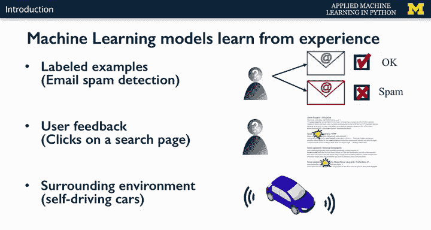
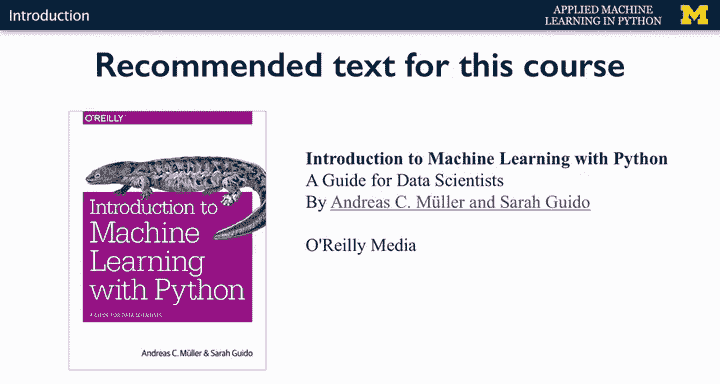

# 密歇根大学《Python用于数据科学实践》第1课：机器学习导论 🚀

在本节课中，我们将要学习**机器学习**的基本概念、其重要性以及它在数据科学中的应用。我们将探讨机器学习如何解决传统编程难以处理的问题，并了解几个关键的应用领域。

---

大家好，欢迎来到密歇根大学在线课程《应用数据科学》的**应用机器学习**部分。

我是凯文·柯林斯·汤普森，是密歇根大学信息与计算机科学的副教授。

我将担任本部分课程的讲师。

我拥有约20年的研究和开发经验，将机器学习应用于学术界和工业界的各种问题，从语言辅导软件到商业搜索引擎。

这是一个参与机器学习极其令人兴奋的时代。

我希望本部分课程能激励你更深入地探索这个迷人的世界。

本周，你将学习什么是机器学习以及它为何对数据科学至关重要。

你将了解机器学习如何应用于我们信息经济中的关键问题，以及如何在Python中设置你的第一个机器学习应用。

---

## 什么是机器学习？🤔

上一节我们介绍了课程概述，本节中我们来看看机器学习的定义。

在许多情况下，当需要解决一个计算问题时，例如从数据库中存储和检索数据，我们通常的解决方法是编写一个程序，手动指定一系列需要运行的编程步骤来解决该特定问题。

这种方法对于绝大多数计算机科学问题非常有效。

然而，并非所有问题都适合通过编写手工制作的程序或一套规则来有效解决。

例如，你如何用编程语言写下一套规则，来准确地将人类语音转换为文本？这个过程被称为**语音识别**，现在已在数百万智能手机上使用，或应用于世界各地的客户支持系统。

考虑到人类语音的微妙和复杂性，包括大量不同的发音、词汇、口音等，手工编写一套程序规则来识别音频信号的部分内容并决定信号中包含哪些单词等，将是一项艰巨的任务。

即便如此，它在识别不同类型的语音时可能仍然不够灵活，也不够稳健。

此外，如果我们需要定制系统，使其能够识别新单词或我们现有规则中未编码的其他特征，我们将不得不编写一套全新的规则，这将是一项极其困难的任务。

另一方面，**机器学习**为我们提供了技术，使我们能够从称为**训练数据**的标记示例中，自动高效地学习这些复杂的规则。这种方式比尝试手工编程所有规则要准确和灵活得多。

而且，由于我们未来看到的任何示例都不太可能与训练集中的内容完全匹配，因此有效机器学习算法的一个主要目标是能够**泛化**，即正确预测或识别在训练期间未见过的新对象。

所以，机器学习的基本问题是探索计算机如何自我编程以执行任务，并在获得更多经验时自动提高其性能。

这种经验可以以多种不同格式或情境的数据形式出现，例如用于训练系统初始结构的标记示例（如电子邮件垃圾邮件检测系统）。

系统可以从用户那里获得反馈，例如搜索引擎获取搜索页面上的点击数据。

系统也可以从随时间收集的周围环境中获取数据，例如自动驾驶汽车可以检测附近的物体和事件，并学会更可靠地移动。

---

## 机器学习的学科基础 🧠

为了有效且高效地实现这一目标，机器学习大量借鉴了**统计学**和**计算机科学**。

这些统计方法为机器学习算法提供了从数据中推断结论、从数据中学习以及评估这些结论可靠性的方法。

另一方面，计算机科学方法为机器学习算法提供了解决问题的计算能力，包括有效的大规模计算架构以及用于捕获、操作、索引、组合数据和进行预测的算法。

试想一下，商业搜索引擎如何能快速地将你的查询与数十亿个网页进行匹配，并几乎瞬间返回一组有用的结果。

这正是结合统计方法与计算机科学力量的理想例证。

机器学习与其他领域之间的联系也在不断增长，这非常引人入胜。

例如，关于个体或系统如何在给定环境中优化其性能的问题，也与生物学中关于生物体如何觅食的研究有共通之处。

它还与经济学的相关研究有联系，涉及如何计算最优定价和市场结构。

甚至与心理学，特别是人类学习的模型和因素相关，并利用这些来影响机器学习技术的设计。

因此，这个不断发展的机器学习领域真正汇集了多个科学领域的见解。

这也是我发现它如此迷人的原因之一。

---

## 机器学习的应用实例 💡

机器学习算法现在越来越多地参与到日常生活的各个方面，从你阅读和观看的内容，到你购物的方式，再到你遇见的人以及你的出行方式。

以下是几个例子。

**欺诈检测**：每次你使用信用卡购物时，机器学习算法会立即检查你的购买行为，以验证这是否可能是一笔欺诈交易。为此，这些算法会查看你刚刚完成的当前交易的特征，例如时间、地点和金额。它们会根据该购买行为是否与你先前购买的特征一致，来预测其是否为欺诈。系统还会记录用户关于交易是否确实为欺诈的任何反馈，并利用该反馈在未来做出更好的预测。

**搜索和推荐系统**：这也是机器学习应用的一个巨大领域。事实上，机器学习算法是商业搜索引擎工作的核心。从你开始输入查询的那一刻起，一个算法可能会监控你的按键，以预测在你输入时最佳的自动补全查询。然后，一旦你完成查询，其他一些机器学习算法将被应用，以确定你为该查询看到的网页的选择和排名。此外，其他机器学习算法将决定你在页面上看到哪些广告（如果有的话），系统为你建议哪些相关查询等等。此外，搜索引擎通常使用你与搜索站点交互的数据，例如你点击了哪些页面、阅读页面的时长，来提高其未来的有效性。

以类似的方式，**电影推荐网站**使用机器学习算法，根据你过去的评论和与网站的互动模式，以及你的偏好与其他用户偏好的关系，来建模你过去喜欢什么。它利用这些数据学习一个关于你个人品味的模型，以期为你提供更好的选择，让你更投入地使用网站，或引导你随着时间的推移购买更多电影。

最后，第三个在过去几年中在识别质量方面取得显著进步的示例领域是**语音和图像识别**。尽管研究人员已经致力于语音和图像识别数十年，但最近，计算能力的提升、更好的算法（包括深度学习的使用）以及数据量的大幅增加，共同导致了识别算法在过去五年左右在准确性和灵活性上的显著飞跃。现在，识别技术已经足够可靠和快速，可以作为智能手机和家庭设备的基本功能，这些设备可以响应语音命令或问题。计算机视觉和图像识别现在可以越来越准确地识别图像或视频中的物体和动作。甚至有一段时间以来，超过85%的手写邮件由美国邮政服务以非常高的准确率自动分拣。在医学领域也有非常令人兴奋的进展，正在开发图像识别算法来将癌细胞分类为恶性或良性，估计最佳个性化治疗方案，或在医学图像中发现难以检测的肿瘤。当然，自动驾驶或自主车辆广泛使用实时图像识别和视频处理，以及其他技术如强化学习。

这些例子仅仅触及了机器学习在当今社会中如何应用的表面。在本课程的进展过程中，你将会遇到并处理其他一些例子。

---

## 关于“应用”机器学习 📘

本课程模块的名称实际上是“应用机器学习”。那么“应用”部分意味着什么？当我们设计这个数据科学系列时，我们觉得需要一门课程，更侧重于如何在高层次上正确应用和解释机器学习算法的结果，而较少关注这些算法内部具体如何工作的技术细节。

已经有许多优秀的现有核心机器学习课程提供了更深层次的技术细节。而这种详细的知识对于使用机器学习算法并将其用于特定应用总是必要的。

事实上，一个非常令人兴奋的趋势正在发生：用于语音识别、语言翻译、文本分类和许多其他任务的即用型机器学习算法，现在正作为基于网络的服务在云计算平台上提供。这极大地增加了能够使用它们的开发人员受众，并使构建应用机器学习的高层次解决方案变得比以往任何时候都更容易。

以下书籍《Python机器学习入门》不是完成本课程所必需的，但我们推荐它作为一个额外的资源，可能对你在学习过程中以及后续参考时有用。像本课程一样，这本书侧重于使用Python中的`scikit-learn`构建你自己的机器学习任务解决方案的实践细节。它提供了机器学习概念的进一步背景知识，对本课程涵盖的特定主题以及一些附加主题提供了更深入的讲解，并提供了一些额外的编码示例。

---

## 总结 ✨

本节课中我们一起学习了机器学习的核心定义，即计算机通过经验（数据）自我编程和改进性能的能力。我们探讨了机器学习与统计学和计算机科学的紧密联系，并了解了它在欺诈检测、搜索推荐、语音图像识别等领域的强大应用。最后，我们明确了本“应用”课程的重点在于如何正确使用和解释机器学习工具，而非其底层算法的全部技术细节。