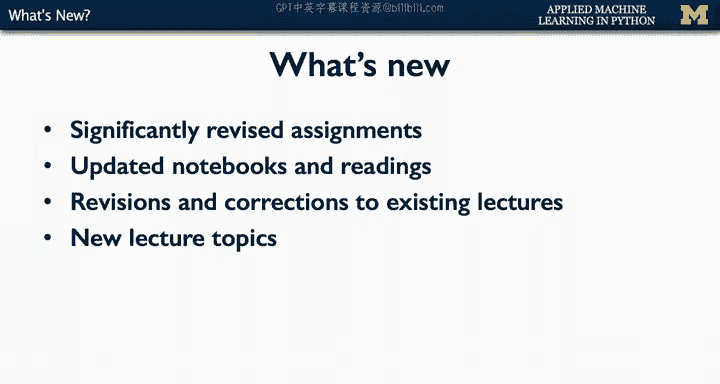

# 56：Python数据科学专项课程更新说明 📢

在本节课中，我们将了解密歇根大学《Python用于数据科学实践》专项课程（特别是机器学习课程部分）的最新更新内容。这些更新旨在提升学习体验，确保课程内容与当前技术发展保持同步。

---

自从我们首次发布Python数据科学专项课程以来，我们非常高兴地看到它帮助了全球数十万学习者追求他们对数据科学的兴趣。

在此过程中，我们收到了大量有益的反馈，并已尽力将这些反馈融入机器学习课程的这一新版本中。

我们投入了大量工作，在此更新版本中为您带来了许多新内容。

以下是本次更新的主要方面：

*   **作业与测验**：我们大幅修订了作业内容，并同步更新了测验题目。
*   **课程材料与代码**：我们修订了课程阅读材料，并更新了所有Notebook，以确保它们与**Scikit-learn**等库的最新版本兼容。这些库在过去几年中也经历了重大发展。
*   **讲座视频**：最后同样重要的是，我们对现有讲座视频进行了审核，以阐明某些观点、增加更多示例，并在此过程中进行了一些修订和更正。

---

我们希望您能发现课程的这个新版本非常实用。

请告诉我们您的学习体验，并祝您在数据科学之旅的下一步中好运。

在本节课中，我们一起了解了本次课程更新的背景、目标以及涵盖的具体方面，包括作业、测验、学习材料和讲座内容的全面优化。