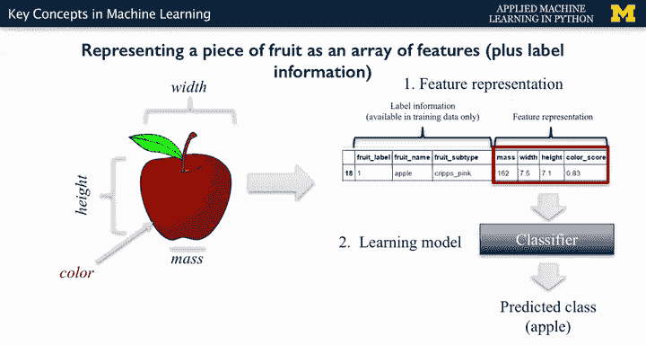

# 课程1：机器学习核心概念 🎯

在本节课中，我们将学习机器学习的两大主要类型：监督学习和无监督学习。我们将探讨它们的基本定义、典型应用场景以及解决机器学习问题的三个基本步骤。

---

## 概述

机器学习任务，例如信用卡欺诈检测、电影推荐和语音识别，可以分为两大主要类型。

## 监督学习 📊

监督学习的目标是预测与每个输入项相关联的某个输出变量。

如果输出是一个类别，即有限数量的可能性，例如判断信用卡交易是否为欺诈，或者识别语音信号对应的英文单词，我们称之为**分类问题**。此时，我们学习的函数称为**分类器**。

如果我们要预测的输出变量不是类别，而是一个实数值，例如汽车从0加速到100公里/小时所需的时间（以秒为单位），我们称之为**回归问题**。此时，我们学习的是**回归函数**。

更正式地，我们通常用大写字母 **X** 表示数据项表格，每行代表一个数据项。与每个数据项关联的标签存储在变量 **Y** 中。我们的目标是学习一个函数 **f**，将 **X** 中的数据项映射到 **Y** 中的标签。

为此，系统需要一组带有标签的训练样本，即输入 **x_i** 和输出 **y_i**。这组带标签的训练样本用于确定将输入映射到期望输出的最佳函数。

例如，在图像识别的监督学习问题中，这涉及构建一个分类器。输入 **x_i** 可以是描述单张图像的像素集合，期望的标签 **y_i** 可能是图像中物体的名称。

科学家们开发了许多算法来进行监督学习，用于从训练数据中估计函数 **f**。我们将在课程中介绍其中一些算法。

监督学习需要有这个带标签对象的训练集来进行预测。但是，如果整个目标就是预测这些标签，那么最初的这组带标签项从何而来？

答案是，训练标签通常由人工标注者提供。为某些问题获取标签的难易程度取决于所需标签数据的数量、提供准确标签所需的人类专业知识水平以及标注任务的复杂性等因素。

像亚马逊的Mechanical Turk或CrowdFlower这样的众包平台，已成为从人工工作者那里获取明确提供标签的重要来源。客户可以将需要标注的机器学习任务与能够利用人类智能提供标签的工人群体联系起来。

这些是更明确获取的标签。我们也可以获取隐式标签。例如，如果搜索引擎检测到用户点击了一个结果链接，然后看到用户在返回搜索引擎之前有一两分钟没有其他活动，系统可能会将该活动用作该页面的某种隐式标签。换句话说，如果用户花了一些时间访问该页面，那么该页面更可能与他们的查询相关。

## 无监督学习 🧩

在许多情况下，我们只有输入数据，没有任何与之相关的标签。在这些情况下，我们可以解决的问题涉及获取输入数据并尝试在其中找到某种有用的结构。

“结构”是什么意思？通常，这意味着在数据中找到有趣的聚类或分组。一旦我们能以聚类、分组或其他有趣子集的形式发现这种结构，该结构就可以用于任务，例如生成输入数据的有用摘要，或者可视化该结构。

假设你运营一个向客户销售产品的电子商务网站，你可能有成千上万甚至数百万的客户。你可能想知道是否可以将客户分类或分组为不同的类型。例如，可能有使用网站更高级功能的“高级用户”，可能有关注廉价折扣且在网站上停留时间很短的“快速浏览型用户”，也可能有花费大量时间比较不同商品的“谨慎研究型用户”。

如果你能获取人们与网站互动的数据，并使用无监督学习来发现这些不同的群体，那么你可以想象，也许可以为每个群体定制网站的产品推荐，从而提高该群体用户购买产品或获得更好体验的机会。

你事先并不知道有多少个群体，甚至不知道它们是什么样子，而且你没有任何带标签的示例。因此，这是一个经典的无监督学习问题。

另一种非常重要的无监督学习问题是检测对Web服务器的异常访问。出于安全原因，你可能希望在网站用户发出可能是网络攻击的请求时收到通知，或者其行为与网站上典型用户行为非常不同。

由于可能存在许多不同类型的黑客攻击或入侵尝试，我们无法获得可靠的训练标签来使用监督学习训练分类器。相反，我们需要一种无监督的方法，允许我们执行所谓的**异常检测**。这种方法不假设未来的攻击会与以前的攻击形式相同，但假设网站攻击的某些特征在某种程度上会与平均用户行为不同。

## 应用机器学习的三个步骤 🔄

假设你遇到一种情况，认为机器学习可能适用，无论是使用监督方法还是无监督方法。你将如何应用机器学习来解决你的问题？有三个基本步骤。我将使用分类作为典型的机器学习场景，因此我经常只使用“分类器”这个术语作为机器学习任务的例子。但我要描述的内容同样适用于其他形式的监督学习（如我们稍后将介绍的回归）和无监督学习（如聚类）。

### 第一步：问题表示与算法选择

解决机器学习问题的第一步是，你必须弄清楚如何以计算机能够理解的方式来表示学习问题。你需要能够获取你的数据，甚至对你感兴趣识别的对象（例如）进行描述，以便将其用作算法的输入。你还需要决定将哪种类型的学习算法应用于这些数据。

例如，表示图像的方式有很多种。通常，它被表示为一个彩色像素数组。也可能有与图像相关的元数据。如果你想进行欺诈检测，可以考虑如何表示信用卡交易，这可能由交易的时间、地点和金额来表示。

因此，你需要某种方式来表示你的数据，并选择你想应用于数据的算法类型。

### 第二步：确定评估方法

你需要做的第二件事是确定一种评估方法，为机器学习算法（通常是分类器）的预测或输出提供某种质量或准确性评分。

如果你有一个评估方法，这允许你评估和比较不同分类器的有效性，从而判断哪些分类器对你的特定问题表现良好，哪些是好的，哪些是差的。

例如，一个好的分类器具有高**准确率**，即它在高比例的情况下做出的预测与正确的真实标签相匹配。

### 第三步：搜索最优分类器

在应用机器学习解决问题时，你需要做的第三件事是，一旦我们决定了如何表示输入数据、分类器类型和评估方法，我们就需要搜索能给出该问题最佳评估结果的**最优分类器**。

在本课程中，我们将深入探讨这三个方面，并使用Python解决一些具体示例。我们即将看到一个具体示例，展示如何在Python中使用机器学习库来解决分类问题。

现在，让我们更详细地了解这三个步骤。

## 问题表示：特征与模型 🛠️

首先，我们来谈谈将问题转换为计算机可以处理的表示意味着什么。这涉及两件事：你需要将每个对象（每个输入对象，我们通常称之为**样本**）转换为一组描述该对象的**特征**。其次，你需要选择一个**学习模型**，即你希望系统学习的那种分类器。

让我们更仔细地看看对象的特征表示是什么意思。

数据集中的每个数据点都代表某个事物、某个对象、情况、事件或实体，由一系列属性列表表示。例如，一封电子邮件可以表示为消息中包含的单词列表。一张图片可以表示为构成图像的像素的颜色值矩阵。一个像这个苹果一样的水果，可以用它的颜色、形状、质地等来表示。对象的这些属性值称为**特征**。

你可以将包含这种特征表示的输入数据视为函数的输入。你可以很容易地将其可视化为一个表格，其中表的每一行代表一个数据实例，表的列代表对象的特征。

使用特征来表示一个对象可能有很多不同的选择。例如，我展示了一个水果，让我们拿起一个柠檬。柠檬有形状、宽高比，也有质量、味道。我想如果你现在在商店买柠檬，它们还带有一个方便的条形码，用于标识水果的类型。因此，我们可以收集关于一个事物的许多不同类型的信息，并以计算机能够理解的形式呈现。

因此，为机器学习算法找出如何表示对象的问题实际上是一个挑战，它被称为**特征工程**或**特征提取**，我们将在课程的第四周介绍。

表示机器学习问题的另一个关键部分是选择适合该问题的分类器类型。本课程将介绍许多不同类型的分类器。它们在准确性、可解释性、速度等方面都有不同的权衡。我们将在本课程的第二周介绍这些。

## 迭代过程：优化与改进 🔁

因此，解决机器学习任务的过程通常是一个循环，涉及一个迭代过程，如下图所示。我们首先对问题的良好特征和可能合适的分类器做出初步猜测。然后，我们使用训练数据训练系统，进行评估，看看分类器的效果如何。接着，基于哪些有效、哪些无效，哪些示例被正确或错误分类，我们可以进行**失败分析**，看看系统仍在哪些地方出错。然后，根据失败分析的结果，我们通常会**优化特征集**。例如，我们可能会发现缺少一个重要特征，而这个特征有助于纠正一些错误。

根据我的经验，这种迭代过程非常常见。事实上，这是用机器学习解决问题的典型方式。通常，你可能需要多次经历这个循环，以不断优化特征并评估它们对准确性的影响，或者根据你选择的评估方法尝试不同类型的分类器，以确定你是否为你的问题找到了正确的方法。

---

## 总结

本节课中，我们一起学习了机器学习的核心概念。我们明确了监督学习和无监督学习的区别：监督学习用于预测已知标签，包括分类和回归；无监督学习用于在无标签数据中发现结构，如聚类和异常检测。我们还详细探讨了应用机器学习的三个基本步骤：问题表示与算法选择、确定评估方法以及搜索最优模型。最后，我们了解到解决机器学习问题通常是一个迭代优化特征和模型的过程。