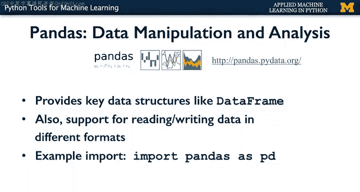

# 58：Python机器学习工具 🛠️


在本节课中，我们将学习如何开始使用Python进行机器学习应用。我们将介绍几个关键的Python库，这些库是构建机器学习项目的基础。掌握这些工具是后续实践的重要前提。

## 概述

我们已经了解了机器学习的基本背景和一些主要的问题类型。现在，最好的学习方式就是动手在Python中开始我们自己的机器学习应用。我们将立即开始，为此，我们需要利用几个重要的Python库来支持我们的工作。

## 核心Python库介绍

以下是支持我们机器学习工作的几个核心Python库。我们将逐一介绍它们的主要功能和用途。

### Scikit-learn

我们将用于机器学习的最重要的库叫做 **Scikit-learn**。Scikit-learn是使用最广泛的Python机器学习库，也是本课程的基础。它是一个持续开发和改进的开源项目，支持非常广泛的、重要的机器学习算法。它拥有优秀的在线文档和非常活跃的用户社区。由于被广泛采用，Scikit-learn在网上有许多示例应用、教程和代码示例。因此，我们建议你在学习本课程时使用的一个有价值的参考资料是 **Scikit-learn用户指南** 和 **API文档**，其中包含了库中不同算法的更多细节，以及这些算法支持的各种选项的详细信息。

Scikit-learn使用了另外两个Python科学计算库，称为 **SciPy** 和 **NumPy**。

### SciPy 与 NumPy


**SciPy** 是一个Python库，支持科学计算中常用的数据操作和分析方法。这包括对统计分布、函数优化、线性代数和各种专用数学函数的支持。在本课程的某些部分，我们将利用SciPy提供所谓的**稀疏矩阵**，这是我们存储大部分为零的大型表格的一种方式。关于这一点，稍后会有更多介绍。

**NumPy** 是一个用于科学计算的Python库，它包含了对Scikit-learn使用的一些基本数据结构的支持，例如**多维数组**。通常，输入到Scikit-learn的数据将是NumPy数组的形式。

### Pandas

**Pandas** 是一个用于数据操作和分析的Python库。如果你学习了本系列的第一门课程，你已经对Pandas的功能有了一些经验。我们将使用的Pandas支持的关键数据结构叫做**数据框**，它基本上就像一个带有行和命名列的电子表格。与NumPy支持的数组不同，数据框中的列可以是完全不同的类型。你可以有一列保存字符串值，另一列保存日期，另一列保存浮点数，等等。

Pandas还对以各种格式读写数据有很好的支持，从逗号分隔的CSV文件到数据库使用的结构化查询语言SQL等等。

### Matplotlib

**Matplotlib** 是一个广泛使用的Python 2D绘图库。它可以在各种平台上的不同格式和交互式环境中生成高质量的图形。Matplotlib可以用于Python脚本、Python和IPython Shell、Web应用服务器以及各种不同的图形用户界面工具包。如果你学习了本数据科学系列的第二门课程，你已经有一些使用Matplotlib的经验。在这里，我们将主要使用 `matplotlib.pyplot` 进行数据分析，因为它只需几行代码就可以创建直方图、条形图、箭头图、散点图等等。


## 库版本与检查


以下是本课程中使用的主要库的版本。请确保你使用的Scikit-learn和其他库的版本与此处列出的相同或更高。



如果你不确定自己拥有哪些版本，这里有一些示例代码，展示了如何检查你拥有的Scikit-learn、NumPy和Pandas的版本。你可以使用类似的代码来检查其他库的版本。

```python
# 示例代码：检查库版本
import sklearn
import numpy as np
import pandas as pd
import matplotlib

print(f"Scikit-learn version: {sklearn.__version__}")
print(f"NumPy version: {np.__version__}")
print(f"Pandas version: {pd.__version__}")
print(f"Matplotlib version: {matplotlib.__version__}")
```

## 安装建议


我们建议使用 **Anaconda Python发行版** 来安装所有这些库，因为它包含了我们在课程这一部分所需的所有库。如果你有其他现有的Python安装，你可以使用Pip从命令行安装我们将要使用的库。

## 总结

本节课中，我们一起学习了开始Python机器学习应用所需的核心工具。我们介绍了Scikit-learn作为主要的机器学习库，以及其依赖的SciPy和NumPy库。我们还回顾了用于数据处理的Pandas库和用于数据可视化的Matplotlib库。最后，我们了解了如何检查库的版本以确保环境兼容。掌握这些库是构建有效机器学习模型的第一步。