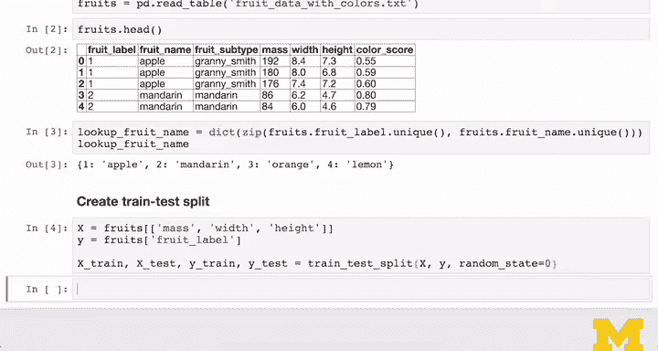

# 密歇根大学《Python用于数据科学实践》第4课：机器学习问题实例 🍎🍊🍋


在本节课中，我们将构建一个极其简单的物体识别系统，以此作为我们首次探索机器学习的实践。虽然我们将使用的例子非常简单，但它确实反映了构建真实世界商业系统时所涉及的许多关键机器学习概念。

## 概述

我们将使用一个名为“Fruit data with Col.TXT”的小型数据集。该数据集最初由爱丁堡大学的Ian Murray博士创建，用于训练一个分类器来区分不同类型的水果。为了创建这个数据集，Murray博士测量了数十个橙子、柠檬和苹果的高度、宽度、质量等特征。我们对其原始数据进行了略微重新格式化，并添加了一两个模拟特征（如颜色评分）用于教学。

你可能会认为水果预测是一个有点不切实际的场景。考虑到数据集的有限性，这确实是一个“玩具”例子。但实际上，食品公司现在确实依赖机器学习系统进行自动化质量控制，其概念与我们即将构建的系统并无太大不同。例如，确实存在水果运输公司使用的真实系统，可以在加工过程中筛查腐烂的橙子。当然，这些系统使用的特征比我们这里看到的要复杂一些。

## 理解数据：表格化视角

要解决机器学习问题，你可以将输入数据视为一个表格。在我们的案例中，每一行代表一个对象（即一个水果），而对象的属性（即测量值、颜色、大小等）则由各列中的值表示。

在监督学习问题中，数据集通常还会包含一个特殊的列，即对象的**标签**。如果数据集本身没有这个字段，有时可以从一个或多个列的信息中推导出来。

在继续之前，请确保你已经运行了以下代码片段，加载我们将要使用的必要库。

```python
import pandas as pd
from sklearn.model_selection import train_test_split
```


## 加载与查看数据

我们要做的第一件事是使用pandas中非常方便的`read_table`命令加载水果数据集。这将从磁盘读取数据集，并将其存储到一个我们称为`fruits`的DataFrame变量中。

```python
fruits = pd.read_table('fruit_data_with_colors.txt')
```

现在，让我们查看这个数据集，并输出DataFrame的前几行。

```python
print(fruits.head())
```

我们可以看到，数据集的每一行代表一个水果，由表格列中的几个特征表示。按顺序，我们看到的列是：
*   **fruit_label**：这是我们将使用的训练标签。它是一个数字，对应水果的一般类型（例如，1代表苹果，2代表橘子，3代表普通橙子等）。这个标签由数据集的创建者提供。
*   **fruit_name** 和 **fruit_subtype**：这两列包含水果一般和具体类别的文本描述。`fruit_name`是同一行中对应`fruit_label`的文本形式。我们不会将这些名称列用作特征，包含它们只是为了让我们更容易阅读数据集。
*   **mass**、**width**、**height**：这些是每个水果的测量值，分别以克和厘米为单位记录其质量、宽度和高度。
*   **color_score**：这个特征存储在一个名为`color_score`的列中，它是一个单一的数字，旨在粗略地表示水果的颜色。在真实系统中，这可能会是更复杂的东西，比如颜色分布的直方图，或者来自水果实际图像或视频的像素。但为了我们的目的，我们将只用一个光谱尺度来总结颜色。接近1的分数表示水果是红色的，0.7左右的分数表示黄色，依此类推。

查看这个DataFrame，我们可以看到它包含59行，对应59个被测量并录入表格的不同水果。

## 定义目标与评估挑战

我们的目标是根据这些数据构建一个分类器，该分类器可以基于任何给定的特征观测值（如质量、高度、宽度和颜色评分）来预测正确的水果类型。例如，我们能否根据颜色评分和尺寸来区分橙子和柠檬，并让分类器仅根据观测到的测量值正确预测水果类型？

现在，假设我们已经有了一个可以使用的分类器，我们如何知道它的预测是否可能准确呢？我们可以选择一个我们已经知道标签的水果样本（称为**测试样本**），将该水果的特征输入分类器，然后将分类器预测的标签与水果类型的实际真实标签进行比较。

这里有一个非常重要的点：**如果我们使用数据中用于训练分类器的带标签水果示例之一，我们就不能将同一个水果样本也用作测试样本来评估分类器。** 为什么？

我们的分类器需要具备的一个关键能力是，它需要在任何输入样本、任何我们未来可能看到的新水果上都能良好工作，而不仅仅是在训练集中的那些样本上。因为我们的分类器可以简单地记住训练集中的每一个样本，那么之后对于任何一个相同的样本，它都能轻易地给出正确的标签。因此，使用我们最初用来训练分类器的相同样本来衡量分类器的性能，并不能告诉我们分类器对于从未见过的新水果可能工作得如何。它只会告诉我们关于训练集中已有的信息。

## 划分训练集与测试集

由于我们唯一的标签数据来源是给定的数据集，为了估计分类器在未来样本上的表现，我们需要将原始数据集分成两部分：
1.  一个称为**训练集**的带标签样本数组，用于训练分类器。
2.  保留剩余的带标签样本，并将它们放入第二个独立的数组，称为**测试集**，用于评估训练好的分类器。

为了从输入数据集中创建训练集和测试集，scikit-learn提供了一个方便的函数来完成这种划分，毫不意外，它叫做`train_test_split`。以下是我们如何使用它的示例：

```python
X = fruits[['mass', 'width', 'height', 'color_score']]
y = fruits['fruit_label']

X_train, X_test, y_train, y_test = train_test_split(X, y, test_size=0.25, random_state=0)
```

这个函数随机打乱数据集，并将输入样本的一定百分比划分出来作为训练集，然后将剩余的样本放入另一个变量作为测试集。在这个例子中，我们使用了75%（训练）对25%（测试）的划分比例。这是一个相当标准的相对划分比例，是决定训练与测试比例时一个很好的经验法则。

提醒一下，当我们使用scikit-learn时，我们将使用变量`X`（大写）的不同形式来表示我们拥有的数据，它通常是一个二维数组或DataFrame。而用于标签的符号通常基于小写`y`，它通常是一个一维数组或标量。



请注意`train_test_split`函数中`random_state`参数的使用。这个`random_state`参数为函数内部的随机数生成器提供了一个种子值。如果我们为这个种子值选择不同的值，将导致不同的随机化训练和测试划分。如果我们希望每次都能得到相同的训练和测试划分，只需确保传入相同的`random_state`参数值。因此，在我们的所有示例中，我们将该参数设置为0。

`train_test_split`函数会将训练集放入`X_train`，测试集放入`X_test`，训练标签放入`y_train`，测试标签放入`y_test`。这是将原始数据按75%-25%的比例划分成这两部分。这几乎是我们所有编码中都会使用的变量名和约定。

我们将不带标签的数据行（训练实例）放入这个大写`X`变量中，并将这些行对应的标签列表放入一个名为小写`y`的变量中。在使用训练集和测试集时，我们将使用`X_train`来训练分类器，使用`X_test`在分类器训练后对其进行评估。

现在我们可以看到应用这个`train_test_split`函数的结果。它确实将我们的水果数据集按照正确的样本比例划分成了训练集和测试集。

## 总结


本节课中，我们一起学习了机器学习问题的基本构建模块。我们介绍了如何将数据视为表格，其中行代表样本，列代表特征和标签。我们明确了分类器的目标是能够泛化到新数据，而不仅仅是记住训练样本。为了实现这一点，我们学习了使用`train_test_split`函数将数据集划分为**训练集**和**测试集**的关键步骤。训练集用于“教导”模型，而测试集则用于客观地评估模型在未见过的数据上的表现。现在我们已经准备好了训练和测试数据，在下一节中，我们将在将数据输入机器学习算法之前，更深入地查看数据本身。