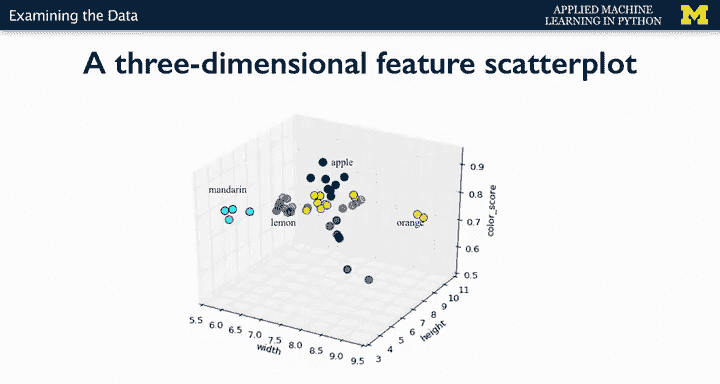

# 课程名称：Python用于数据科学实践（第5课／共5课）｜数据探查方法 🔍


## 概述

在本节课中，我们将要学习数据探查的基本方法。数据探查是应用机器学习前的重要步骤，它帮助我们理解数据内容、发现潜在问题，并评估机器学习模型成功的可能性。

## 为什么要进行数据探查？ 🤔

在考虑将机器学习应用于数据集时，首先实际查看数据集是一个非常好的第一步。

以下是进行数据探查的几个原因。

### 理解数据内容

首先，探查有助于了解数据集中实际包含的内容。

通过检查每个对象的特征，你可以更好地了解数据仍需进行何种清洗或预处理，以及每个属性或特征的典型值范围或分布。

当处理复杂对象（如文本）时，这种初步探索尤其有价值，因为这些对象可能由许多特征表示，而这些特征是通过一系列预处理步骤提取的。

例如，你可能会发现你获得的数据集有一个包含人名的列，而这个列仍需拆分为单独的名和姓列。如果你将姓名用作预测特征之一，这可能很重要。

### 发现数据问题

其次，你可能会注意到缺失或嘈杂的数据，或者一些特定的不一致之处。

例如，列使用了错误的数据类型，特定列或特定特征的测量单位不正确或不一致。

或者，你可能会注意到某个特定标记类的示例数量不足。

例如，假设你正在处理一个每行代表一个患者记录的应用程序。你可能会发现，某些人的体重测量值可能意外地以克为单位，而不是千克，这显然会对结果的准确性产生巨大影响。

因此，检查和可视化数据将帮助你检测和理解这些潜在的噪声或错误来源。

### 评估机器学习必要性

最后，对于你的数据集，你的问题实际上可能无需机器学习即可解决。这种情况并不常见，但如果发生，通过查看数据中存在的内容，你可以节省大量时间。

例如，你的数据集可能包含一个特征，该特征明显是你想要预测的标签的有力指标。

假设你的目标是根据房屋的销售价格、海拔高度、房间大小等属性来预测其位置是在纽约市还是旧金山。你的数据可能还包括房屋照片的URL。该图像可能在其元数据中包含房屋的GPS坐标，或者URL可能以一种不太明显但人类可识别的方式编码了位置信息。

这样，你只需查看数据就能解决问题。正如我所说，这种情况并不常见，但确实会发生。因此，简要检查你的数据集可以为你节省大量不必要的工作。

## 准备训练集 📊

我们将确保使用 `train_test_split` 从原始数据集中获得一个训练集。

我们将在这个训练集上进行所有的初始可视化和特征分析。

我们只会在分类器训练完成后，使用测试集来实际评估分类器。

训练集和测试集的完全分离非常重要。我们将在后面的课程中更深入地探讨其重要性的一些具体原因。

## 创建可视化图表 📈

现在我们已经选择了训练集，让我们创建一些简单的可视化图表，来查看训练集中对象的特征（在我们的案例中是不同水果的特征）如何相互关联以及如何与标签关联。

通过这些可视化，我们至少可以获得两大好处。

### 了解特征值范围与异常值

首先，我们可以了解每个特征的值范围，并且可以立即看到与其他点非常不同的任何异常值。这可能表明数据集中存在噪声、缺失特征或其他问题。

### 评估机器学习可行性

其次，通过观察不同类型对象在特征空间中的聚类和分离程度，我们可以更好地了解机器学习算法在预测不同类别时表现良好的可能性。

特征空间指的是使用我们数据中特定列的特征来表示对象。

例如，如果具有相同标签的对象（例如所有柠檬）具有相似的特征值，我们应该在可视化中看到一个定义明确的聚类。

而如果具有不同标签的对象的特征往往差异很大，我们应该看到它们被清晰地分离到图表的不同区域。

因此，在特征空间中，类别定义明确且分离良好的对象，是一个很好的迹象，表明分类器很可能能够根据特征以良好的准确性预测类别标签。

## 可视化技术 🎨

我将在这里展示的可视化技术在你拥有相对较少数量的特征（例如少于20个）时效果很好。稍后，当我们介绍无监督学习时，你将学习如何创建使用大量特征维度（数百、数千甚至数百万）来表示每个对象的数据集的可视化。

但现在，我们将使用的第一个可视化工具称为特征配对图。

### 特征配对图

这个图表显示了所有可能的特征对，并为每一对生成一个散点图，显示特征之间是否相关以及如何相关。

散点图中的每个点代表一个水果，根据其所属类别着色，并使用分配给该散点图的一对特征进行定位。

对角线是一个直方图，显示该特征的特征值分布。

在这个配对图中，按顺序显示的维度是我们训练集中水果示例的高度、宽度、质量和颜色分数。

因此，左上角的直方图显示了训练集中所有样本的高度特征分布。

紧邻其右侧的散点图在x轴上绘制每个样本的宽度，在y轴上绘制样本的高度。

仅通过查看这个配对图，我们已经可以看到一些特征对（例如右上角的高度和颜色分数）对于分离不同类别的水果效果很好。

这表明使用这些特征训练的分类器很可能能够相当好地学会分类各种水果类型。

以下是用于创建此图的代码。现在让我们在训练集上运行它。

```python
# 示例代码：创建特征配对图
import seaborn as sns
import matplotlib.pyplot as plt

# 假设 `train_data` 是训练集 DataFrame，包含特征列和 'label' 列
sns.pairplot(train_data, hue='label')
plt.show()
```

请注意，像这样的配对图只显示特征对之间可能存在的交互，而不是所有特征之间的交互。

因此，图表本身可能不会显示特征之间存在的所有有趣关系，但它确实让你对可能存在的一些交互有一个大致的了解。

### 三维特征空间图

我们还可以通过创建三维图来查看使用三个特征子集的特征空间。

以下是我们可以用来实现这一点的代码。

```python
# 示例代码：创建三维散点图
from mpl_toolkits.mplot3d import Axes3D

fig = plt.figure()
ax = fig.add_subplot(111, projection='3d')

# 假设我们使用宽度、高度和颜色分数三个特征
x = train_data['width']
y = train_data['height']
z = train_data['color_score']
labels = train_data['label']

# 根据标签着色
scatter = ax.scatter(x, y, z, c=labels, cmap='viridis')
legend1 = ax.legend(*scatter.legend_elements(), title="Classes")
ax.add_artist(legend1)

ax.set_xlabel('Width')
ax.set_ylabel('Height')
ax.set_zlabel('Color Score')
plt.show()
```

在这个例子中，我们使用三个坐标绘制不同的水果。这里我们将显示宽度、高度和颜色分数。

同样，每个点代表一个水果，并根据其水果标签值着色。

在这个3D图中，你可以通过按住鼠标按钮并拖动来沿各个轴旋转图表。你可以清楚地看到，不同的水果类型形成了定义相当明确的聚类，并且在特征空间中也分离得很好。

## 总结

本节课中，我们一起学习了数据探查的重要性与方法。我们了解到，在应用机器学习之前，对数据进行初步检查和可视化是至关重要的步骤。这有助于我们理解数据内容、发现缺失值、噪声或不一致之处，甚至可能发现无需复杂模型即可解决问题的线索。



我们介绍了如何准备独立的训练集进行分析，并探索了两种可视化技术：特征配对图和三维特征空间图。这些工具帮助我们直观地评估特征之间的关系、数据的聚类情况，以及机器学习模型可能取得的成功程度。


记住，良好的数据探查是构建有效机器学习模型的坚实第一步。在接下来的课程中，我们将基于这些探查结果，开始构建和评估具体的预测模型。